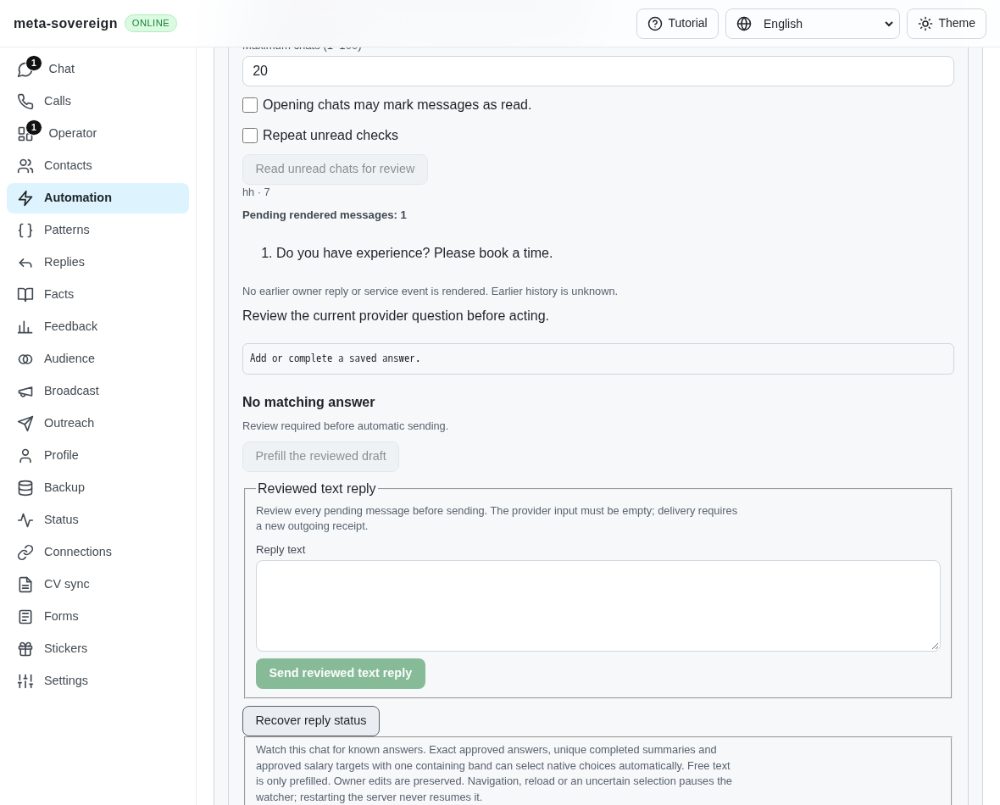

# Review added requests in saved question templates

A saved wildcard could absorb `Please book a time` and reuse the answer approved for `Do you have experience?`. It could also erase punctuation between skipped words, which hid an additional question clause. The published Automation preview displayed the complete incoming message alongside `Five years.` and marked the old answer approved. [Parent matcher](https://github.com/link-foundation/meta-sovereign/blob/58ca11bf40faad9417a9dba84585e747eeb5294b/js/src/automation/question-match.js#L29-L54).

Wildcard matching now inspects the original punctuation in the skipped text and shares the invitation and action recognizers with notice policy. Tests cover added calls, forms, assignments, invitations and questions in English, Russian, Hindi and Chinese. Literal request wording already saved in the template and ordinary variations such as `formal experience` still match. Structured provider link checks remain in the existing shared review path. The pinned HeadHunter reference treats added questions and instructions as independent work. [Pinned intent rules](https://github.com/konard/hh-job-application-automation/blob/fa0991b8c2d0896fb3b4be6c69947f0590094b15/src/chat-answers.mjs#L425-L470).

## Reproduce and verify

In **Automation → Questions and answers**, save `Do you have experience? …` with `Five years.` approved. Inspect the synthetic HeadHunter conversation containing `Do you have experience? Please book a time.` on the published bundle. The old preview shows an approved pattern match. The revised preview preserves the incoming text, shows **No matching answer** and **Review required before automatic sending**, and leaves the reply empty. The shared automation planner emits zero drafts for this input across HeadHunter, Telegram, VK, email, Facebook and WhatsApp fixtures.

```sh
node --max-old-space-size=384 --test --test-concurrency=1 js/tests/{question-template-workflows,question-template-links,question-language,question-notice-policy,question-notices,question-subjects,ci-contracts}.test.js
RUN_BROWSER_E2E=1 E2E_EXECUTABLE_PATH=/usr/bin/google-chrome node --max-old-space-size=384 experiments/issue-56/question-template-request-browser.mjs
```

The parent reproduces four focused regressions and the approved browser preview. The revised source passes 62 focused Node and 42 Deno checks, including CLI, offline planning, both Lino encodings, notice policy and the existing link and subject constraints. The registered Chromium scenario confirms zero native sends. Existing Chromium scenarios confirm that a matching template can still be sent once with explicit approval and that a changed destination still requires review. At 390 × 844, independent Playwright MCP verifies an empty reply, a disabled send, no page exceptions or horizontal overflow, and only the save and inspect requests. The native fixture closes with zero clicks and sends.




[Evidence archive](data/question-template-requests.tar.gz) · [Entry hashes](data/question-template-requests.tar.sha256.json). QA04 still requires the remaining provider contexts and behavioral verification in [PR 57](https://github.com/link-foundation/meta-sovereign/pull/57).
