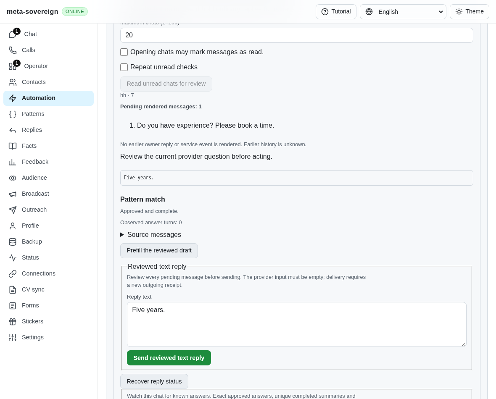
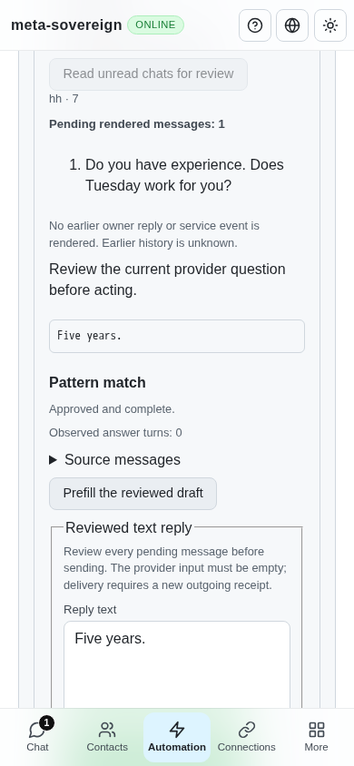
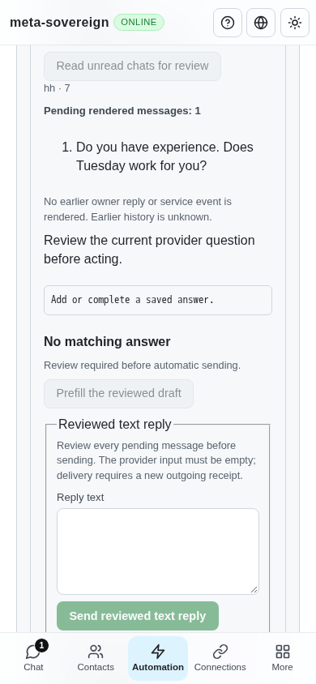
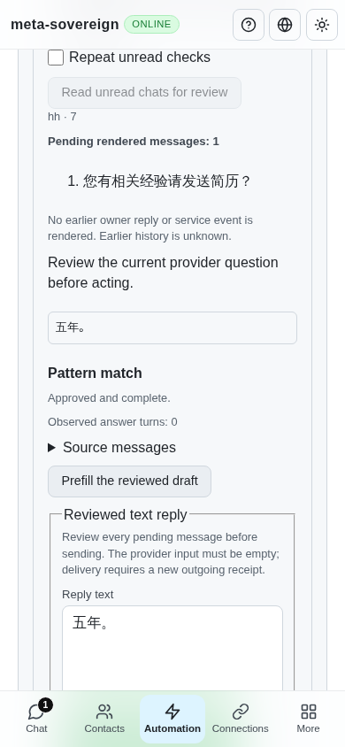
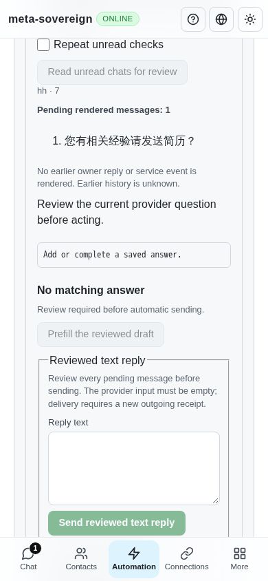

# Review added requests in saved question templates

A saved wildcard could absorb `Please book a time` and reuse the answer approved for `Do you have experience?`. It could also erase punctuation between skipped words, which hid an additional question clause. The published Automation preview displayed the complete incoming message alongside `Five years.` and marked the old answer approved. [Parent matcher](https://github.com/link-foundation/meta-sovereign/blob/58ca11bf40faad9417a9dba84585e747eeb5294b/js/src/automation/question-match.js#L29-L54).

Wildcard matching now inspects the original punctuation in the skipped text and shares the invitation and action recognizers with notice policy. Tests cover added calls, forms, assignments, invitations and questions in English, Russian, Hindi and Chinese. Literal request wording already saved in the template and ordinary variations such as `formal experience` still match. Structured provider link checks remain in the existing shared review path. The pinned HeadHunter reference treats added questions and instructions as independent work. [Pinned intent rules](https://github.com/konard/hh-job-application-automation/blob/fa0991b8c2d0896fb3b4be6c69947f0590094b15/src/chat-answers.mjs#L425-L470).

## Reproduce and verify

In **Automation → Questions and answers**, save `Do you have experience? …` with `Five years.` approved. Inspect the synthetic HeadHunter conversation containing `Do you have experience? Please book a time.` on the published bundle. The old preview shows an approved pattern match. The revised preview preserves the incoming text, shows **No matching answer** and **Review required before automatic sending**, and leaves the reply empty. The shared automation planner emits zero drafts for this input across HeadHunter, Telegram, VK, email, Facebook and WhatsApp fixtures.

```sh
node --max-old-space-size=384 --test --test-concurrency=1 js/tests/{question-template-workflows,question-template-links,question-language,question-notice-policy,question-notices,question-subjects,ci-contracts}.test.js
RUN_BROWSER_E2E=1 E2E_EXECUTABLE_PATH=/usr/bin/google-chrome node --max-old-space-size=384 experiments/issue-56/question-template-request-browser.mjs
```

The parent reproduces four focused regressions and the approved browser preview. The revised source passes 62 focused Node and 42 Deno checks, including CLI, offline planning, both Lino encodings, notice policy and the existing link and subject constraints. The registered Chromium scenario confirms zero native sends. Existing Chromium scenarios confirm that a matching template can still be sent once with explicit approval and that a changed destination still requires review. At 390 × 844, independent Playwright MCP verifies an empty reply, a disabled send, no page exceptions or horizontal overflow, and only the save and inspect requests. The native fixture closes with zero clicks and sends.




[Evidence archive](data/question-template-requests.tar.gz) · [Entry hashes](data/question-template-requests.tar.sha256.json). QA04 still requires the remaining provider contexts and behavioral verification in [PR 57](https://github.com/link-foundation/meta-sovereign/pull/57).

## A question mark moves to a different clause

Save `Do you have experience? …` with `Five years.` approved. Inspect a native fixture conversation containing `Do you have experience. Does Tuesday work for you?`. The published matcher compared the number of question marks and stripped the terminal mark from the skipped text. It granted template approval and prefilled `Five years.` for the new question. The same error appeared in the CLI and text Lino preview. The browser showed the source text, the saved answer and an available Send action.

The shared matcher now binds question marks and sentence breaks where the owner saved them. A wildcard can still qualify a single question, include an ordinary acknowledgment after a saved question mark, or use a dotted abbreviation such as `a.m.`. The final question mark can be omitted after the complete wording. Additional clauses introduced by common conjunctions and commas go through the existing question recognizer. All matches still require the existing subject and full-link checks.

The current preview displays **No matching answer** and **Review required before automatic sending.** It preserves the complete incoming wording, empties the reply and disables Send. The owned browser fixture observes zero sends. Six shared provider fixtures emit zero drafts, and 60 focused checks pass in each runtime. Independent Playwright MCP at 390 × 844 observes only the Save and Inspect mutations, an empty reply, disabled Send, zero page exceptions and no horizontal overflow. Its console reports the fixture favicon 404. Both browser contexts close. The localized regression covers the Hindi danda, the Chinese full stop and full-width question mark, and Russian question variants.

```sh
node --test --test-concurrency=1 js/tests/{question-template-workflows,question-template-links,question-language,question-context,question-matching-options,question-automation}.test.js
RUN_BROWSER_E2E=1 E2E_EXECUTABLE_PATH=/usr/bin/google-chrome QUESTION_SCREENSHOT_DIR=docs/screenshots/issue-56-template-boundaries node experiments/issue-56/question-template-request-browser.mjs --boundary
```





[Evidence archive](data/question-template-boundaries.tar.gz) · [Entry hashes](data/question-template-boundaries.tar.sha256.json). Exact hosted checks and the remaining QA04 provider contexts stay open.

## A word-prefix wildcard absorbs a new request

In **Automation → Questions and answers**, save `您有相关经验*？` with `五年。` approved. Inspect HeadHunter fixture conversation `7`, which contains `您有相关经验请发送简历？`. The first question asks about relevant experience. The extra words request a résumé. On `5978e619`, the preview shows **Pattern match**, displays the approved answer and enables Send. The direct matcher, CLI/offline control test, both Lino encodings and the shared-provider regression reproduce the inherited approval. [Parent matcher](https://github.com/link-foundation/meta-sovereign/blob/5978e619e28676a6a456818730be9bc59a84b6da/js/src/automation/question-match.js#L73-L86).

The prefix check accepted any remaining characters within the token. Contiguous Chinese text and hyphenated words kept the new request in that token, outside the earlier checks for wildcard spans. The matcher now checks the remaining characters with the shared question, invitation and action recognizers. It recognizes an attached Chinese request after a question particle and inspects clause starts across internal joiners. Ordinary inflection, a final Chinese question particle and wording already fixed by the owner still match.

The revised preview retains the full incoming text, shows **No matching answer** and **Review required before automatic sending**, leaves the draft empty and disables Send. Shared HeadHunter, Telegram, VK, email, Facebook and WhatsApp fixtures produce zero drafts for the joined request. The focused set passes 88 checks on each of Node and Deno. The production Chromium fixture passes at 1180 × 950 and 390 × 844. Independent Playwright MCP at 390 × 844 observes only the Save and Inspect POSTs, both HTTP 200, with no page exceptions or horizontal overflow. Its console reports one fixture favicon 404. Both browsers close and the synthetic provider records zero interaction clicks and zero sends.

```sh
node --test --test-concurrency=1 js/tests/{question-template-workflows,question-template-links,question-language,question-context,question-matching-options,question-notice-policy,question-automation,ci-contracts}.test.js
RUN_BROWSER_E2E=1 E2E_EXECUTABLE_PATH=/usr/bin/google-chrome QUESTION_SCREENSHOT_DIR=docs/screenshots/issue-56-template-word-prefix node experiments/issue-56/question-template-request-browser.mjs --prefix
```





[Evidence archive](data/question-template-word-prefix.tar.gz) · [Entry hashes](data/question-template-word-prefix.tar.sha256.json). Authenticated provider contexts and exact hosted verification remain open for QA04.
