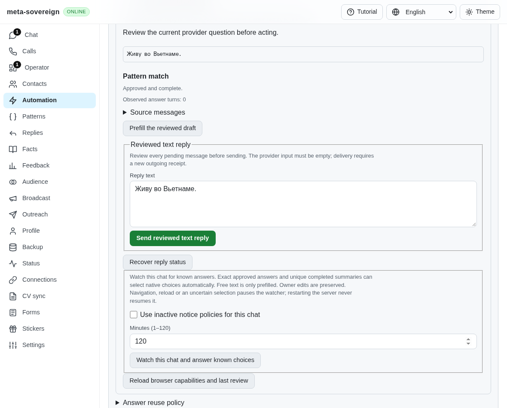
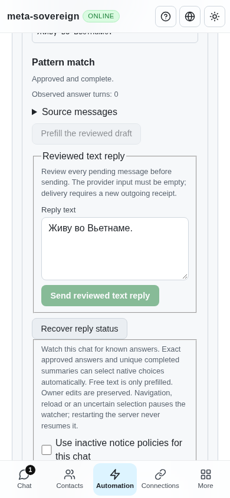

# Saved ordered-word template workflow

Issue [#56](https://github.com/link-foundation/meta-sovereign/issues/56),
PR [#57](https://github.com/link-foundation/meta-sovereign/pull/57), 2026-11-14.

The QA03 inventory entry already had a bounded shared matcher, but no
template-specific evidence connecting saved rules to native question review
and confirmed delivery. This unit adds that coverage without changing the
production matcher, transports, delivery policy or UI.

## Behavior and reproduction

Save `ГДЕ … ЖИВЁТ*?` with the approved answer `Живу во Вьетнаме.` in
Automation → Questions and answers. The observed question
`Где вы сейчас живете?` produces **Pattern match** with that exact answer.
Reviewing sends nothing. An explicit reviewed reply requires the actual native
outgoing receipt; reload restores the sent state and disables another send.
The same saved syntax works in the foreground CLI, offline controls and the
default text and binary Links Notation API without enabling JSON compatibility.

The finite matcher checks exercise zero-length gaps, the six-word budget for a
two-fixed-word template, refusal at seven words, ordered words and suffixes,
case-sensitive opt-out, `ё`/`е` folding and the `...` alias. Additional tasks,
links, reordered words and a prefix before the requested suffix word refuse
the template. Existing broader question and delivery regressions remain intact.

## Verification

- Five focused Node and five Deno cases pass. The shared runner case uses five
  injected senders (HH, Telegram, VK, email and WhatsApp), verifies source/chat
  scope, the exact approved answer and one delivery despite a repeated draft.
- Thirteen existing question-automation checks pass. One focused CI contract
  verifies the new mandatory `question-templates` group in the existing browser
  registry, npm commands and scenario budgets.
- One local Chromium scenario saves through the production UI, parses the
  native HH-shaped question, observes zero review effects, obtains one exact
  outgoing receipt and verifies locked recovery at phone width. It reports
  two cases and no page errors. The hosted browser matrix remains required.
- Independent Playwright MCP repeats save, review, explicit delivery and reload.
  Its final owned-provider counters are zero choice clicks, one text send and
  an empty composer; both server and browser close. The first MCP session also
  verifies phone width and retains screenshots. Its console has a favicon 404
  and two handled `ERR_CACHE_WRITE_FAILURE` resource diagnostics, retained
  without claiming a clean console.
- Scoped strict lint, formatting, secrets and diff checks pass. Duplication is
  6.49%, below the unchanged 6.5% limit.

The first draft used single-letter filler words that triggered the existing
technology-subject guard and omitted the required `provider:chat` scope prefix;
those fixture failures are retained. The first browser draft waited for the
compatibility PUT rather than the UI's Lino POST `/answers/save`. The next
draft changed the provider DOM before the initial browser-session navigation;
priming that session before mounting the question fixes the fixture. Neither
failure required production changes.

The first MCP shutdown raced Playwright's own SIGTERM handler, which closed
the page before final counters were read. The reusable server now owns its
signal handlers and closes resources in `finally`. The repeated independent
flow exits successfully and records the actual counters. The failed log is
retained alongside the final receipt.

All provider pages and senders here are disposable fixtures. No authenticated
provider account was contacted. This verifies the shared template mechanism
and one native adapter path; authenticated provider parity, other QA entries
and the rest of issue #56 remain unfinished. QA03 stays pending exact-head
hosted verification in the inventory; PR57 remains draft and unmerged.

The checked [evidence archive](data/question-templates.tar.gz) and
[SHA-256 manifest](data/question-templates.tar.sha256.json) retain changed
sources, finite successful and draft-failure logs, independent MCP receipts,
comment snapshots and screenshot hashes. Run the focused reproduction with
`node --test --test-concurrency=1 js/tests/question-template-workflows.test.js`;
the browser driver is `experiments/issue-56/question-templates-browser.mjs`
with `RUN_BROWSER_E2E=1` and an available `E2E_EXECUTABLE_PATH`.
