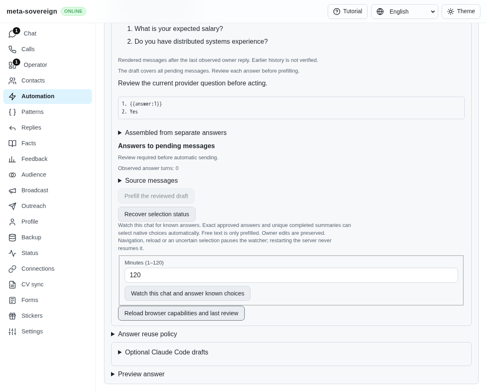
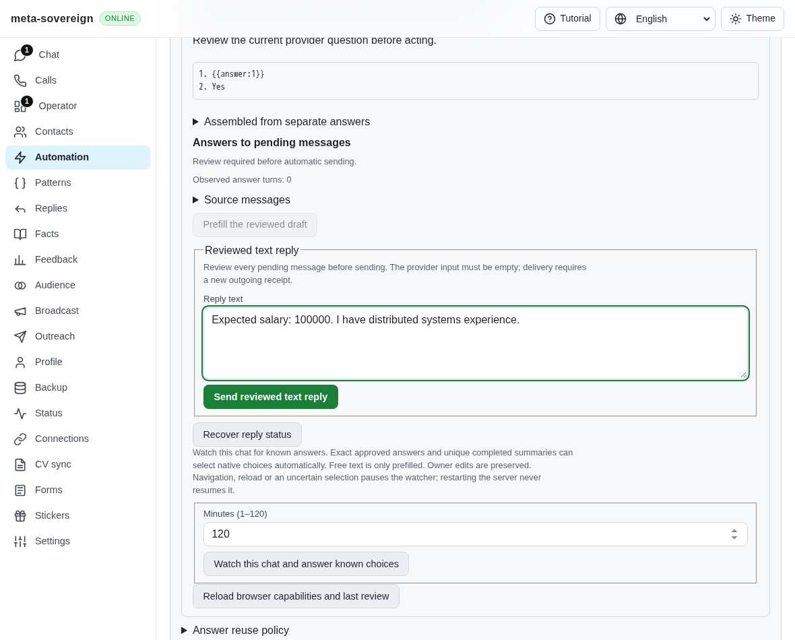
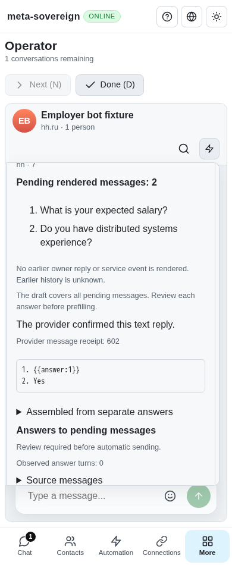

# Review and recover provider text replies in the shared UI

Implementation evidence for [PR 57](https://github.com/link-foundation/meta-sovereign/pull/57), R-AA1. Questions, Chat and Operator now expose the same explicit reviewed-text action over the [persistent question service](question-text.md). This completes the visible controls described as unfinished in that backend snapshot. Background acknowledgement/rejection delivery, inactive-owner restoration, unread orchestration, live-provider verification and every unchecked issue criterion remain required. The PR stays draft and unmerged.

## Reproduction and behavior

Actual parent `c446791d046eca9a17b16f365dbfa25180b901cf` can send reviewed text through CLI and Lino but its visible review only offers prefilling a complete saved answer. Inspect a free-text HH question with one unanswered earlier message: the incomplete plan disables prefill and no editable reviewed reply exists. The new browser admission fails against that parent's shipped bundle with `0 !== 1`; its screenshot shows the unavailable action. The probe restores the working bundle in `finally`.

```sh
PYTHONDONTWRITEBYTECODE=1 python3 experiments/issue-56/question-text-ui-before.py
NODE_OPTIONS=--max-old-space-size=384 node experiments/issue-56/question-text-ui-probe.mjs
```

Open **Provider browser answers** in Questions or the Chat/Operator automation menu, inspect the selected chat, review every pending message, edit **Reply text**, and explicitly select **Send reviewed text reply**. This action appears only when the server declares text support and the page API exposes that operation. The page's automation-call allowlist now includes it. Native-option prompts retain their existing choice controls and wording.

An unsent draft is stored for the exact review, with one bounded entry per conversation. Reload restores it through a read-only status request; a different review never inherits it. A complete plan can provide an initial suggestion. Incomplete, oversized or corrupt suggestions are not silently truncated into a sendable answer, and unavailable local storage does not discard the server review. Submitted text comes from the persisted outbox and remains locked during sending, confirmed delivery or uncertainty.

Expired/outgoing questions, owner drafts, prefilled provider input and uncertain attempts block sending. The UI enters its pending state before the mutation. Losing the HTTP response keeps both text and delivery controls locked until explicit read-only recovery. Only a validated positive provider receipt produces the confirmed-text wording; missing receipts remain uncertain across reload. Existing watcher limits remain explicit: free-text watching still only prefills a known answer.

The layout uses existing grouped fields, spacing, disclosure and button styles. Behavior was compared with pinned [Telegram Web A](https://github.com/Ajaxy/telegram-tt/blob/f67a40879a7d78c2683ec5a296cf55bc22417d56/src/api/gramjs/methods/messages.ts) pending-message transitions and [T3 Code](https://github.com/pingdotgg/t3code/blob/08a463e29976617134de01e9341f898bc881d0eb/apps/web/src/components/settings/AppearanceSettingsPanel.tsx) grouped settings controls. Source snapshots are archived; no external code was copied.

## Focused evidence

- Twenty-two Node checks pass: bounded/exact-review draft persistence, intentional empty edits, storage refusal/corruption, submitted-text precedence and mandatory CI registration.
- Forty-nine compatibility checks pass for localized dictionaries, complete pending-turn planning, shared review evidence and private fixture controls.
- Thirteen production Chromium cases pass through the real UI/server, default sender, browser-commander and routed HH-shaped native controls. They cover editing without effects, reload, positive receipts, duplicate prevention, lost responses, uncertainty, owner drafts, changed earlier questions, new-review isolation, strict choices, prefill, unsupported capabilities, Chat and phone-sized Operator.
- Sixteen existing native-choice UI cases pass with every prior assertion retained through shared fixture extraction, including late pending-message changes, draft preservation, lost responses and both Chat/Operator surfaces.
- Seven independent Playwright MCP checks pass with the production UI/server and an explicitly counted sender stub. They verify whole-turn editing, unsent and confirmed reloads, owner-draft protection, uncertainty and both Chat/Operator surfaces. The stub is separate from native-provider delivery evidence; it permits one browser under the local memory limit. It records no ordinary sends or prefills. Both the browser and private server are closed afterward.

The first local browser process ended before assertions. Its next bounded probe exposed the missing page API allowlist entry, then passed after registration. A later capability-test fixture tried to parse default Lino as JSON; the retained failure led to decoding and re-encoding the negotiated format, preserving JSON-disabled coverage. The initial MCP label locator included the edited textarea's DOM text; using its actual textbox accessibility role corrects the probe. Self-review also reproduces a refused-attempt edit being replaced by the old submitted text on reload. The additional failing regression and production browser check now preserve that edit, while sending/sent/unknown text remains immutable. Initial logs remain in the archive.

```sh
NODE_OPTIONS=--max-old-space-size=384 node --test --test-concurrency=1 --test-timeout=30000 js/tests/question-browser-text-state.test.js js/tests/ci-contracts.test.js
NODE_OPTIONS=--max-old-space-size=384 node --test --test-concurrency=1 --test-timeout=30000 js/tests/i18n.test.js js/tests/browser-pending-turn.test.js js/tests/question-pending-plan.test.js js/tests/question-browser-fixture.test.js
```

The new `question-text-controls` scenario has its own mandatory Chromium/WebKit group. Every earlier question scenario remains registered once; the existing 180-second subprocess and 35-minute job budgets are unchanged. The parent backend's actual [Checks run 43078283106](https://github.com/link-foundation/meta-sovereign/actions/runs/43078283106) has passing runtime/static jobs and Chromium; WebKit is still running at collection. Desktop release, Pages, security and links pass for that SHA; Desktop run 43078283080 is a separate workflow, not browser verification. The new UI commit requires its own hosted execution. Full suites and runtime matrices were not repeated locally.

Scoped lint, formatting, syntax, secret scanning and the unchanged duplication threshold pass. Sharing the disposable chat/read-marker setup removes fixture repetition without removing assertions. The evidence collector checks the unrounded line ratio as well as the command result; rounded `6.50%` output alone cannot establish a pass. The [evidence archive](data/question-text-ui.tar.gz) and SHA-256 manifest preserve parent/current source, raw logs and screenshot hashes; [collect-question-text-ui.py](../../../experiments/issue-56/collect-question-text-ui.py) validates observations before collection.

## Visual evidence

Actual parent, with no editable reply:



Explicit editable reply after reviewing the pending messages:



Independent MCP phone-sized Operator confirmation (counted sender stub):


