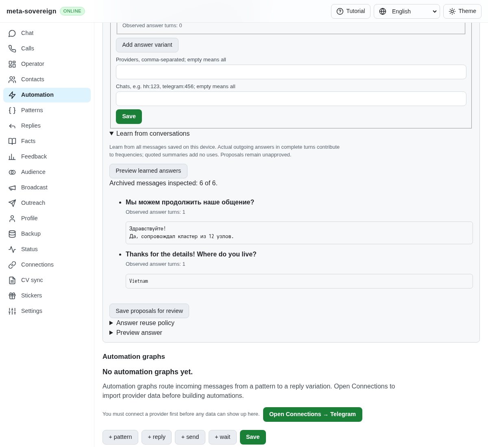
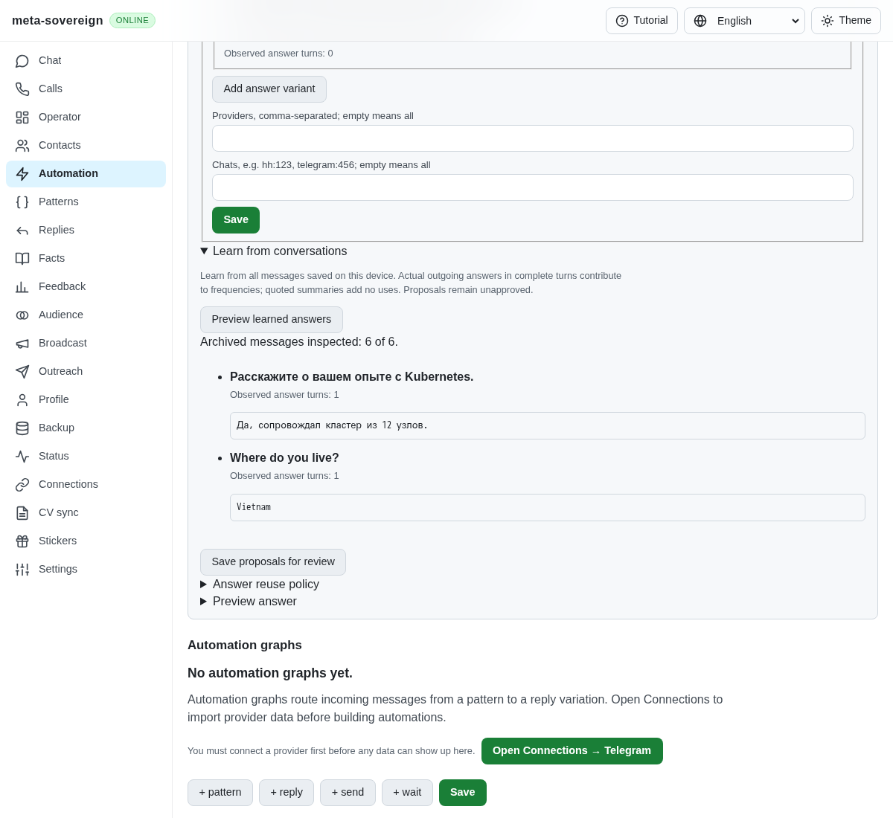

# Question identity across acknowledgments and reminders

An acknowledgment before a saved question prevented exact reuse. In archive learning, an employer's continuation reminder replaced the preceding technical question; a greeting and the eventual substantive reply then became one answer to the reminder. An approved bare “yes” could also answer a request for experience or examples without providing those details.

The shared planner and learner now remove bounded, recognized acknowledgment and polite prefixes only when the remainder still asks a question. Original messages, options, approvals and the returned incoming question remain intact. Matching, configured contexts and salary resolution use the question core. Explicit requests for details reject bare affirmatives during planning and learning; binary answers and substantive negative experience remain usable.

The streaming learner retains at most the immediately preceding question across recognized whole-message reminders. A substantive actual outgoing reply can answer that question; brief continuation consent answers the reminder. Explicit reply IDs take precedence. Other questions, service barriers, delivered-state checks and the original 24-hour age limit prevent unrelated reassociation. Repeated reminders cannot extend that lifetime. Standalone greetings add neither answer text nor observed-turn evidence. Archive imports continue to produce unapproved proposals and preserve transcripts.

This behavior was studied in the pinned `konard/hh-job-application-automation` question-answer source and tests, especially acknowledgment normalization, reminder ownership, greeting exclusion and requests for details. The implementation uses this repository's existing bounded streaming learner, provenance and approval contracts; reference code was not copied or executed. It is a conservative EN/RU/HI/ZH heuristic. General apology extraction, every historical summary layout, complete form handling and provider workflows remain open in the reference inventory.

Reproduce without accounts with `node experiments/issue-56/question-turns.mjs`. Enable identifier-only diagnostics using `META_SOVEREIGN_QUESTION_DEBUG=1`; tracing is off by default. The reusable `node examples/question-reminder-learning.mjs` checks an original technical question, its reminder, a greeting and the actual answer without applying proposals or sending messages.

Seven of the initial eight regressions fail before the correction. The combined turn, CLI/API, archive, policy, language and automation checks pass 44 tests with concurrency one. A separate existing salary/turn check passes 18 tests. The final expanded turn checks pass all 12 tests, including both Lino encodings, five stored provider identifiers, offline UI controls, repeated-reminder expiry, unknown reply IDs and preservation of the original salary question. Two errors in the expanded test fixtures were corrected: the CLI success code/saved seed count and required currency keywords. Both failed and corrected logs are retained. These are local focused checks; complete runtime/browser matrices remain in CI.

Changed-source ESLint and the production web build pass. The full production question browser flow passes in installed Chrome, including approved question-core reuse, review for an insufficient affirmative and actual archive learning. Its first new assertion inherited placeholder replacement from the preceding scenario; the test now explicitly sets its own substitution state. The failed log and screenshot are retained rather than represented as a product defect.

Independent Playwright MCP uses the same isolated six-message history before and after. Before, the learner associates a greeting plus technical reply with the continuation reminder and retains an acknowledgment in the city question. After, it proposes the actual technical reply under its original question, excludes the greeting and proposes the core city question. Each observed answer count is one. All API responses succeed; the only console error is the fixture's missing favicon. Both browser and fixture are closed. Verified raw checks, traces and browser observations are archived in `data/question-turns.tar.gz` with per-file hashes.

Before:

After:

The complete issue remains unfinished in [PR 57](https://github.com/link-foundation/meta-sovereign/pull/57).
