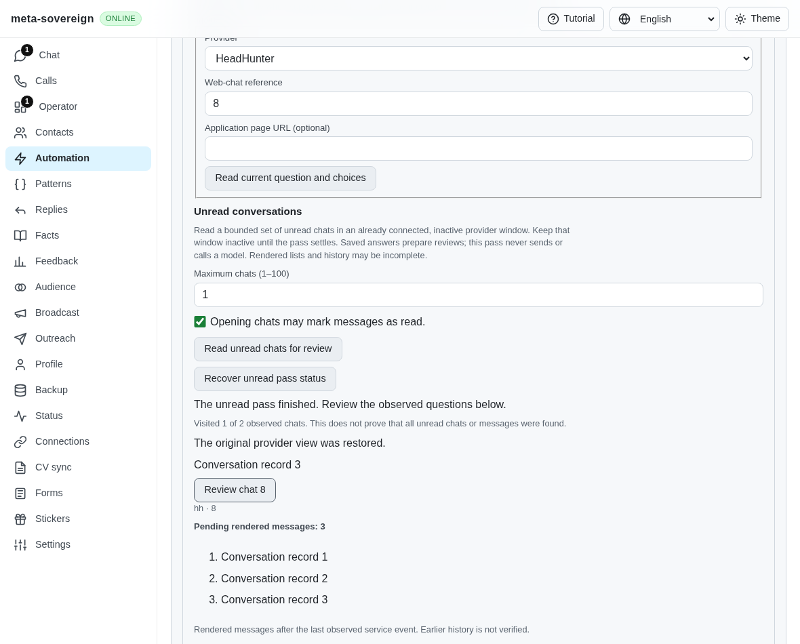
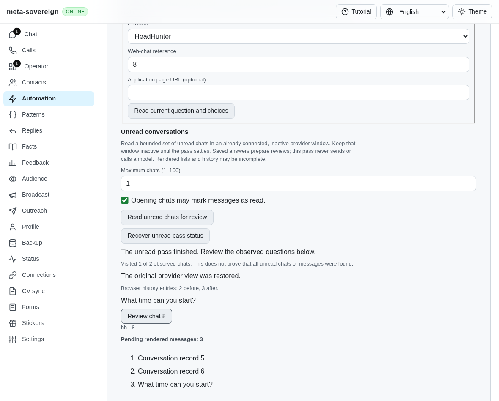
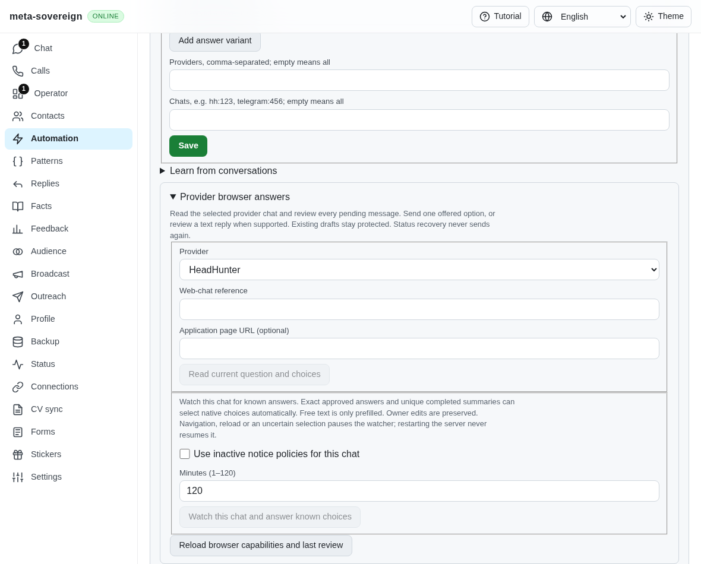
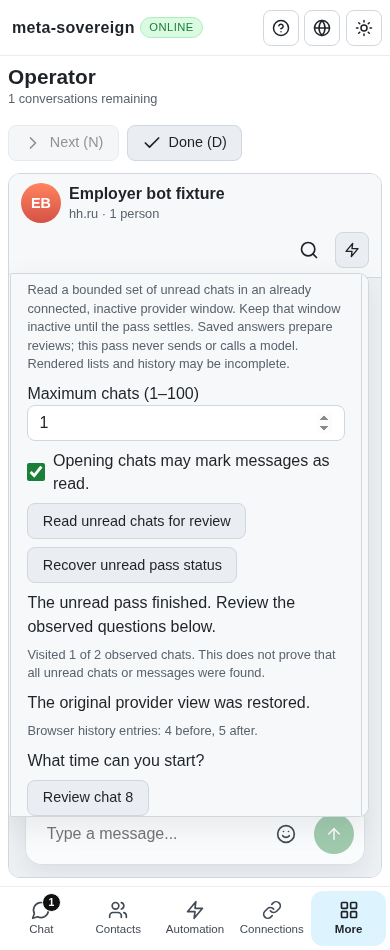

# Finite unread reviews through shared controls

The native unread traversal previously had no public command, route or Questions/Chat/Operator control. A caller can now explicitly consent to opening unread conversations, run one bounded pass in an already connected inactive provider window, and review frozen per-chat questions. This pass uses saved answers, never invokes a model, prefills a provider draft or sends a reply. Those remain separate reviewed operations with their existing current-question and delivery checks.

The same service exposes `unreadStart`, `unreadStatus` and `unreadStop` to the CLI and both Lino transports. `unreadSources` advertises only adapters with the necessary native list/filter/history/document support; reading capabilities opens no browser. The built-in declaration currently includes HH. The four-language common browser-answer control is used by Questions, Chat and Operator. Starting requires the explicit “Opening chats may mark messages as read” checkbox. A numeric limit bounds the pass to 1–100 chats, with 20 by default. The underlying time, list, history and native ownership bounds still apply.

## Durable admission and recovery

The caller persists a fresh `question-unread:` UUID before issuing Start. The server durably stores that ID and the frozen settings before invoking the browser. The same ID always recovers the recorded result instead of repeating navigation or mark-read effects, including after a lost response. Admission is serialized and only one pass per provider can run in a service instance. Failed initial durability prevents the browser call. Polling only reads the saved pass; it never starts another traversal.

Reloading any shared control requires explicit status recovery before another Start. A new pending pass clears its preceding completed result. Chat and Operator share the saved ID for the same chat; switching between them uses read-only recovery. While pending or running, conflicting inspect, prefill, reply and watch controls are unavailable. Review opens the frozen stored review without rereading the provider. Every later provider action retains its independent explicit confirmation and live revalidation.

Stop aborts and waits for the pending provider operation and restoration attempt to settle. Shutdown blocks queued admissions and drains active work. A process without the runtime owner returns `paused` and `owned: false` without rewriting the shared durable record or resuming the pass. That process cannot stop a different running process. Stop in the owning server's controls, or interrupt the owning foreground CLI command, to drain that owner's action. Restart never resumes browser effects automatically.

Coverage remains `complete: false`. The receipt reports observed and visited counts and does not establish that every unread conversation or message was found. Invalid question snapshots produce an explicit per-chat failure with no actionable review ID. Native restoration receipts retain uncertainty when the owner returns or a route/document changes. Original URL, filter, draft, selection and reading/list positions are checked while owned. Original history length is not promised: the UI now also shows the checked before/after history counts. Only the separately witnessed owned forward suffix may be reused; pre-existing owner forward history remains protected.

## Latest-question correction

The first native UI run exposed an additional defect: the history scanner went to the newest messages, collected older windows and restored its original reading anchor before the caller read the question. The resulting review could therefore describe an older rendered message. The scanner now runs a private observation callback after its first stable newest window and before moving backward. The native unread reader freezes the question at that point and retains the separate full history and restoration receipt. Cancellation still prevents an actionable question. Public history result shapes do not change.

Before: the retained real browser review selects “Conversation record 3” after restoring the reading anchor.



After: the same native fixture records “What time can you start?”, builds the saved “At 9 a.m.” answer, restores the owner view and discloses history growth.



The actual parent also lacks the public unread control entirely.



## Reproduction and checks

`PYTHONDONTWRITEBYTECODE=1 python3 experiments/issue-56/question-unread-review-before.py` temporarily restores the actual `08cff80a` service, client, controls, bundle and history scanner. The missing admission and newest-observation regressions fail against that parent. The parent browser screenshot confirms that the shared control is absent. A `finally` block restores every working source.

```sh
meta-sovereign answers browser unread --source=hh --confirm=true --max-chats=2
meta-sovereign answers browser unread-status --pass-id=question-unread:YOUR-UUID
meta-sovereign answers browser unread-stop --pass-id=question-unread:YOUR-UUID
```

The foreground command prints the admitted ID before polling and owns its signal handlers through cleanup. An optional `--pass-id` lets a caller persist its ID before dispatch. Status and Stop must use the same local storage configuration. The command operates on an existing connected browser session; it does not launch or authenticate a provider window.

Focused automated checks cover admission, bounds, default capabilities without launch, saved-answer reviews, invalid snapshots, duplicate IDs, simultaneous admission, failed durability, foreign read-only status, restart, Stop/close races and restoration failure. Client checks cover CLI, both Lino formats, origin restrictions, confirmation, lost responses and malformed coverage/restoration/review IDs. The history-order regression fails on the actual parent. Existing manual browser-answer and watch-control checks remain included.

`NODE_OPTIONS=--max-old-space-size=384 node experiments/issue-56/question-unread-review-browser.mjs` exercises production bundled controls, negotiated transport, the real default sender and native Chromium provider navigation. It checks exact URL/draft/selection/scroll state, consent, one-chat bounds, frozen reviews, recovery without duplicate visits, an empty pass, shared Chat and phone-sized Operator. The provider HTML and account data are synthetic. Chat's independent ordinary read marker can reload that routed HTML, so the fixture waits for that operation before capturing the pass's initial state. Each surface gets a newly seeded unread local conversation; Operator truthfully has no card after Chat marks the only one read. Operator also explicitly recovers Chat's saved pass before starting another.

The separate Playwright MCP fixture uses a counted sender boundary to hold cancellation precisely. It checks confirmation and frozen reviews, lost-response recovery across reload, Stop draining, actual restoration failure, Chat and phone-sized Operator. It complements the native traversal checks and does not claim a live provider operation.

Forty-three focused Node checks and the same 43 Deno checks pass, together with three locale/mandatory-registration checks in each runtime, five native Chromium UI cases and six independent MCP cases. The two actual-parent regressions fail before correction. Strict scoped ESLint, formatting, secret scanning and the unchanged duplication gate pass. The tracked production bundle is rebuilt. Browser processes, private servers and all pending reads are closed before collecting evidence; no full local runtime/browser matrix is run. [Archived sources, intermediate failures and raw receipts](data/question-unread-review.tar.gz) and the [SHA-256 manifest](data/question-unread-review.tar.sha256.json) preserve the evidence.

Phone-sized Operator uses the same controls and retains explicit partial coverage and native history counts.



The preceding exact `08cff80a` head passes Checks, Security, Links, Pages and Desktop workflows, created at 2026-11-11 23:54:07 UTC. Full hosted runtime/browser matrices remain mandatory for the new commit. Persistent polling, automatic policy delivery, authenticated provider verification and every unchecked issue-wide criterion remain unfinished; QA17, HH09 and HH10 stay unchecked and PR57 stays draft and unmerged.
