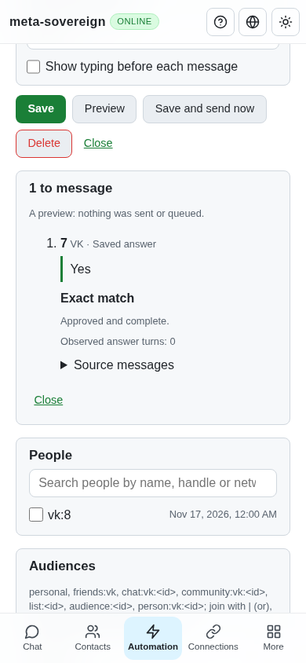
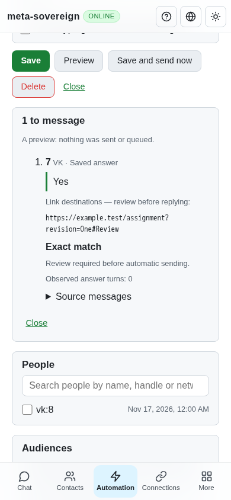

# VK question destinations and native chronology

Issue [#56](https://github.com/link-foundation/meta-sovereign/issues/56),
PR [#57](https://github.com/link-foundation/meta-sovereign/pull/57), 2026-11-17.

An approved saved answer can be reused for a VK question that carries a separate
assignment link, document or wall post. Published parent `6d1dcc24` discards those
destinations when constructing the question's identity. With an ISO timestamp,
the actual preview says “Approved and complete” without displaying the target.
A target-only edit also leaves the reviewed draft valid.

Actual VK messages expose a separate prerequisite defect: their native Unix
timestamps fail Q&A's `Date.parse` checks. Mixed seconds, milliseconds and ISO
history also sorts by different units. This prevents valid native questions,
learning, archived pairs and recent context from reaching the destination checks.
The initial all-numeric draft probe and browser failure demonstrate this separate
problem; they are retained and are not counted as attachment-loss evidence.

## Source comparison and correction

VK's primary schema at
[`333481bd`](https://github.com/VKCOM/vk-api-schema/tree/333481bd082ad747d4873ef4a77f9247097eeef0)
defines message dates as integers, a link's URL independently of its title in
[`base_link_no_product`](https://github.com/VKCOM/vk-api-schema/blob/333481bd082ad747d4873ef4a77f9247097eeef0/base/objects.json),
and an optional document URL in
[`docs_doc`](https://github.com/VKCOM/vk-api-schema/blob/333481bd082ad747d4873ef4a77f9247097eeef0/docs/objects.json).
The current message-attachment schema omits some legacy link/wall fields; the
repository's existing VK adapter is the reference for those supported shapes.
No upstream defect is inferred from that omission.

Use the existing shared `messageTime` conversion at every Q&A chronology check
and in shared history ordering. Preserve original timestamp bytes in storage and
frozen turns. Numeric strings, seconds, milliseconds and ISO timestamps compare
as instants; malformed chronology still refuses the affected turn or archive chat.
The browser unread adapter already converts native dates, retained as a positive
control rather than rewritten.

Extract direct VK link, file-document and wall destinations before raw records
are removed. Validate native/normalized agreement, unchanged source text, full
URL syntax and wall identifiers. Keep order, repetitions, case, query and fragment
bytes. Missing document URLs, malformed/stale/conflicting metadata and bounds
violations retain `links: null` and refuse the whole question turn. Limits remain
128 source entries, 20 targets, 2,000 characters per target and 6,000 total.
The adapter's ordinary null collection remains valid; photo thumbnails and
existing media-document rendering remain unchanged.

Planning and final admission bind the same destinations into frozen question
history. A target-only edit or a legacy reviewed draft without that identity
requires a fresh plan. Existing review evidence exposes literal targets through
CLI, both Lino formats, Chat, Operator and automation previews; no destination is
followed. Private or unverified source metadata also reaches pure and archive
learning before raw projections are discarded. Existing default-off question
diagnostics report the refusal without adding message or target payloads.

## Reproduction and verification

Use finite disposable stores and injected senders, with one local test worker:

```sh
python3 -B experiments/issue-56/question-api-links-parent.py --vk
node --test --test-concurrency=1 js/tests/question-vk-links.test.js js/tests/question-message-time.test.js
```

The final actual-parent comparison restores all eight edited source files in
`finally`; 25 of 27 checks fail before the correction. The two positive controls
retain ordinary text behavior and the existing unread date conversion. Earlier
timestamp-confounded draft probes remain in the evidence and are distinguished
from this final comparison.

Fifty focused checks pass, including existing Telegram, email and native-link
compatibility, four actual VK normalizers, native numeric dates, normalized null
collections, destination edits, bounds, private learning, explicit confirmation,
exactly-once ordinary delivery, foreground CLI and both Lino encodings. Thirty-six
additional focused learning/context/summary/turn checks pass. The existing browser
registration contract passes with the VK scenario mandatory in the question
template group. Full runtime and browser matrices remain in hosted CI.

One actual Chromium scenario captures the parent's unsafe approval and corrected
desktop/phone previews with zero sends and page exceptions. Independent
Playwright MCP checks four translated labels, literal targets, phone wrapping,
no target requests and no preview replay after reload. Every owned server and
browser is closed. Its console retains one favicon 404 and three cache-write
diagnostics; there is no clean-console claim.




The [source/log/screenshot archive](data/question-vk-links.tar.gz) and
[SHA-256 manifest](data/question-vk-links.tar.sha256.json) preserve the exact parent
and corrected sources, finite checks and primary schema excerpts. Scoped lint, format, secrets and source/documentation limits pass, as does
the unchanged duplication gate at 6.49%.
Exact-head hosted verification remains required. This unit covers direct VK
destinations and chronology; advanced intent/context, other provider/nested
attachment cases and every other unfinished original requirement remain open.
QA04 is not accepted, the inventory remains 83 accepted and 35 unfinished, and
PR57 stays draft and unmerged.
