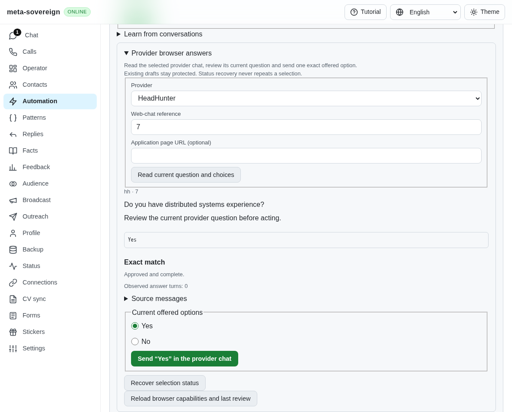
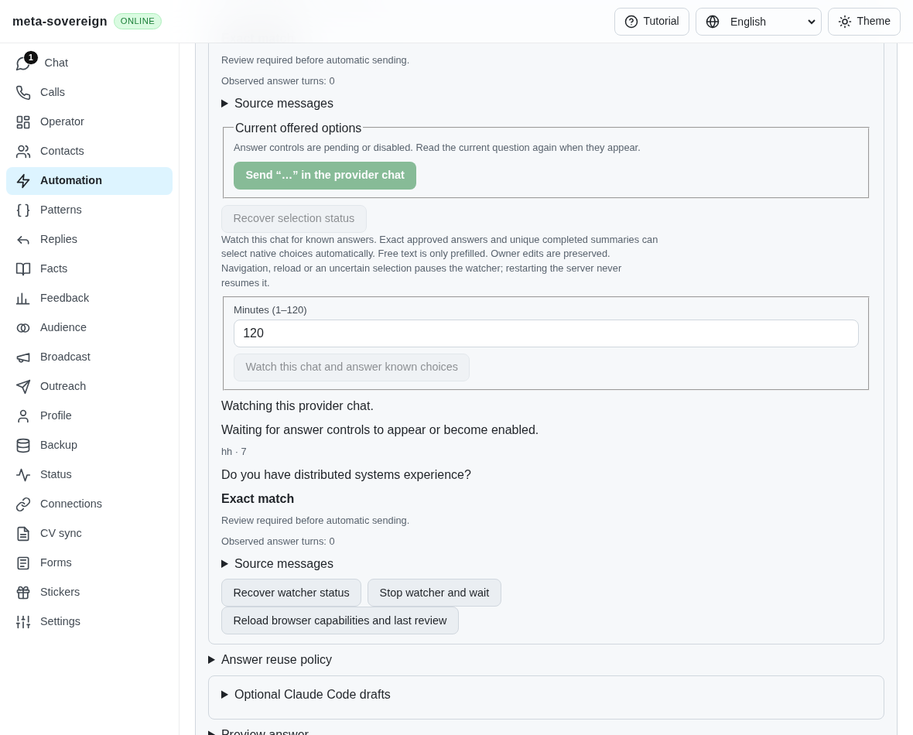
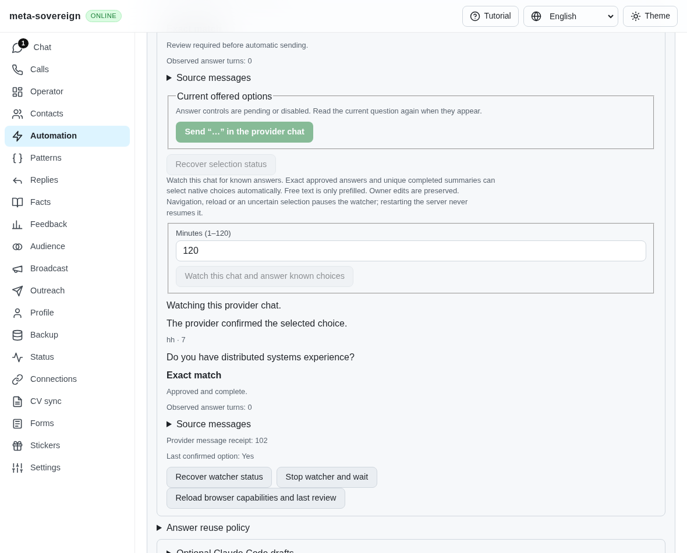
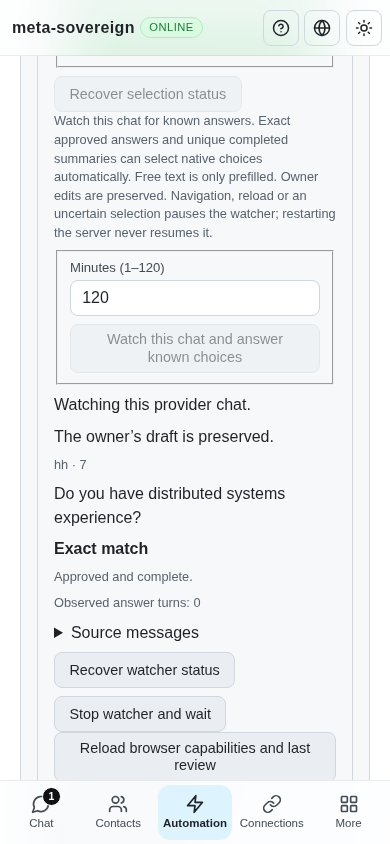
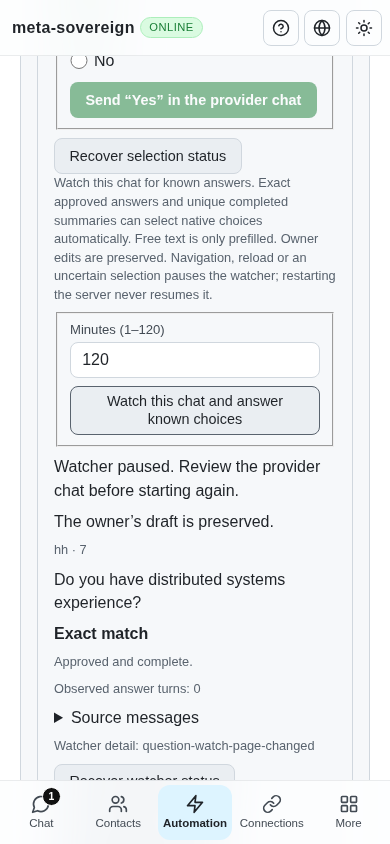
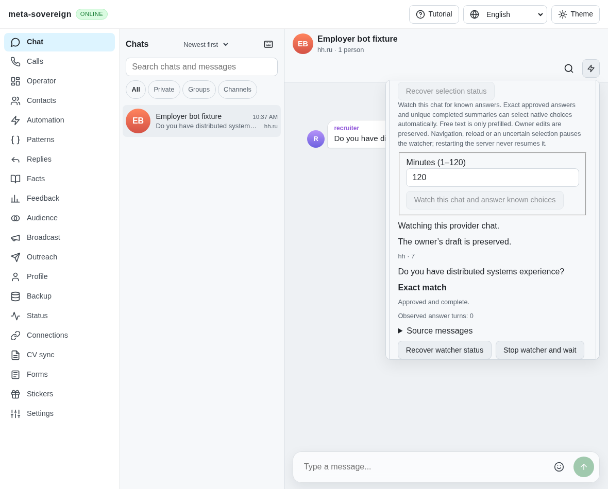
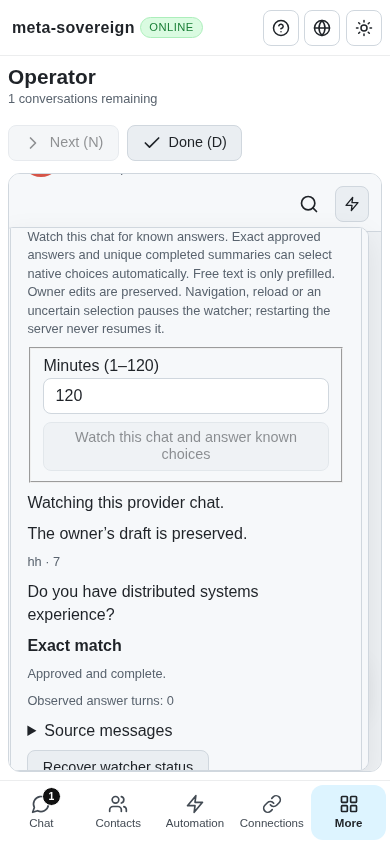

# Finite current-chat question automation

[PR57](https://github.com/link-foundation/meta-sovereign/pull/57) adds an explicitly
started HH browser-chat watch to the shared question service. This implements a
bounded part of QA14. Live signed-in provider parity, all-unread orchestration
(C14/C15), acknowledgement/rejection/invitation handling (QA17), and every other
unchecked criterion remain unfinished. The PR remains draft and unmerged.

## Reference and behavior

The pinned HH reference `fa0991b8c2d0896fb3b4be6c69947f0590094b15`,
`forms-and-chats.md` lines 244–253 and `chat-choices.mjs`, requires actual offered
options, waiting for delayed controls, preserving owner drafts, and using the same
reader/sender for application and chat conversations. This unit reuses the existing
production native-choice adapter, private draft ownership, approved exact and
accepted-summary planning, and durable shared question reservation. Generic
conversation starters remain distinct from offered answers.

After inspecting a current chat, the owner explicitly starts a 1–120 minute watch
(default 120 minutes). A review expires after 30 minutes; each new watch must start
from an unexpired review whose actual current snapshot still matches. The watch
binds that document and never navigates back to it. It waits for disabled/delayed
options and clicks only complete approved exact or unique accepted-summary choices.
Knowledge is checked again inside the provider action queue immediately before a
write. An incoming new question may be answered in the same document. Free-text
answers are prefilled only; the watch never sends ordinary text. Only an unchanged
privately owned automatic draft may clear when native choices arrive.

A positive provider/chat/option-matched receipt establishes delivery. Missing proof
pauses the watch with the shared uncertain reservation; neither polling nor reload
retries that action. Manual and automatic answers share one question key. The
[durable flush prerequisite](outbox-flush.md) closes the grouped text-store window
before provider dispatch. Status also recovers a receipt newer than the saved watch
intent. Explicitly resolved outbox entries remain identified as owner decisions.

Stop closes admission, waits for an already issued action, retains its receipt and
releases the lease once. Expiry, page changes, storage failures and shutdown drain
and release ownership. A saved active record without its process is reported as
paused/owner-unavailable, never resumed. A record already paused by its owner may
be marked stopped; a foreign active record cannot claim its owner has drained.
Default-off diagnostics log phases and identifiers without question/draft bodies.

## Shared controls and recovery

Foreground CLI, trusted text/binary Lino routes, and four-language Questions, Chat
and Operator controls use the same service. Start persists a caller UUID before
issuing the request. Repeated IDs and read-only status recover existing state,
including a lost HTTP response, without another provider lease. Polling is bounded
to one request at a time and late status responses cannot overwrite a new action.
A separate CLI process reads saved state but cannot stop another process's watch;
Ctrl+C/SIGTERM in the owning foreground process drains it. The server can stop its
own watch through the trusted API. No model process is needed for this saved-answer
watch. [Usage](../../QUESTION-BROWSER.md) includes the commands and request fields.

## Reproduction and verification

The before experiment temporarily restores the actual `ea8d7eae` shared React
component, builds it and verifies that watch controls are absent. It retains the
current backend for the isolated comparison and always restores/rebuilds the draft
component in `finally`. It does not claim a whole-parent runtime comparison.

Focused new cases cover confirmation, capability, expired reviews, delayed options,
owner edits, accepted-summary conflicts, free-text prefill, queued knowledge
changes, unknown receipts, durable status recovery, document changes, expiry,
Stop/shutdown drainage, storage failures and concurrent repeated request IDs. The
transport cases use actual production routes and the foreground CLI wrapper.

During development, the real UI exposed a missing public-method registry entry,
stale previous-watch display, and Stop leaving an already released paused record
paused. Tests and shared controls now cover those paths. The full CLI test also
found the generic model wrapper treating a successfully drained Ctrl+C as a model
failure; the saved-answer watch now owns its signal handlers. A server test used an
expired fixed-clock review; it now inspects through its own production route.
Initial failures remain in the evidence archive.

- **34 focused Node checks** and **18 new Deno checks** pass; two existing model
  CLI checks also pass after the signal-ownership correction.
- **20 native HH browser fixture cases** pass, including real cross-origin frames,
  hidden/reloaded document refusal and listener cleanup.
- **Five production Chromium scenarios** pass with no page errors: delayed native
  choices, owned-draft replacement, owner edits, lost start response/reload recovery,
  and same-URL provider reload. The helper joins the hosted Questions browser job.
- **Independent Playwright MCP Chat desktop and Operator mobile** checks pass:
  start, owner-draft protection, Stop, zero native clicks/text sends, no page errors
  or horizontal overflow. The initial fixture landing logs one missing favicon;
  its exact console entry is retained separately.
- Scoped lint, formatting, secrets and Deno module checks pass. The existing
  duplication gate passes at **6.49%** against its 6.5% threshold.

Verification logs and the final screenshots are collected with source snapshots
and SHA-256 hashes. Full runtime and WebKit matrices run in hosted CI. The previous
pushed commit `ea8d7eae978375b953bf212d364aa645deaae69a` passed all five workflows,
including both browser jobs; the new commit still requires its own exact-head CI.

## Visual evidence

The [archive](data/question-watch.tar.gz) and
[SHA-256 manifest](data/question-watch.tar.sha256.json) preserve the finite evidence.
No live provider account or owner application server was used.
