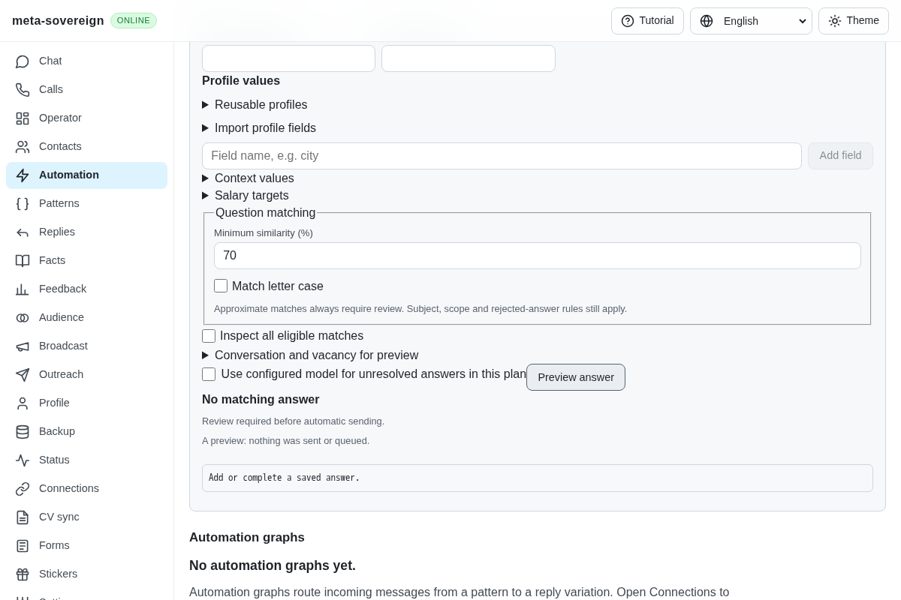
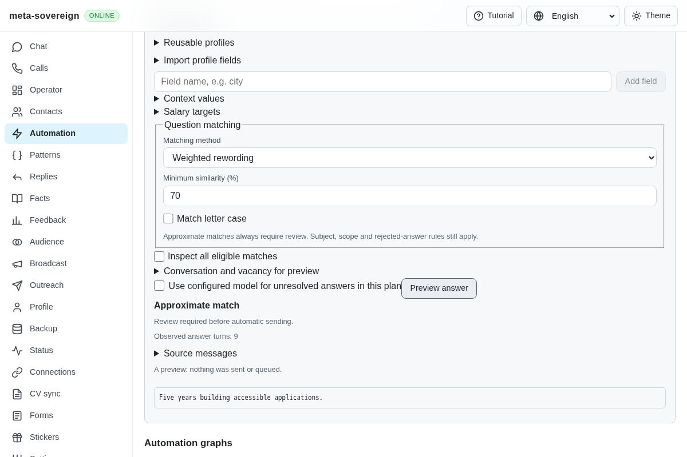
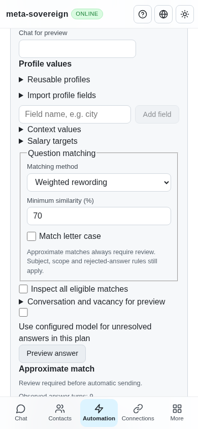

# Selectable weighted question rewording

[PR 57](https://github.com/link-foundation/meta-sovereign/pull/57) adds a shared
weighted matching method after studying the complete pinned Q/A database and
[reference PR 123](https://github.com/konard/hh-job-application-automation/pull/123).
The implementation uses 40% normalized character edit similarity and 60%
stemmed keyword overlap, with subject coverage for reworded questions. Russian
informal address and word endings are normalized when case folding is enabled.
Reference code was studied without copying it into the implementation.

The owner selects **Weighted rewording** in the answer preview, saved question
action or Forms planner. **Ordered words** remains the default; existing saved
settings and ordered scores retain their behavior. Exact answers and explicit
templates keep their existing precedence. Every weighted suggestion requires
review, even if the saved answer is approved or the score is 100%.

Existing technology, currency and employment-subject guards remain effective.
Generic shared wording alone cannot qualify unrelated questions. The shared
case, threshold, scope, alias, rejection, approval and frequency rules still
apply. Weighted matching admits at most 1,048,576 character cells per pair and
shares 4,194,304 cells per planning operation, including without match inspection.
Only two edit-distance rows are allocated. An exhausted inspection is explicitly
incomplete; exact matching remains available.

## Reproduce and verify

Save an approved answer for `What are your software engineering experiences?`
and preview `Describe your experiences in software engineering?` at 70%.
Ordered matching returns no answer at its 50% score. Select weighted matching:
the score becomes 72.24489795918367%, and the most frequently observed approved
answer is proposed for review. This changes no knowledge or provider state.

The same setting is available through:

```sh
meta-sovereign automations answers plan --question='Describe your experiences in software engineering?' --matching-algorithm=weighted --threshold=0.7
meta-sovereign forms-plan --file=inspection.json --matching-algorithm=weighted --threshold=0.7
```

Both Lino transports accept `matching: { algorithm: 'weighted', threshold: 0.7 }`.
Invalid algorithm values fail validation. Explicit flags override the matching
record; omitted settings preserve existing defaults and saved action shapes.
The shared controls are translated in English, Russian, Chinese and Hindi.

Nine of the ten new regressions fail against exact parent `1b449fb5`; the existing
exhausted-budget control passes. All 45 focused checks pass after the change:

```sh
python3 -B experiments/issue-56/question-weighted-parent.py
node --max-old-space-size=256 --test --test-concurrency=1 js/tests/question-weighted.test.js js/tests/question-matching-options.test.js js/tests/question-subjects.test.js js/tests/forms-review-prefill.test.js
RUN_BROWSER_E2E=1 E2E_EXECUTABLE_PATH=/usr/bin/google-chrome QUESTION_WEIGHTED_SCREENSHOTS=1 node --max-old-space-size=384 experiments/issue-56/question-weighted-browser.mjs
```

Coverage includes the arithmetic, Russian endings/address, case and Unicode,
distinct subjects, finite budgets, old defaults, saved-action round trips,
frequency ranking, stable pages, read-only CLI/API planning and owner field
preservation in Forms. Production Chromium verifies the selector, reviewed
answer, persisted action and phone layout, recording zero sends. The scenario
also runs in the normal hosted Questions browser sequence. Independent
Playwright MCP verifies actual English and Russian controls and desktop/phone
layout. Its owned server closes with unchanged knowledge and zero sends; its
only console error is a browser cache-write failure, with the loaded UI and
preview verified successfully.

All 25 locale checks pass. Scoped lint, formatting and secret checks, source and
documentation limits pass; duplication remains within the unchanged 6.5% gate
at 6.49%. Full runtime and browser matrices run on hosted CI.







The [evidence archive](data/question-weighted.tar.gz) and
[manifest](data/question-weighted.tar.sha256.json) preserve the exact parent
sources, reference research, focused logs, browser/MCP receipts and screenshot
hashes. Recollect with [collect-question-weighted.py](../../../experiments/issue-56/collect-question-weighted.py).
Full runtime, browser and native matrices remain on hosted CI for the published
SHA. Historical/provider parity and the other 35 unchecked acceptance criteria
remain unfinished; this unit does not complete issue 56. PR57 stays draft and
unmerged.
