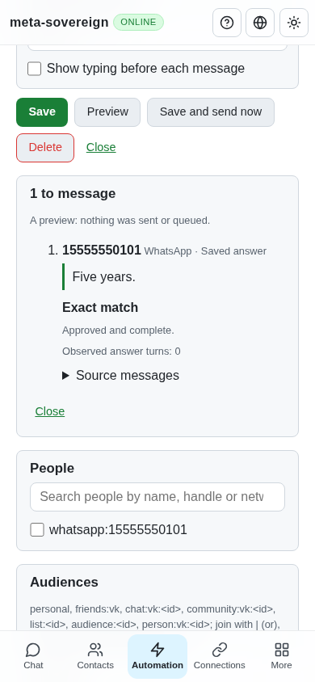
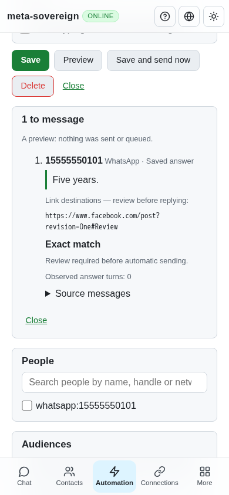

# WhatsApp Cloud question destinations and captions

Issue [#56](https://github.com/link-foundation/meta-sovereign/issues/56),
PR [#57](https://github.com/link-foundation/meta-sovereign/pull/57), 2026-11-23.

Import a WhatsApp Cloud payload containing a familiar question and the
`referral` for the ad or post that started the conversation. On `a57f60cd`, the
shared Automation preview marks the saved answer approved and omits the
destination. The normalizer reads top-level captions, which leaves native
image, video and document captions out of the question text.

The adapter now preserves exact referral `source_url` and contact-card
`urls[].url` values, including their path, query and fragment. It reads the
nested caption for each media type. The media download URL stays on the
attachment. Review displays destinations as literal text, and changing only a
destination invalidates an earlier review. Contradictory or oversized
destination data, unknown provider messages and captions that disagree with
saved text block automatic planning. Linked turns stay out of learned answer
rules. [Meta webhook payload reference](https://www.postman.com/meta/whatsapp-business-platform/documentation/wlk6lh4/whatsapp-cloud-api?entity=request-13382743-2309e8d8-c804-4053-a070-fc2d0371ba52).

Earlier records with a retained raw referral can recover it directly. Older
records with a dropped media caption need the original payload imported again
to restore that text to history.

## Reproduction and verification

Use a disposable checkout for the parent replay. With dependencies installed,
run the focused regression and production preview from the repository root.

```sh
python3 -B experiments/issue-56/question-api-links-parent.py --whatsapp
node --test --test-concurrency=1 js/tests/question-whatsapp-links.test.js
export RUN_BROWSER_E2E=1
python3 -B experiments/issue-56/question-api-links-parent.py --whatsapp --browser
node experiments/issue-56/question-whatsapp-links-browser.mjs
```

All nine dedicated checks fail at the published parent. The corrected source
passes 114 focused Node checks and 97 Deno tests with 27 substeps. The tests
exercise the production adapter with synthetic Cloud payloads, shared planning
and final-history revalidation, private learning, the CLI and both Lino
encodings. The explicitly confirmed send and the ordinary text control use
disposable send stubs. The browser scenario runs in the hosted
question-templates group.

Production Chromium shows the full destination and the required review at
desktop and phone widths. Independent Playwright MCP verifies the translated
labels and review hold in English, Russian, Hindi and Chinese. Four preview
POSTs return HTTP 200. Reload leaves the preview closed, the fixture logs zero
sends, and the browser makes zero destination requests. The console records
Chromium cache write errors. The inspection finds no page exceptions, and both
the browser and fixture server close.




The [archive](data/question-whatsapp-links.tar.gz) and
[SHA-256 manifest](data/question-whatsapp-links.tar.sha256.json) preserve the
focused runs, screenshots, source and browser diagnostics. Verification supplies
the payload directly to the Cloud adapter. The app still lacks a live Cloud
webhook endpoint, and this work has no authenticated WhatsApp delivery receipt.
Exact-source hosted checks and the rest of QA04 remain open. The issue inventory
still has 88 verified and 30 open criteria.
