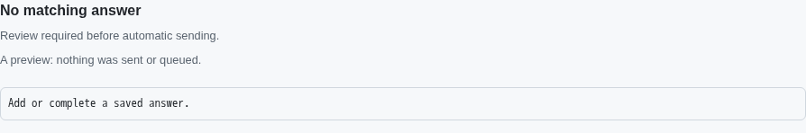
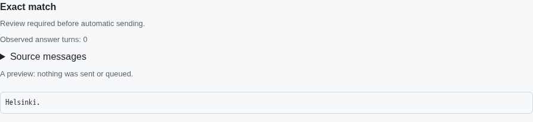
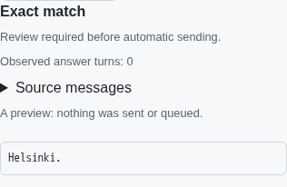

# Existing saved questionnaire components

The pinned HH contract requires reusing individual answers from already saved
whole questionnaires, indexing them when tools read knowledge, and explicitly
backfilling saved replies and archived counts. This correction in
[PR #57](https://github.com/link-foundation/meta-sovereign/pull/57) addresses that
gap in the shared chat, application and external-form planner.

## Reproduction and root cause

On parent `9c9baf5d`, save an approved questionnaire with two numbered questions
and aligned numbered answers. Preview only its second question with approximate
matching disabled: the result is unanswered. Explicit learning without archived
messages proposes no components. The actual parent regression retains three
failures. The learner split newly observed conversations, but neither shared
planning nor explicit learning indexed existing saved whole replies.

## Correction

Each shared plan rebuilds a bounded read-only component view of current saved
knowledge. Only unambiguous aligned numbered answers split. Whole replies retain
exact-match priority. Components retain scopes, frequency and corrections, use
current template values and keep missing values incomplete. Derived answers need
review and do not inherit whole-answer approval or canonical status. Capacity
refusals apply nothing; existing optional value-free diagnostics remain off.

Explicit offline learning combines saved components with the archive learner.
Saved wording adds zero uses and no evidence. Stable identifiers join actual
archived counts without recounting replays. Existing approvals, restricted
scopes and whole replies remain intact. CLI `answers backfill-questionnaires`,
both Lino API encodings and the existing shared review controls expose the same
operation; `answers learn` includes it too. Controls explain it in English,
Russian, Chinese and Hindi. See the [user guide](../../QUESTIONNAIRES.md).

## Verification and limits

Twenty focused portable checks pass: eight new regressions and twelve existing
list/control checks. An additional focused regression verifies current template
values and incomplete missing values. Coverage includes all five providers and
form mode, whole priority, ambiguity, disabled rules, scope, corrections,
frequency, actual archive counts, replay, CLI, offline UI API and both Lino
encodings. Scoped lint and formatting pass.

One focused Chromium scenario reads the production preview without writing,
previews zero-use components and saves unapproved proposals while preserving
the whole reply. The mandatory question browser target includes this scenario
on both hosted engines. Independent Playwright MCP checks reproduce before/after
behavior, verify a 390-pixel layout and report no page errors. Both isolated
servers close their resources. No live provider or owner app server is used.

The [verified archive](data/questionnaire-index.tar.gz) and
[manifest](data/questionnaire-index.tar.sha256.json) preserve actual parent bytes,
negative/positive checks, synthetic fixtures, browser receipts and screenshot
hashes. The published correction still requires exact-head hosted verification.
Neither complete QA09/QA10 criterion is accepted yet; all other unfinished
requirements remain active and PR57 remains draft.
