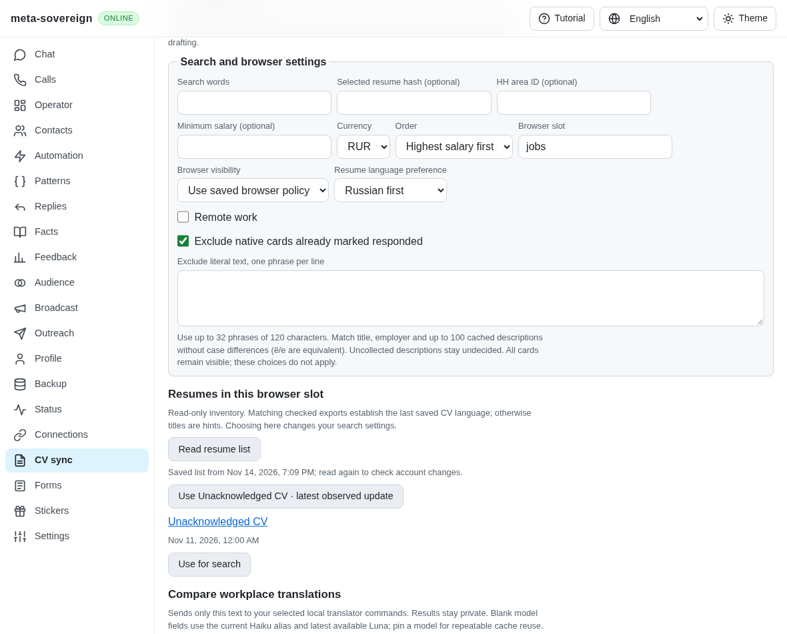
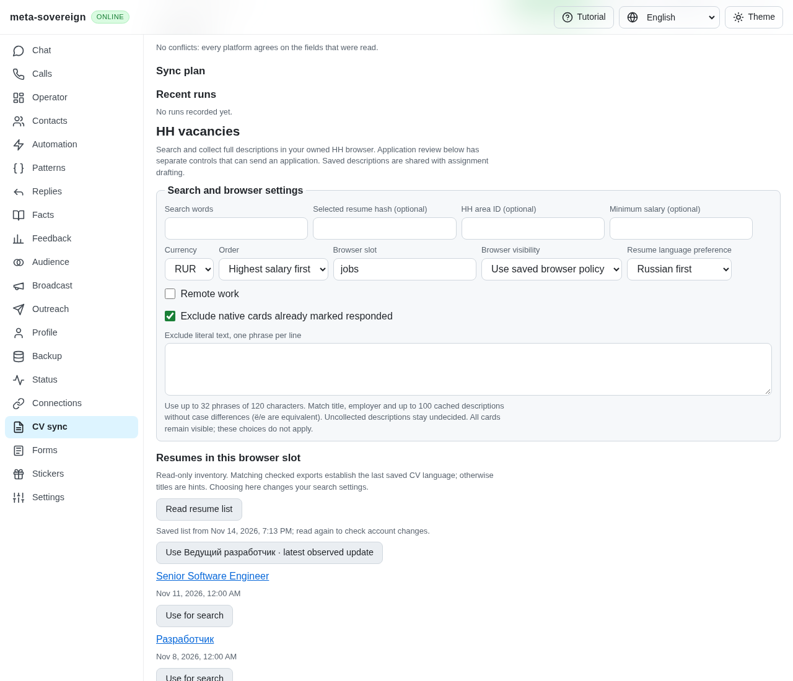
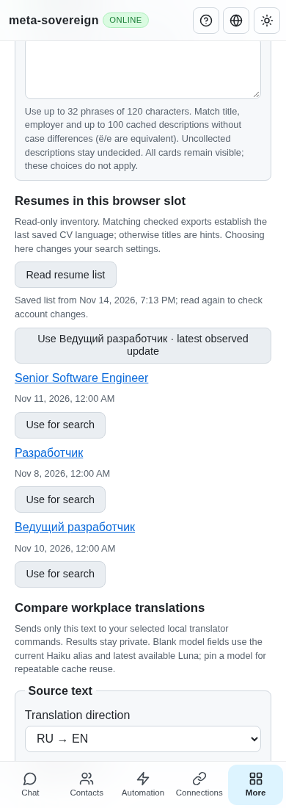

# Acknowledged résumé cache recovery

A rejected native résumé refresh now restores the last acknowledged list before
service readers can observe it. An absent list stays absent. A successful list
survives concurrent reads, closing/reopening the real snapshot store, and UI
reload on desktop and phone. This corrects a prerequisite of HH02; authenticated
workflow parity and all 81 original incomplete inventory rows remain required.
PR57 stays draft and unmerged.

## Cause and correction

`createBrowserStore` admits mutations to memory before its driver acknowledges
the snapshot. The old résumé cache used a plain `put`. If the driver rejected
that save, the request failed but the attempted list remained in memory. A later
cached read exposed that list, and a later flush could persist it. The mounted
view kept its earlier successful response, so reloading was necessary to see
the discrepancy.

The cache now reuses `saveAcknowledgedRecord`, which restores or removes the
attempted record after a refused mutation or flush. The service also reuses the
shared acknowledged writer/reader boundary, holding cached reads until either
commit or rollback finishes. Existing cancellation, native read-only discovery,
export-language verification and browser ownership rules are preserved. No new
automatic discovery or provider action is introduced by recovery.

## Reproduction and verification

The bounded regression uses the real browser store with one controlled ENOSPC
driver refusal, both with and without an earlier acknowledged list. It observes
the admitted attempted value, starts a concurrent service read, releases the
refused save, then checks cache restoration and actual store reopen. Recovery
cannot call the injected native discovery reader.

These probes temporarily select actual published parent `281d6dcc` and restore
the working sources/bundle in `finally`:

```sh
python3 -B experiments/issue-56/resume-cache-before.py
python3 -B experiments/issue-56/resume-cache-before.py --native
```

The parent fails both service cases. Its native UI shows a single
`Unacknowledged CV` after the refused refresh and reload, replacing the earlier
three-entry list. The native assertion fails with `1 !== 3`.

The corrected focused selection passes 30 Node and 30 Deno tests:

```sh
node --max-old-space-size=384 --test --test-concurrency=1 \
  js/tests/job-resume-cache-durability.test.js js/tests/job-resumes.test.js \
  js/tests/job-resume-language.test.js js/tests/vacancy-controls.test.js \
  js/tests/job-vacancy-cache-durability.test.js js/tests/job-choice-durability.test.js
DENO_V8_FLAGS=--max-old-space-size=384 deno test --allow-all --no-check \
  js/tests/job-resume-cache-durability.test.js js/tests/job-resumes.test.js \
  js/tests/job-resume-language.test.js js/tests/vacancy-controls.test.js \
  js/tests/job-vacancy-cache-durability.test.js js/tests/job-choice-durability.test.js
python3 -B experiments/issue-56/resume-cache-native.py
```

The three durability regressions share the same finite controlled-refusal
fixture; all original cache/choice assertions remain. Only the new native scenario
runs locally. It is also appended to the existing
mandatory `job-resumes` browser group, preserving both previous scenarios,
runtime/engine coverage and deadlines. Native Chromium and an independent
Playwright MCP flow each retain all three entries after reload, including at
390-pixel phone width. Both report one refused save, zero provider clicks, no
recovery replay and drained owned resources; MCP reports no page errors.

An initial MCP fixture URL accidentally contained a trailing slash, sending
`//fail-next` rather than the exact fault-control path. The retained failing
receipt and server log show zero injected refusals. Correcting the control URL
produces the verified one-refusal flow. A later signal-based fixture teardown
did not yield its final receipt; the fixture now exposes an owned close route.
The final wrapper exits successfully after server/browser drainage and restores
the existing bundle. These are fixture corrections, not production behavior.

## Visual evidence

Before, the actual parent exposes the refused one-entry list after reload:



After, the acknowledged list is retained:





The [checksummed archive](data/resume-cache.tar.gz) and
[per-file manifest](data/resume-cache.tar.sha256.json) retain parent/current
sources, complete focused logs, browser receipts, fixture corrections and all
five screenshots. Recreate them with
`experiments/issue-56/collect-resume-cache.py` after verification. Scoped static
gates and exact-head hosted results are recorded in the work plan; pending
hosted work does not establish a pass or complete the original issue.
