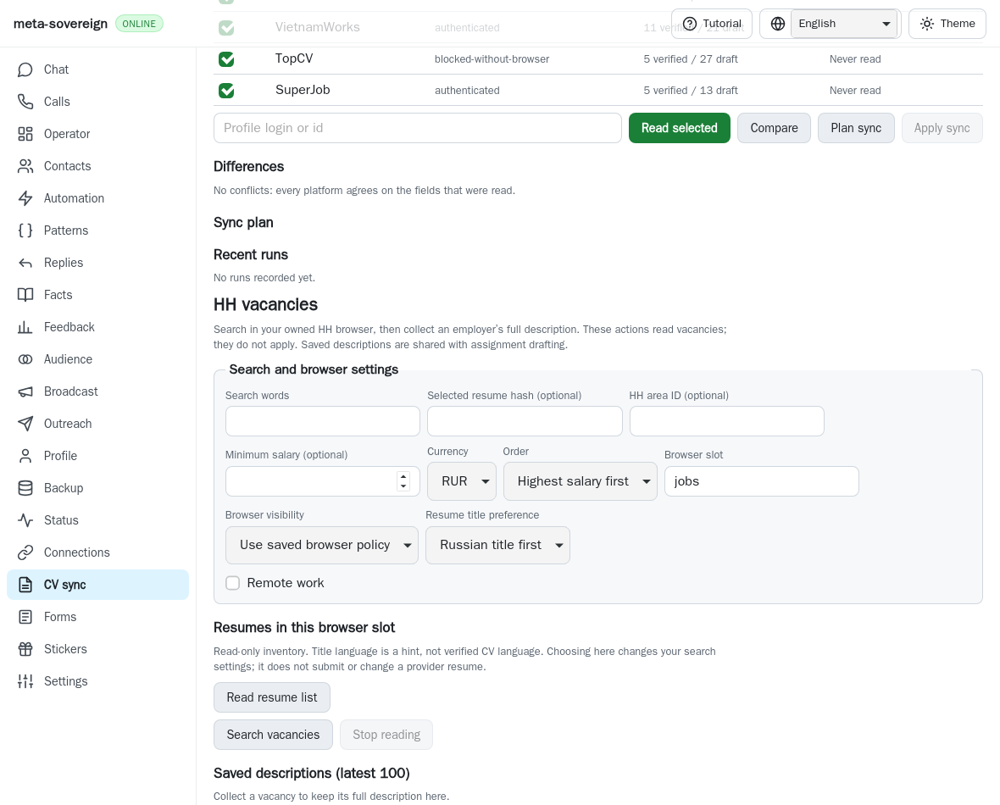
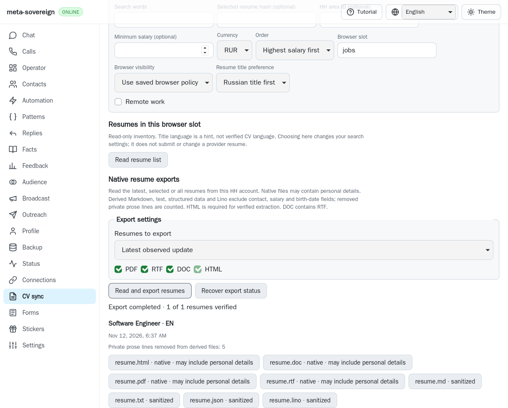
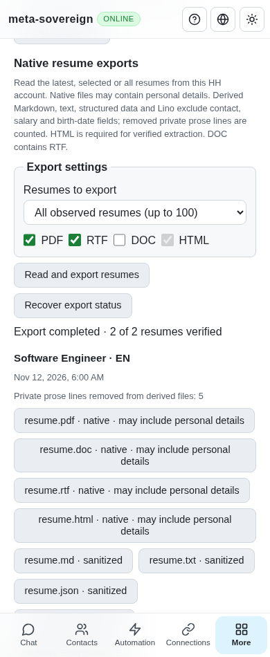

# Native HH résumé exports and sanitized bilingual CVs

This unit implements HH12/HH13 through CLI, the Lino API and the shared CV
screen. Authenticated live-provider verification, native application selection,
CV editing/synchronization and every other unchecked issue criterion remain
required. [PR57](https://github.com/link-foundation/meta-sovereign/pull/57)
remains draft and unmerged.

## Reproduction and behavior

The published parent `3a6a49fd` has a native résumé inventory but no export
service or CV export controls. `resume-export-before.py` temporarily restores
that exact service and browser bundle, runs the focused regression and captures
the absent controls, then restores the working sources in `finally`.

**Export resumes** reads the native list afresh in one owned jobs browser and
chooses the most recently updated résumé, one specified native hash, or every
observed résumé. The operation requires a valid list and verifies each exact
résumé page before requesting the native converter with that page's cookies.
It supports PDF, DOC/RTF and HTML; native DOC bytes are RTF, matching the
provider's converter. HTML is always included because it supplies the structured
source. Native files remain private and can contain contacts. The UI explicitly
distinguishes native files from sanitized derivatives.

An inert parser extracts Russian or English native export labels, owner name,
position, skills, About and workplaces. Derived Markdown, text, structured JSON
and typed round-trippable Lino retain workplace company, position, period/date
precision, location, website, description and stable industry identifiers.
Official localized industry dictionaries are fetched separately with a bounded,
day-long cache; unknown or ambiguous industry labels refuse the export rather
than inventing an ID. Company metadata, including Wayback URLs, remains intact.
Only native export labels establish the returned résumé language; inventory
title hints are insufficient.

Contact, salary and birth-date fields are excluded from the derived model.
Recognized private lines in About/work descriptions are removed and counted by
kind; private values in structured scalar fields refuse the export. The final
structured object is checked again before serializing any derivative. This
rule does not publish or modify the private originals, canonical personal CV,
provider page, or other résumé data.

Downloads stream bounded chunks into fresh private server directories and files
(0700/0600), with exact page/frame/token checks. HTML is capped at 2 MiB and
other native formats at 8 MiB each; native signatures, exact URLs, byte counts
and digests must agree. Structured derivatives are bounded at 256 KiB. Only
verified manifest metadata enters the store or API. Explicit download requests
recheck provenance, fixed file names, bounded file size and digest, and return
same-origin attachments with no-store/nosniff headers. Failed refreshes retain
previous verified exports; incomplete private output is removed.

## Recovery and interfaces

A client-generated request ID is persisted before admission and browser work.
The admission POST returns metadata while the finite owned operation proceeds.
A lost reply can be recovered through GET without another browser operation.
Restart reports an interrupted in-progress request without replaying it. Stop
waits for owned cleanup and retains completed files. If a POST never arrived,
explicit ID-specific cancellation writes a durable tombstone that refuses a
late admission with the same ID. A failed cancellation flush stays uncertain
until an explicit retry confirms durability. Unknown status blocks new starts;
it never claims success. Other workspace operations retain their ownership.

- `vacancies-resume-export --all=true --formats=pdf,rtf,doc,html` waits for the
  final result. Omit `--all` for the latest résumé or use `--resume=<hash>`.
  `--browser-slot=jobs` and explicit `--headless=true|false` use existing browser
  policy. Optional `--out=<directory>` copies only reverified files into a fresh
  private result directory; existing exports are never overwritten.
- `vacancies-resume-export-status --request-id=<id>`,
  `vacancies-resume-export-cancel --request-id=<id>` and
  `vacancies-resume-exports-stored` provide read-only recovery, explicit
  cancellation and cached inventory.
- `POST /api/vacancies/resume-export`,
  `POST /api/vacancies/resume-export-cancel`,
  `GET /api/vacancies/resume-export-status`,
  `GET /api/vacancies/resume-exports-stored` and
  `GET /api/vacancies/resume-export-file` use the existing origin checks,
  request limits and default text/binary Lino transport.
- The CV screen exposes latest/selected/all, native formats, progress, Stop,
  recovery and explicit per-file downloads in English, Russian, Chinese and
  Hindi. Browser reload restores request status and verified files without a
  provider read. Download controls initiate a download without claiming that
  the owner saved it.

## Reference and evidence

Behavior was studied without copying code from the pinned
[`konard/hh-job-application-automation@fa0991b8`](https://github.com/konard/hh-job-application-automation/tree/fa0991b8c2d0896fb3b4be6c69947f0590094b15)
2026-11-05 export, native DOM, CV, industry and date modules. The native converter
uses `txt` for its HTML export and returns RTF for DOC. The official industry
lookup retains stable IDs instead of translating them from localized labels.

Thirty-five focused Node checks, twelve focused Deno checks and twelve CI
contract checks pass. They cover options, bilingual periods, privacy, Lino round trips,
industry/cache bounds, durable admission/cancellation, restart/ownership,
private-file tampering and growth, CLI, both Lino encodings, exact receipts and
four localized renderings. Native WebKit scenarios use actual owned commander
navigation, inert HTML extraction and browser-streamed converter downloads
against synthetic provider pages. They cover latest/selected/all, lost replies,
unreceived requests, malformed PDF, cached phone reload and Stop during a late
launch, with zero provider clicks. WebKit's route interception omits Cookie
headers in this environment; the fixture verifies its synthetic cookie through
the owned page's cookie API instead. This does not establish authenticated
provider transport.

Four independent Playwright MCP cases pass with three counted reads, two
retained exports, a verified HTTP 200 attachment and zero page errors. MCP exercises the production UI, service, routes and
private attachment verification through a counted synthetic read boundary.
Native converter extraction is verified separately to keep concurrent browser
memory bounded. Screenshots show the actual parent and final desktop/phone
controls. These fixtures do not substitute for authenticated live parity.

Reproduce with `PYTHONDONTWRITEBYTECODE=1 python3
experiments/issue-56/resume-export-before.py`. Run the finite native scenarios
with `RUN_BROWSER_E2E=1 E2E_BROWSER=webkit node
experiments/issue-56/resume-export-browser.mjs`. The source/log/screenshot
[archive](data/resume-exports.tar.gz) retains verified logs, source snapshots,
screenshots and digests. Full runtime/browser matrices stay in hosted CI;
exact new-head results remain required.

The preceding exact parent Checks run
[43162679447](https://github.com/link-foundation/meta-sovereign/actions/runs/43162679447),
created 2026-11-12 05:38:01 UTC, failed in WebKit shard 4/4, job 130998380216.
Raw job log lines 838–861 show `verifyResumeProfile` waiting for a hidden
Preview answer summary under a closed Questions disclosure. The preserved
artifact confirms that state. A finite isolated replay passed; root cause is
still unproven. This export unit does not claim to fix that failure. The
investigation and exact new-head CI remain required.

## Before and after

