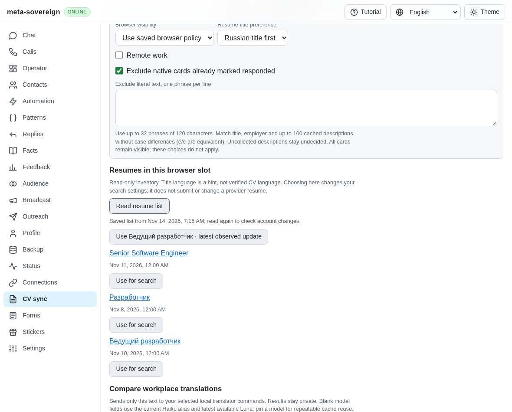
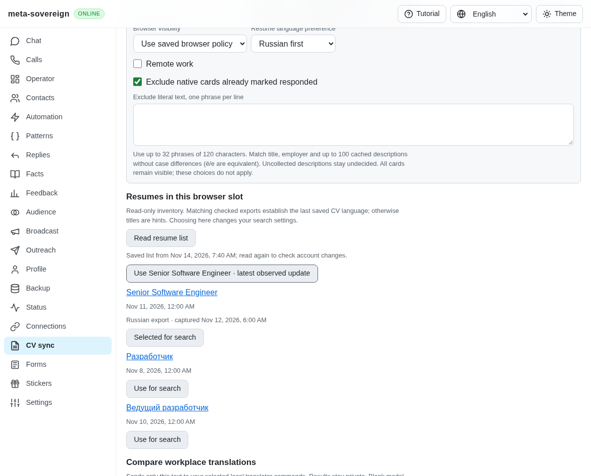
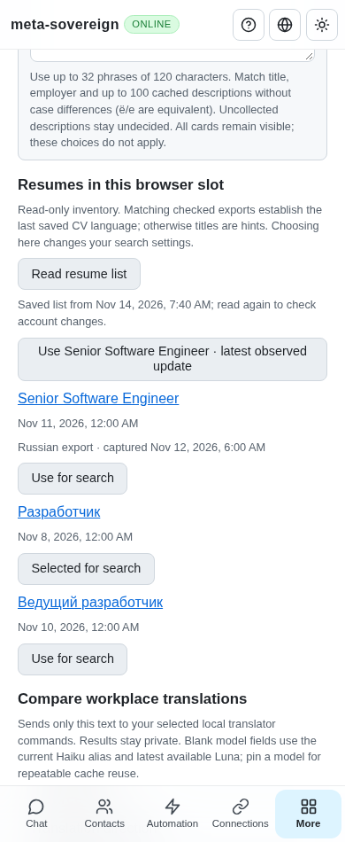

# Suggesting a résumé from checked export language

PR: https://github.com/link-foundation/meta-sovereign/pull/57

Résumé search suggestions now prefer a matching checked Russian or English export
over a title hint. The owner can still choose any observed résumé explicitly.
The list shows the export language and capture date; choosing a row changes the
search settings. Native application résumé selection remains required.

HH02 and HH06 remain incomplete, along with all 81 originally unchecked inventory
rows. Historical export evidence does not establish a current provider form's
selection or live authenticated parity. The PR remains draft and unmerged.

## Reproduction and evidence rules

On published parent `e8533c0c478ee997c3974caf63798bd74e1619f3`, a Russian CV with
the title “Senior Software Engineer” loses to a Cyrillic title when Russian is
requested, even when its same-slot native export is available. The selection
function only considers title characters and observed dates.

The server now validates the latest and immutable export receipts, résumé hash,
browser slot, title and observed update date, then reads and checksums the bounded
structured export. Its embedded language and identity must agree. A changed or
unknown native update invalidates the evidence. Missing, contradictory or corrupt
matching artifacts refuse the operation without overwriting the last list or
exposing private filesystem paths.

Only small evidence metadata enters the response. Durable list records keep their
existing format and contain neither export proofs nor CV contents. Server cache
reads recheck the artifacts. Browser-only snapshots strip unverified claims.
Explicit owner choices win, while unavailable language evidence retains the
disclosed title/date fallback. Cancellation after an artifact read prevents a new
list from being published.

The pinned HH résumé reference at
`fa0991b8c2d0896fb3b4be6c69947f0590094b15` was read for selection behavior; no
upstream code was copied. Completing the native chooser, including its selected
hash and owner edits, remains a separate acceptance criterion.

```sh
PYTHONDONTWRITEBYTECODE=1 python3 experiments/issue-56/resume-language-before.py
PYTHONDONTWRITEBYTECODE=1 python3 experiments/issue-56/resume-language-before.py --native
node --max-old-space-size=384 --test --test-concurrency=1 js/tests/job-resume-language.test.js js/tests/job-resume-language-controls.test.js js/tests/job-resumes.test.js
deno test --allow-all --no-check --v8-flags=--max-old-space-size=384 js/tests/job-resume-language.test.js js/tests/job-resume-language-controls.test.js
RUN_BROWSER_E2E=1 E2E_BROWSER=chromium E2E_EXECUTABLE_PATH=/opt/google/chrome/chrome node --max-old-space-size=384 experiments/issue-56/resume-language-native.mjs
```

The focused checks cover explicit choices, unchanged cache bytes, service restart,
slot isolation, renamed or undated CVs, tampered/missing files, contradictory
receipts, portable response validation, cancellation, CLI and both real HTTP Lino
encodings. All four locale renders disclose the same evidence.

One production Chromium scenario and independent Playwright MCP verify the new
suggestion, a manual choice, phone reload and all four locales. The fixture reports
one read browser, zero provider mutations and no page errors. Every owned fixture
closes. Initial fixture routing and Deno import failures are retained with the
passing checks. Hosted CI remains required for the published head.

## Screenshots

The parent suggests a title hint despite the matching Russian export:



The checked export now supplies the suggestion and its visible evidence:



The owner's manual choice survives phone reload:



Reproducers, source snapshots, reference material, logs and screenshots are
preserved in `data/resume-language.tar.gz`, with per-file hashes in
`data/resume-language.tar.sha256.json`. Prior archives remain intact.
