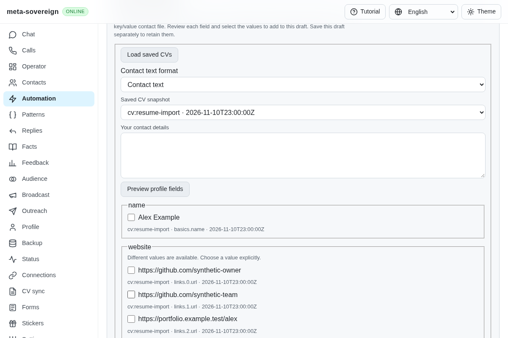
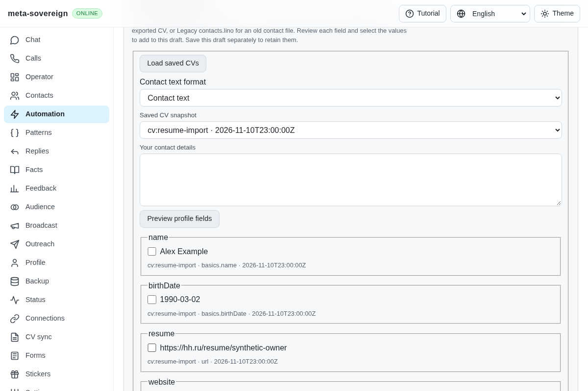
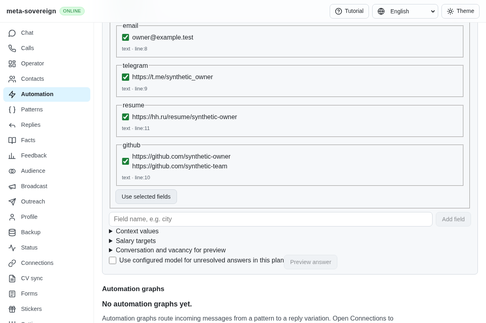
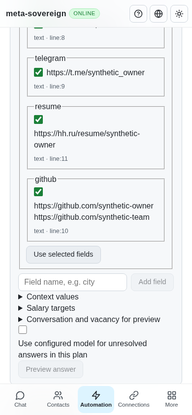

# Reviewed résumé contact import

[PR 57](https://github.com/link-foundation/meta-sovereign/pull/57) extends the shared profile importer toward reference requirements B4/B4a. Selected canonical CVs now retain birth dates, their actual public résumé URL and multiple GitHub links. An explicit Résumé Markdown format extracts contact facts from an exported CV header, with original line evidence. The resulting profile can be reviewed, saved and reused by the existing question and form planners.

To reproduce the previous defect at `07ca5e138b028dfff67b94a46bf7c5f0a553130d`, preview the synthetic `resumeCv` snapshot from `experiments/issue-56/resume-profile-fixture.mjs`. Birth date and résumé URL are absent, and the two GitHub links become competing website candidates. The production browser fails its birth-date assertion after capturing the before image. Seven initial parser regressions also fail before the change; exported Markdown is rejected as an unsupported format.

The cause was incomplete canonical field projection and contact classification, combined with a plain-text-only parser. Shared validation now recognizes the actual public HH résumé URL, keeps GitHub links together with their distinct source locations, and normalizes valid dates to ISO dates suitable for form date controls. Invalid dates, provider lookalikes, credentials and private links retain source-only skipped evidence. Existing current profile values remain current when an import conflicts.

The Markdown parser reads bounded input without rendering HTML or fetching links. It handles simple inline contact links, formatted labels, a full-name heading, explicit first/last-name labels, Russian/English birth-date lines and standalone phone numbers. It excludes images and fenced code and stops at known work/education/skills sections, preventing employer contacts from becoming owner contacts. It proposes the heading as a full name rather than guessing its name order. Literal underscores and URL colons retain their meaning. This is a contact-header parser, not a complete Markdown implementation.

CLI, default text and binary Lino HTTP, offline controls and both shared profile editors use the same extraction. Choose Résumé Markdown, preview the fields, select individual candidates, and use the selected fields in the draft. Saving remains a separate action. CLI extraction accepts `answers profile --text-file=... --format=resume-markdown --json`. Neither preview nor selection modifies the source CV or saves a profile implicitly.

Fifty-six focused checks pass in Node and Deno:

```sh
NODE_OPTIONS=--max-old-space-size=384 node --test --test-concurrency=1 \
  js/tests/question-profile-resume.test.js \
  js/tests/question-profile-resume-controls.test.js \
  js/tests/question-profile-source.test.js js/tests/question-profile-legacy.test.js \
  js/tests/question-profile-controls.test.js js/tests/i18n.test.js
deno test --v8-flags=--max-old-space-size=384 --allow-all --no-check \
  js/tests/question-profile-resume.test.js \
  js/tests/question-profile-resume-controls.test.js \
  js/tests/question-profile-source.test.js js/tests/question-profile-legacy.test.js \
  js/tests/question-profile-controls.test.js js/tests/i18n.test.js
RUN_BROWSER_E2E=1 RESUME_PROFILE_ONLY=1 RESUME_PROFILE_SCREENSHOTS=1 \
  E2E_EXECUTABLE_PATH=/opt/google/chrome/chrome \
  NODE_OPTIONS=--max-old-space-size=384 node js/tests/e2e-questions-browser.mjs
```

The tests cover source evidence, current-value conflicts, malformed/private input, finite parsing, real CLI and both HTTP encodings, offline consistency and explicit profile saving followed by date/GitHub/résumé/name form proposals. Production Chromium and independent Playwright MCP confirm the five canonical CV candidates and all ten Markdown contacts, initially unchecked, with actual draft values after selection. Both desktop and 390-pixel layouts fit their viewport. The fixture confirms the original source is unchanged and no profile is saved. The regression also runs in the normal hosted questions browser flow. Strict changed-code lint, scoped formatting and the production web bundle pass.









The [verified archive](data/resume-profile-import.tar.gz) and [manifest](data/resume-profile-import.tar.sha256.json) retain source, before/after logs, pinned reference research, independent MCP receipts and screenshot hashes. The primary reference is the HH automation project's [exporter](https://github.com/konard/hh-job-application-automation/blob/fa0991b8c2d0896fb3b4be6c69947f0590094b15/src/resume-export.mjs) and [profile loading behavior](https://github.com/konard/hh-job-application-automation/blob/fa0991b8c2d0896fb3b4be6c69947f0590094b15/src/form-prefill.mjs); no reference code was copied.

Automatic résumé export/discovery, complete private-profile/cover-letter parity, automatic multi-form filling and every other unchecked issue criterion remain required. The preceding document-identity head's hosted matrix separately exposed optional-model rendering and full-sequence settings failures; those are tracked for correction rather than reported as passing. Exact new-head hosted verification remains required. PR 57 stays draft and unmerged.
