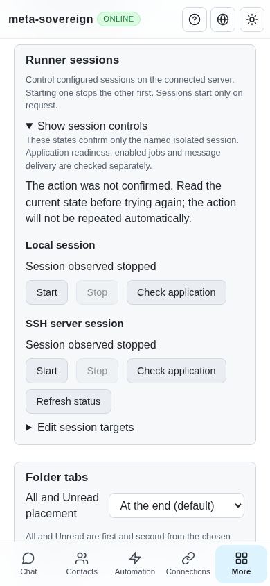
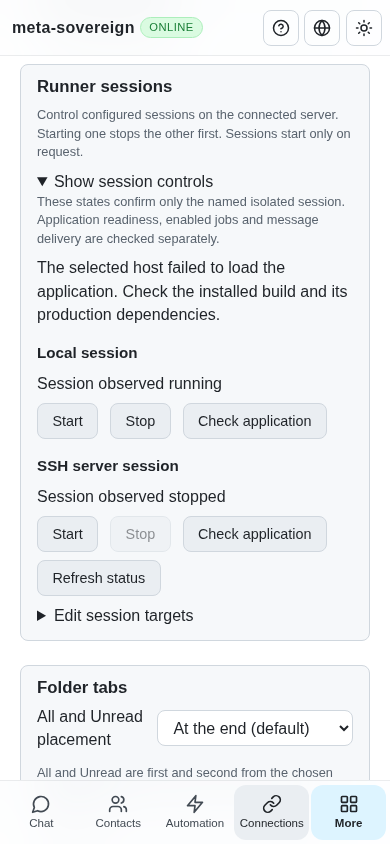

# Check the detached runner application before switching

The detached runner previously checked whether the configured CLI existed and could be read. The selected Node runtime could still fail on a missing server module after the controller stopped the other session.

On parent `c81c40b5`, open **Settings → Runner sessions**, with the local session running and the SSH session stopped. Configure the SSH target to point at the fixture's readable `js/bin/meta-sovereign.js`, where a required server module is absent. Choose **Start** for the SSH session. The parent controller stops the local session, attempts to start the fixture, and returns a generic refusal with both sessions stopped. The browser fixture loads the parent controller from Git and supplies controlled session observations.

On the current branch, the controller verifies the standard product CLI and server exports by loading their module graph in the selected Node runtime. The SSH check uses the existing host-key policy and executes on the configured host. Docker checks use the resolved image ID, no network, and a read-only application mount. The probe does not mount the store. The missing dependency returns `runner-application-dependencies-unavailable` before a stop or start command. The message tells the owner to check the installed build and its production dependencies. The existing readability check still applies to custom entry points. [Node.js module imports](https://nodejs.org/api/esm.html) · [Docker run reference](https://docs.docker.com/reference/cli/docker/container/run/)

- [Runner regression](../../../js/tests/runner-application.test.js) executes the graph probe in native Node, exercises a repaired module and a cancelled check, and verifies the Docker image and arguments. The [API regression](../../../js/tests/runner-api.test.js) checks the same refusal through both Lino encodings and the CLI.
- [Loopback SSH reproduction](../../../experiments/issue-56/runner-node-loopback-ssh.py) runs the installed SSH client with ephemeral keys. The remote probe refuses the incomplete graph and imports the production application from the same checkout. Hosted Linux runs the real Docker and Screen switching fixture with a controlled missing module as well as successful starts.
- Chromium captures the parent and fixed Settings states at desktop and phone sizes. Independent Playwright MCP confirms the recovery message in English, Russian, Hindi and Chinese with the local session retained at 390 pixels.
- The [source and result archive](data/runner-application-graph.tar.gz) preserves the parent and current code, focused results and screenshots. The [SHA-256 manifest](data/runner-application-graph.tar.sha256.json) records every archived file.

VD01 remains open for exact-source hosted verification, reviewed application and dependency installation, and operating-system prerequisites on a clean remote host.
