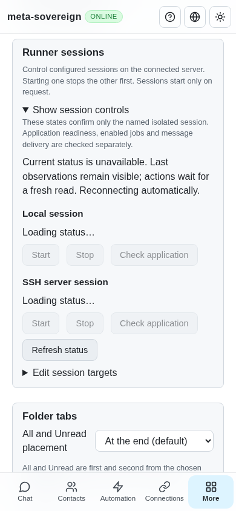
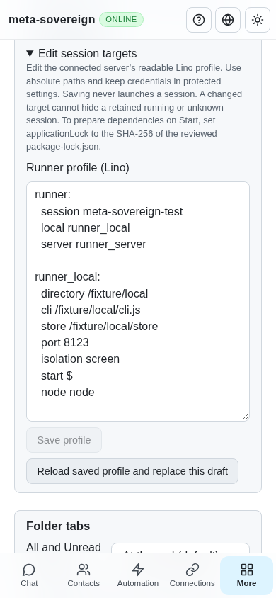
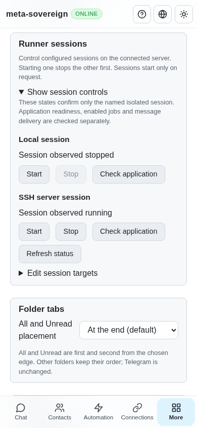

# Prepare the detached runner’s production dependencies

A fresh checkout could pass the application file check and fail the module import. Parent `328e5282` also rejected an explicit lock approval in the runner profile. A cold target remained unusable until its owner logged in and installed dependencies.

1. Provision a fresh copy of the application source on the execution host. Review that release's `package-lock.json` and compute its SHA-256.
2. In **Settings → Runner sessions → Edit session targets**, set the target's `directory` to the checkout root, `cli` to its `js/bin/meta-sovereign.js` and `applicationLock` to the reviewed digest. The CLI also accepts `--server-application-lock` and `--local-application-lock`.
3. Select **Start** while the other runner is active. The controller validates the configured lock and runs `npm ci` inside a private stage with lifecycle scripts disabled. The stage verifies the application graph before it creates the checkout's `node_modules` link. After the staged install is published, the controller loads the real graph from the original CLI path and then stops the active peer.
4. Stop and start the destination again. The lock and graph are checked again, and the prepared dependency tree is reused. A changed digest, unacceptable artifact source, incomplete graph or existing owner-managed tree preserves the active session.

- The [focused regression](../../../js/tests/runner-application-preparation.test.js) invokes native npm using the repository's small vendored dependency. The parent fails the explicit Start case. The current test verifies one cold install, warm reuse, stale approval, unauthorized artifact sources, a damaged source graph and preservation of an owner-managed dependency directory. Docker command checks bind the installation to the resolved image and SSH account.
- [Both Lino encodings and the CLI](../../../js/tests/runner-profile-api.test.js) save and reopen the review digest without starting a session. Chromium and independent Playwright MCP confirm the isolated session following real dependency preparation. In one phone run, an overlapping status request returned HTTP 409 for the initial profile read. **Reload saved profile** recovered it, and the cold and warm starts completed. The browser fixture controls the backend's session observations.
- A temporary checkout of the actual application installed the complete production recipe and loaded the worker graph. The [native experiment](../../../experiments/issue-56/runner-application-native.mjs) also runs the cold and warm path with the real OpenSSH client through a private loopback SSH fixture. The [hosted fixture](../../../experiments/issue-56/runner-docker-hosted.sh) adds native Docker installation using the same image selected for the runner and the actual application production recipe over SSH.
- The [evidence archive](data/runner-application-preparation.tar.gz) preserves the focused logs, configuration, parent source and screenshots. The [SHA-256 manifest](data/runner-application-preparation.tar.sha256.json) records each file. [npm ci](https://docs.npmjs.com/cli/v11/commands/npm-ci/) · [npm lockfiles](https://docs.npmjs.com/cli/v11/configuring-npm/package-lock-json/)

VD01 remains open for hosted exact-source evidence, reviewed source deployment and preparation of missing operating-system prerequisites.
