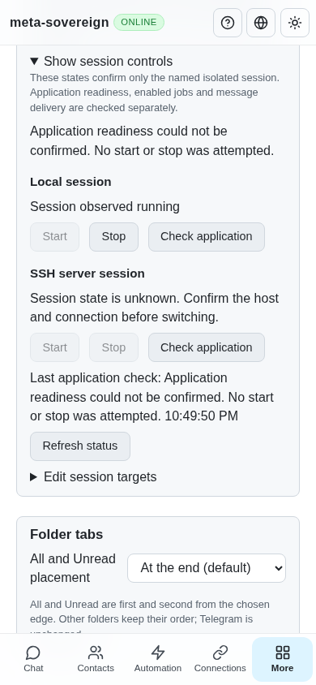
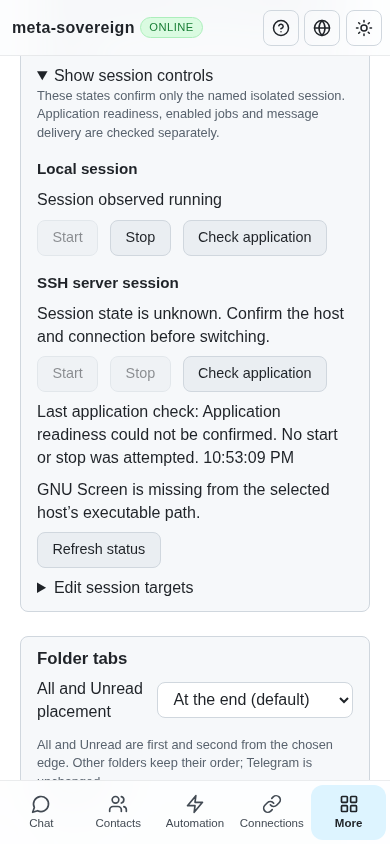

# Diagnose a runner's isolation backend before switching

Configure an SSH runner with an absent application checkout and GNU Screen
missing from the remote account's path. Keep the local runner active, then
open **Settings → Runner sessions** and select **Check application** in the SSH
section. Previously this displayed only the unconfirmed application and
session. Now it also displays the missing GNU Screen binary. Refresh status
keeps the inspection visible until the session observation changes. The local
Stop control remains available. The SSH Start control remains disabled while
the SSH session is unknown.

The session and application commands run from the configured checkout. An
absent checkout returns before either command can identify the missing tool.
For an unknown session, the new inspection performs a read from the host root,
checks the configured executable and validates the result of `screen -v` or
Docker's server-version probe. The receipt distinguishes a missing executable,
an executable with unavailable service or output, a responding backend, and
an unconfirmed lookup. The application and session remain independent. The
backend receipt includes only its kind and status. [GNU Screen manual](https://manpages.debian.org/trixie/screen/screen.1.en.html) · [Docker system info](https://docs.docker.com/reference/cli/docker/system/info/)

The portable regression fails on `a79cfdb3` because the inspection receipt has
no backend observation. It exercises all four Docker outcomes through text and
binary Lino and checks the connected CLI response. The session view regression
checks that a same-state read retains the inspection and that a changed state
expires it. A separate native experiment checks real Screen and Docker directly
and through authenticated loopback SSH. It uses an empty private path to prove
absence and an absent private socket to prove that a discoverable Docker command
can still lack daemon access. The browser fixture compares the previous and
current bundles at 1180 and 390 pixels. Independent Playwright MCP confirms
the retained diagnosis and one application-status message after HTTP 200 at
390 pixels. The remote-availability fixture logs disabled Telegram and favicon
404s plus a browser cache write failure. Every check leaves the peer running.
Node and Deno each pass 43 focused checks.
[Portable tests](../../../js/tests/runner-inspection.test.js) · [Native experiment](../../../experiments/issue-56/runner-backend-native.mjs) · [Browser experiment](../../../experiments/issue-56/runner-backend-browser.mjs)

The pinned upstream installer refuses absent GNU Screen or Docker and asks the
operator to provision it. Its automatic preparation covers the application,
Node and the launcher. The receiving account still needs a working isolation
tool. VD01 remains open for exact-source hosted lifecycle results and
verification against the supported packaged runtime targets. [Upstream SSH installer](https://github.com/konard/vk-bot-desktop/blob/8fbf3b7c42fd8e995ef137cab9b9653a7dc9b1a1/src/server/ssh-installer.js)

The [evidence archive](data/runner-backend-inspection.tar.gz) preserves parent
sources, current sources, browser captures and complete focused logs. The
[SHA-256 manifest](data/runner-backend-inspection.tar.sha256.json) lists the
verified files.
