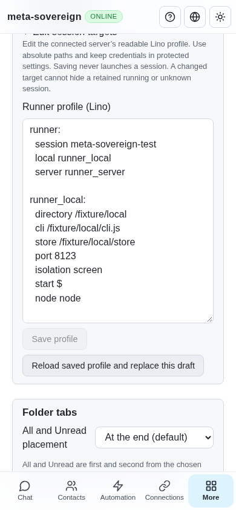
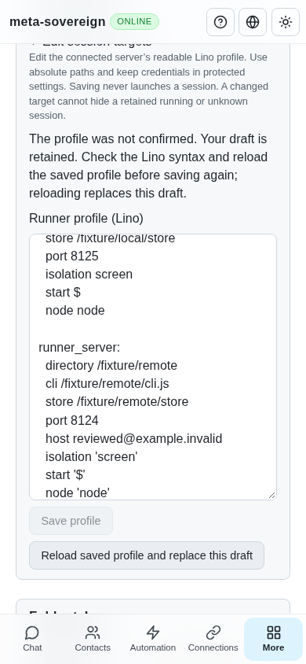
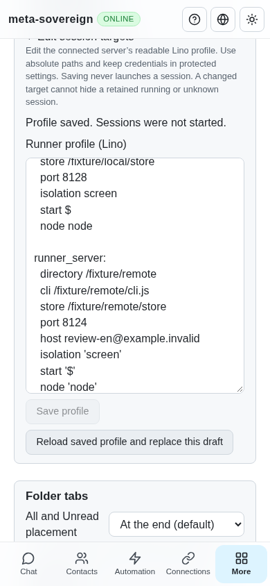

# Layered runner configuration

The desktop reference requires local-over-global readable configuration and
explicit command overrides. At published parent `0d6cec93`, the shared runner
controller read only the global profile and the CLI refused every field override.
Consequently the shared editor displayed the global port even when the app-folder
file selected a different port, and saving edited the global file.

The configuration and requirements at pinned
[`konard/vk-bot-desktop@8fbf3b7c`](https://github.com/konard/vk-bot-desktop/tree/8fbf3b7c42fd8e995ef137cab9b9653a7dc9b1a1)
were read before changing the existing runner. This implements its precedence
for runner targets; it does not accept the complete bot configuration contract.
VD07 and the other 34 unfinished criteria remain required in
[PR #57](https://github.com/link-foundation/meta-sovereign/pull/57).

## Shared behavior

The controller merges the user's global `runner.lino`, the current app folder's
`.meta-sovereign/runner.lino`, then explicit CLI fields. Supplied target fields
merge individually. Each layer is independently validated, including values
hidden by later layers. Existing bounded file reading refuses nonregular and
oversized files. Missing implicit layers remain optional; a selected `--profile`
is required and bypasses the implicit files. Empty profiles remain unconfigured.

The CLI supports session and local/server directory, CLI, store, port, isolation,
start and node fields, plus the server host. Invalid types, relative paths,
out-of-range ports, unsupported isolation and credential-shaped hosts refuse
without printing supplied content. Overrides apply only to local controller
reads/actions; connected requests and file editing refuse overrides. Neither
configuration files nor process environment are modified by these options.

The existing CLI, both Lino HTTP transports and Settings editor share the effective
profile. When an app-folder file exists, revision-checked saves write that file
with private durable permissions and preserve global bytes. A removed inherited
target receives a `false` marker in the stored local layer, preventing it from
reappearing after reload. The returned document remains the canonical effective
profile. A visible change in either layer invalidates the old revision; conflicts
retain the owner's draft and require explicit reload.

Saving does not probe, install, start or stop anything. Existing retained address
bindings and controller leases remain in place. A changed local profile cannot
redirect Stop from an already running old target or hide it from status. An
ephemeral override used for Start is likewise retained for subsequent Stop.
See [the runner guide](../../DESKTOP-RUNNER.md) for configuration examples.

## Reproduction and verification

Create a complete global fixture and a local layer containing `local.port = 8128`
and a distinct server host, then read the profile through the controller, public
CLI or HTTP. The parent returns the global port `8123`; the correction returns
`8128`. In Settings, save a changed server host and reload. The correction retains
the local port, writes only the local file and leaves the global file unchanged.
The fixtures use temporary directories, loopback HTTP and a fake process backend;
they never access the owner's application server or a live provider.

```sh
node --max-old-space-size=384 --test --test-concurrency=1 --test-timeout=30000 js/tests/runner-configuration.test.js js/tests/runner-profile.test.js js/tests/runner-profile-store.test.js js/tests/runner-controller.test.js js/tests/runner-cli.test.js js/tests/runner-profile-api.test.js
python -B experiments/issue-56/runner-configuration-parent.py
RUN_BROWSER_E2E=1 E2E_EXECUTABLE_PATH=/usr/bin/google-chrome python -B experiments/issue-56/runner-configuration-parent.py --browser
RUN_BROWSER_E2E=1 E2E_EXECUTABLE_PATH=/usr/bin/google-chrome node --max-old-space-size=384 experiments/issue-56/runner-configuration-browser.mjs
```

The finite exact-parent probe restores all four changed existing production
files in `finally`. Ten of thirteen new checks fail on that parent; the existing
global revision conflict, invalid hidden configuration and invalid CLI refusal
controls pass. All 31 focused compatibility and regression checks pass after the
change. A further focused controller check verifies the final lint refactoring.
The initial draft exposed fixture setup/assertion mistakes; those were corrected
before the retained successful runs and are not counted as product regressions.

Native Chromium captures the parent ignoring the local file, then verifies local
save/readback, another writer's conflict, draft retention, explicit reload,
closed-editor read ownership and desktop/phone fit. This scenario is also
registered in the existing mandatory `vk-token` Chromium/WebKit CI entry, keeping
all five previous scenarios. The local check runs this one relevant scenario.

Independent Playwright MCP verifies four acknowledged saves in English, Russian,
Chinese and Hindi, reload persistence without mutation replay, both layouts and
zero page exceptions. Fixture shutdown confirms unchanged global bytes, zero
process mutations, zero application health reads and closed resources. All owned
browsers, contexts and fixtures are drained. The raw MCP console retains optional
Telegram-route/favicon 404s and Chromium cache-write errors; this evidence does
not claim a clean console or live-provider acceptance.

| Parent ignores the local port                                                           | Local save retains port and leaves global intact                                     |
| --------------------------------------------------------------------------------------- | ------------------------------------------------------------------------------------ |
|  |  |





Source snapshots, exact parent bytes, focused/parent/native/MCP logs and screenshot
hashes are in the [evidence archive](data/runner-configuration.tar.gz) and its
[manifest](data/runner-configuration.tar.sha256.json). Scoped lint, formatting,
secrets, source/documentation limits and the unchanged duplication gate are checked
before publication. Hosted checks must be reviewed for the published commit.

This unit adds runner configuration precedence and overrides. Automatic dependency
preparation, full desktop execution and the complete independent bot configuration
contract remain unfinished; the inventory stays at 83 accepted and 35 unfinished.
