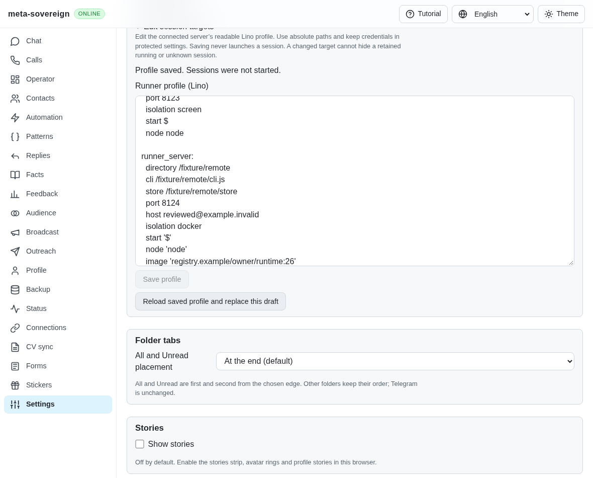

# Remote Docker runner

PR: https://github.com/link-foundation/meta-sovereign/pull/57

The pinned desktop reference permits either Screen or Docker on its SSH server,
while local execution stays Dockerless. The published `47c2b808` profile schema
accepts only Screen. Its actual production sources fail the new Docker regression
with `Runner profile unavailable or invalid.`

The shared profile now accepts an explicit server `isolation docker` and prepared
`image`, including a SHA-256 digest. Local execution and both default isolations
remain Screen. CLI overrides, revision-checked profile saves, both Lino formats
and the existing four-language profile editor use the same schema.

Launch uses start-command's documented `--isolated docker --session … --detached`
contract, an ownership label, init reaping and literal CSV-quoted application/data
mounts. A separate private store mount preserves data across explicit restarts.
The existing controller lease and positive observation rules serialize switches.
Only an exact owned running container authorizes ID-bound Stop or application
health. Missing daemon, foreign identity, ambiguous output and cancellation
refuse effects. Reuse removes only a positively observed owned exited container
by ID, without force, then confirms the name is free. There is no automatic retry.

## Verification

- Published-parent comparison: `experiments/issue-56/runner-docker-before.py`:
  one actual failure and one passing compatible Screen control.
- All 52 focused Node checks pass, covering configuration, shared controller, both profile APIs,
  application health, literal SSH transport and existing stop draining.
- All eight Docker tests pass on both Deno and Bun with limited concurrency.
- The mandatory native browser scenario saves and reloads the actual profile,
  retains an unsaved draft after another owner's revision, verifies disk state,
  checks desktop/phone layout and closes its server/browser fixtures.
- Independent Playwright MCP saves and reloads all four languages: four explicit
  saves, zero JavaScript page errors and zero session mutations. Its initial
  hand-edited probe accidentally added a duplicate `isolation` field; the probe
  was corrected to generate the canonical fixture document. Production behavior
  was unchanged by that correction.
- Hosted `native-and-container` now includes a finite real loopback SSH server,
  the pinned start-command 0.44.0, local Screen and the built application image.
  It must verify actual application readiness, mutual exclusion, idempotent
  Start, retained private data, owned restart, foreign-container refusal and
  resource cleanup. This hosted proof is pending at initial publication.

No Docker build, daemon experiment or runtime/browser matrix ran locally.
The image and compatible application dependencies must be prepared on the remote
host. Automatic dependency preparation remains VD01 work. This controller does
not publish container ports; its application health command runs inside the
observed container.

VD02 remains unfinished until the full mapped contract and hosted proof pass.
The inventory remains 86 verified / 32 unfinished; PR57 stays draft and unmerged.

