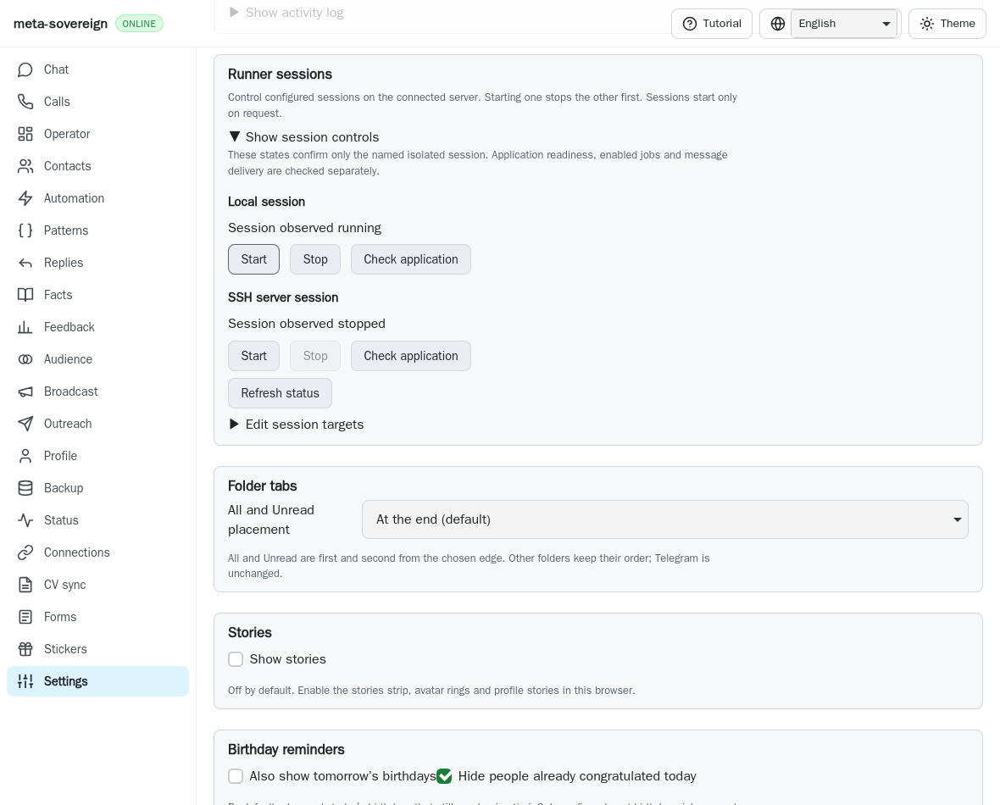
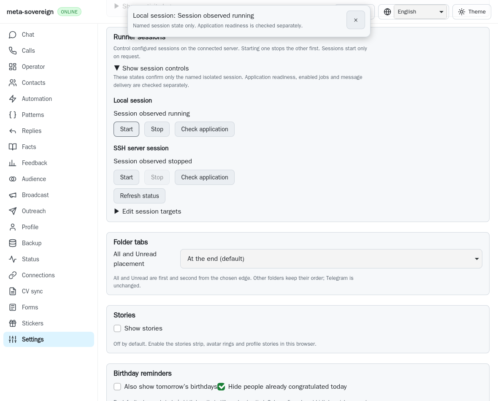
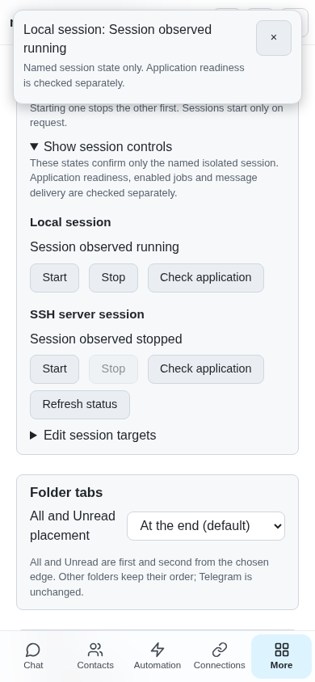

# Observed Start and Stop confirmations

The pinned desktop UI requirement asks for a floating confirmation at the top
center after Start or Stop. Published parent `a493e1cf` updated only its inline
state. The same finite browser regression captures the parent and fails while
waiting for the missing confirmation.

The shared runner owner now creates one confirmation only from an explicit
Start/Stop receipt accepted by the existing strict isolated-session validator.
Pending, refused, contradictory, lost and closed-owner results cannot announce
success. Read recovery cannot create confirmation. Matching status observations
retain its identity; conflicting observations or read failures clear it.

The confirmation identifies the local or SSH session and its observed running
or stopped state. It explicitly leaves application readiness to the separate
check. All four languages share the component and theme tokens. Its polite
status region takes no focus, fits desktop and phone viewports, closes with its
labelled button or Escape and expires after eight seconds. Dismissed feedback
cannot reappear through polling. Unmounting disposes its timer and listener.

```sh
node --max-old-space-size=384 --test --test-concurrency=1 js/tests/runner-view.test.js
npm run build:web
node --max-old-space-size=384 experiments/issue-56/runner-feedback-browser.mjs --parent
node --max-old-space-size=384 experiments/issue-56/runner-feedback-browser.mjs
```

Nine focused Node checks pass. Five assertions fail against the parent model,
including the missing positive action receipt. The owned WebKit fixture checks
held-request silence, observed results, focus, placement, dismissal, Escape,
expiry, ambiguous transport and silent recovery. It is registered in the
existing mandatory `vk-token` browser CI entry. Independent Playwright MCP
review covers translated Start/Stop in all four languages, local and SSH
fixture targets and both viewport sizes: eight synthetic mutations, zero health
reads and zero page exceptions. Unrelated Telegram-route console errors are
retained; this is not an empty-console claim. Every browser and fixture closes.

| Parent                                                                                                               | Updated shared controls                                                                                         |
| -------------------------------------------------------------------------------------------------------------------- | --------------------------------------------------------------------------------------------------------------- |
|  |  |



[Plan](runner-feedback-plan.md), [checked archive](data/runner-feedback.tar.gz)
and [hash manifest](data/runner-feedback.tar.sha256.json).

This fills the floating-confirmation part of VD06. Automatic preparation,
independent desktop ownership and every remaining desktop requirement still
need full acceptance evidence. No inventory row is accepted by this step;
all 60 unchecked criteria remain required in
[PR #57](https://github.com/link-foundation/meta-sovereign/pull/57). Hosted
verification must cover the published commit, including investigation of the
separate Windows Lino close/reopen timeout on `a493e1cf`.
