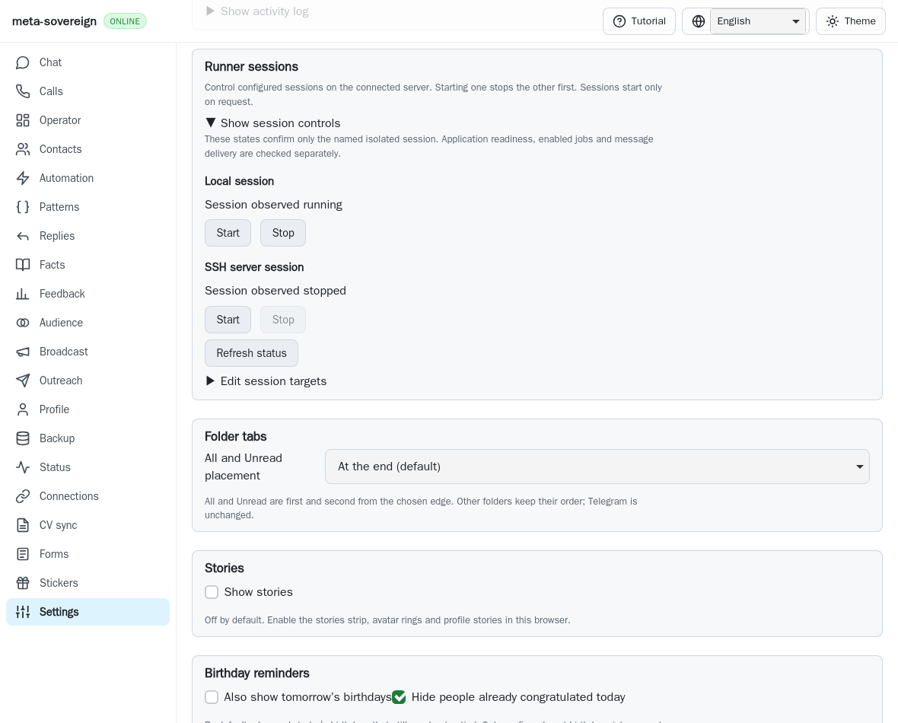
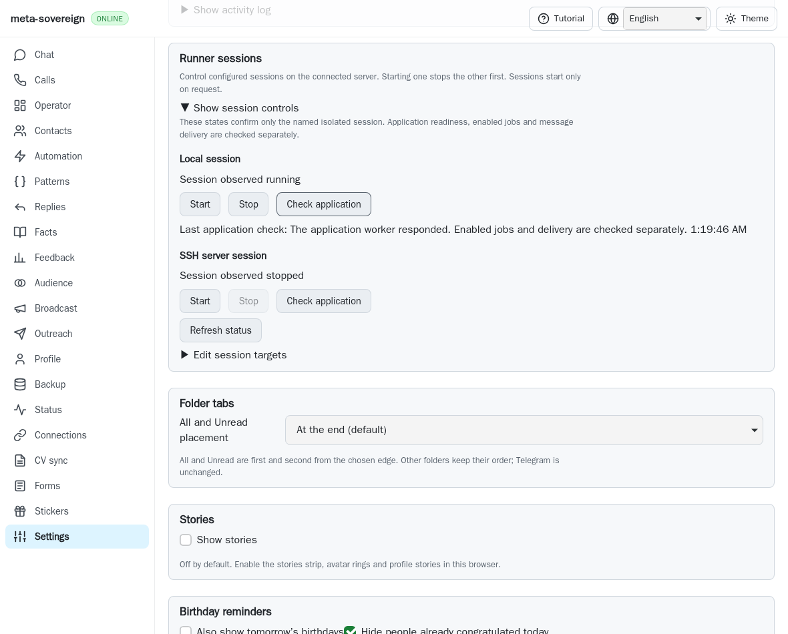
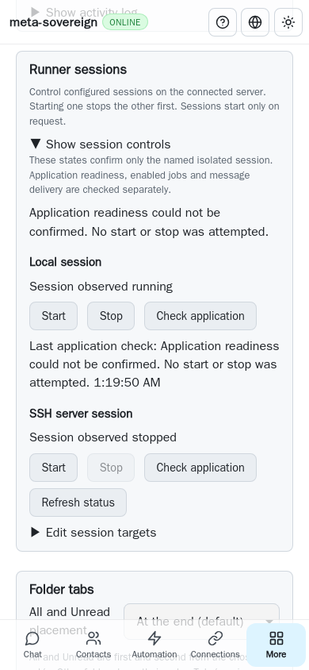

# Explicit runner application health

The pinned desktop reference requires actual local and SSH execution. Named
screen-session status alone cannot establish that the application is responding.
The published `0e595743` controls could observe a session but had no application
inspection. This step adds an explicit read without changing stopped defaults,
starting provider jobs or treating a launch wrapper's exit as application health.

`runner health --store=...` reads the selected store's private rolling-host
control channel. The host requests `/api/health` on its current owned worker
with that worker's private front token. It checks ownership before and after the
reply; startup, replacement, recovery, exit and close cannot confirm an obsolete
worker. Cached PID/port metadata and unrelated public services do not establish
health. A locked reply needs the application's service identity. Ready replies
need a positive health response and explicit storage degradation state.

The worker request has an absolute two-second deadline and 16-KiB limit. The
private control read has a 2.5-second deadline. The configured local/SSH command
has a ten-second deadline; cancellation still waits for its owned child to close
before releasing the controller lease. Absent/older hosts, malformed or noisy
replies, unavailable transport and cancellation return `unknown` without remote
diagnostics. The CLI command does not open data or read a runner profile.

`runner inspect local|server` and `GET /api/runner/inspect?mode=...` select the
configured or retained target and use the same health command on that host.
Stopped/unconfigured sessions skip application execution. Inspection preserves
the retained binding and profile-change refusal, so a health read cannot bypass
the gate on starting a changed target. Existing passcode, origin and default
text/binary Lino rules apply; duplicate selectors and arbitrary paths are refused.

Shared Settings provide **Check application** and a timestamped result separate
from session status. The panel performs only its existing session reads until
explicitly asked for application health. `ready`, `locked`, `degraded` and
`unknown` have original English, Russian, Hindi and Chinese messages. A worker
response does not claim enabled jobs or delivery. New actions or changed session
observations clear the last result; closing aborts the owner and ignores late
positive replies. No mutation is repeated during read recovery.

```sh
python -B experiments/issue-56/runner-health-before.py
node experiments/issue-56/runner-health-admission.mjs
node experiments/issue-56/runner-health-admission.mjs --api
node --test --test-concurrency=1 js/tests/runner-health.test.js js/tests/runner-inspection.test.js js/tests/runner-view.test.js js/tests/rolling-control.test.js js/tests/runner-controller.test.js js/tests/runner-api.test.js js/tests/runner-cli.test.js js/tests/runner-client.test.js js/tests/runner-control.test.js
npm run build:web
node experiments/issue-56/runner-health-check.mjs --before
node experiments/issue-56/runner-health-check.mjs
```

The exact published dispatches fail the two admission regressions: CLI exit 1
and HTTP 404. The published Settings entry fails the same finite browser case
because its inspection button is absent. Forty-six focused Node checks pass,
including a real private rolling host and worker, actual passcode lock, stale
PID after close, ownership replacement, bounded stalled replies, cancellation,
strict receipt projection, retained targets, Lino formats, CLI admission and
existing session switching. Full runtime/platform suites remain assigned to CI.

One owned WebKit scenario covers four health results, separate session status,
stopped-session skipping, closed ownership and desktop/phone fit. It is part of
the existing mandatory `vk-token` CI entry. Independent Playwright MCP checks
translated positive results in all four languages at both sizes. Four explicit
reads, zero page exceptions and zero process mutations are retained, with every
fixture and browser closed. Console evidence includes disabled Telegram-route
404s and Chromium cache-write failures; this is not a clean-console claim.

| Before                                                                                    | After                                                                                |
| ----------------------------------------------------------------------------------------- | ------------------------------------------------------------------------------------ |
|  |  |



[Four-language user guide](../../RUNNER-HEALTH.md).
[Checked evidence archive](data/runner-health.tar.gz) and
[hash manifest](data/runner-health.tar.sha256.json).

Automatic dependency preparation and independent desktop job ownership remain
unfinished. This step does not accept VD01/VD02 or any other unchecked inventory
row. All 60 unchecked criteria retain their full scope in
[PR #57](https://github.com/link-foundation/meta-sovereign/pull/57); exact-head
hosted verification is required before feature acceptance.
