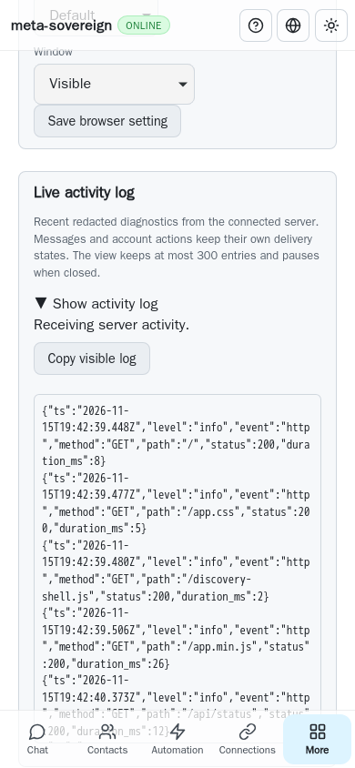
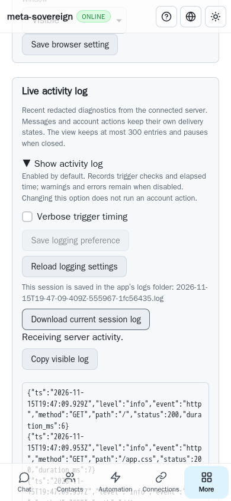
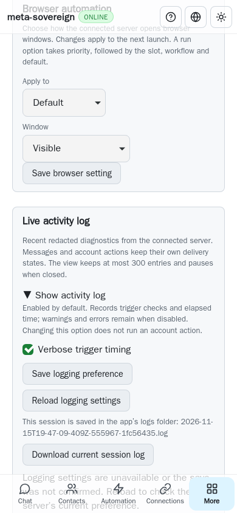

# Runner session logs and observable trigger timing

Required criterion VD14 in [PR57](https://github.com/link-foundation/meta-sovereign/pull/57)
comes from requirements 18–20 in the pinned
[desktop reference](https://github.com/konard/vk-bot-desktop/blob/8fbf3b7c42fd8e995ef137cab9b9653a7dc9b1a1/docs/REQUIREMENTS.md).
Its logger and complete requirements were read; no reference code was copied.

Previously, a successful owned runtime relied on a rotating aggregate and a
bounded memory tail. Library/desktop starts did not own an independent file.
Reproduce the failure with
`python3 -B experiments/issue-56/runner-log-before.py`: the exact parent runtime
refuses an invalid port but retains no session log. This is an actual startup
failure, not an import or syntax error. Its Settings view also lacks the new
preference and download controls.

Each owned runtime now creates a private, unique `logs/<timestamp>-<pid>-<id>.log`
before opening its store, retaining redacted startup, readiness and terminal
events. Regular-file writes complete before returning without an unbounded
stream queue. Closing waits for the actual runtime drain and flushes the file;
a failed start or close preserves its error rather than claiming success. An
unavailable aggregate sink cannot erase this independent evidence. Rolling
workers own their file before opening stores and retain live port accessors
through replacement. Provided memory stores retain their caller's ownership and
never acquire the user's logs directory or claim disk persistence.

Verbose trigger checks and completion duration default on. `serve --verbose=false`,
`MS_VERBOSE=0`, `diagnostics settings --verbose=false`, both Lino API encodings
and four-language Settings controls share the preference. A launch override
does not rewrite the saved owner setting. Explicit saves await durable
acknowledgement before applying; a failed write retains the previous setting.
Errors and warnings remain visible while verbose debug entries are disabled.
Scheduled online/personal policy checks and admitted general incoming/scheduled
automation calls record monotonic elapsed time. These diagnostics do not change
confirmation, deduplication, rate limits or provider delivery states.

Settings identifies the current filename and downloads its full redacted file.
The endpoint freezes the byte range at open, requires the existing unlock and
origin checks, accepts no arbitrary path and returns no absolute filesystem
location. The existing bounded live tail remains independently useful. A failed
save retains the draft and offers an explicit read of the acknowledged setting;
closing the section cancels its owned work.

Focused validation: 31 Node cases across the new session tests and existing
diagnostic, server-redaction and trigger-state tests; eight new cases each in
Bun and Deno. One existing rolling-upgrade case additionally verifies actual
worker replacement and preserved writes. Cases cover distinct private files,
actual startup refusal, failed close, secret redaction, aggregate failure,
verbose filtering, real Lino restart, failed flush, both encodings, finite file
download, passcode/origin refusal, memory ownership and actual trigger timing.
Lint, formatting, secret scanning and the unchanged 6.5% duplication gate pass
(6.48% observed). No full local suite or runtime/browser matrix was run.

One native WebKit case verifies saved/reloaded preferences, a full downloaded
session, draft retention after an unconfirmed save, recovery and both layouts.
Independent MCP verifies English, Russian, Hindi and Chinese, saving/reloading
and disposal at desktop and phone widths. There are no page exceptions or
unexpected HTTP errors. The fixture deliberately has no Telegram account: all
24 console errors map exactly to 404 responses from its six unrelated Telegram
settings endpoints. Both failed draft inspections and the classified final
responses are retained. Aborted reads belong to replaced documents; no provider
session or real account action is used. All owned browsers and servers close.

The pushed parent `3659e48` has four passing workflows, but its test workflow
contains a cancelled macOS job; it is not accepted as passing. Its job log shows
tests starting at line 481, over six minutes after allocation, and cancellation
at line 1590 while cases still pass. The earlier `e3a2d55` pipeline log at lines
370–373 reports cancelled test/browser jobs; available job logs are retained.
GitHub returns `BlobNotFound` for its cancelled Node job 132925832067, and both
CLI/API failures are retained. Fresh exact-head hosted verification is required.

See the [active checklist](runner-log-plan.md),
[checked archive](data/runner-log.tar.gz) and
[SHA-256 manifest](data/runner-log.tar.sha256.json). VD14 remains unchecked until
hosted validation is complete. The other 59 unchecked inventory criteria remain
required in the same PR.

Before: the bounded activity tail has no session controls.

After: acknowledged preference and full-session download.

An unconfirmed save preserves the editable draft.

