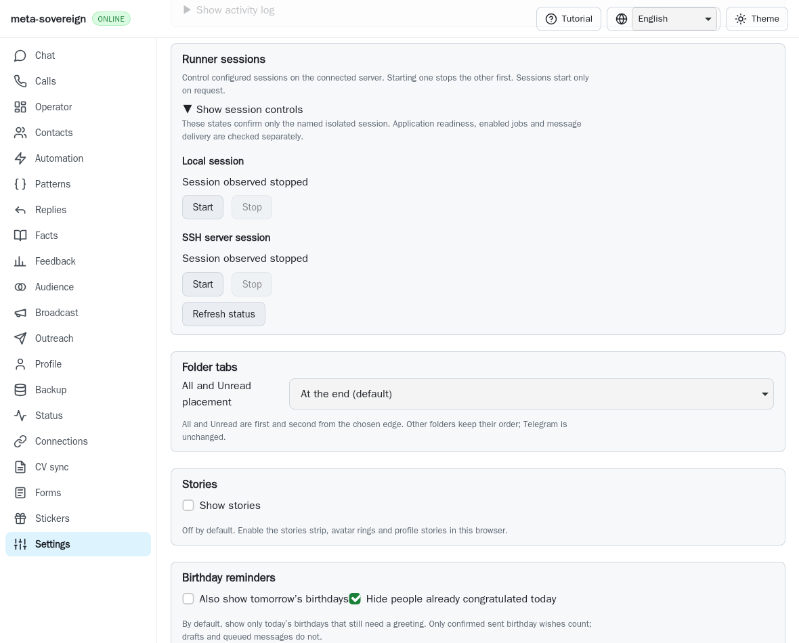
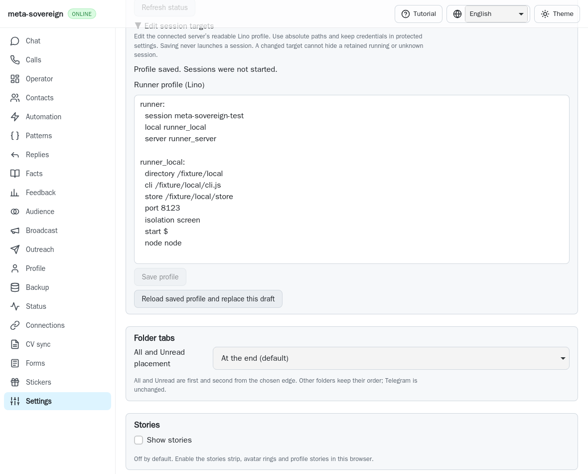
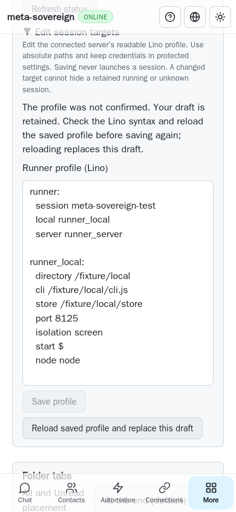

# Shared runner profile editing

The pinned desktop reference requires the runner's local/server configuration
to be editable through the shared interface. Previously its Settings controls
could observe sessions but required manual profile-file editing. The same
bounded readable Lino profile now has CLI, protected API and shared Settings
editing. The grouped disclosure uses the existing T3-inspired settings surfaces
and the product's draft-preservation and truthful acknowledgement rules. No
external implementation was copied.

`runner profile` and `GET /api/runner/profile` return the canonical document and
its SHA-256 revision. `runner configure --input=... --revision=...` and
`POST /api/runner/configure` validate the existing credential-free target schema
and durably write only at the matching revision. HTTP selects the serving user's
fixed default file; it never accepts an arbitrary profile path. CLI local mode
also supports the existing explicit `--profile`. Source documents are bounded
to 64 KiB of UTF-8, configure bodies to 128 KiB; the existing passcode, origin,
text/binary Lino and disabled-default JSON policies still apply. The same
controller lease serializes cooperating readers, writers and session actions.
Direct external file editing is outside this lease.

Reading and saving do not probe, install, launch or stop a process. Changing a
target leaves the retained durable binding intact. A running or unknown old
target still blocks new starts, and status/stop continue to address it. Tests
reconfigure a running target, prove stop uses its old address, then observe the
new address only after the old session is stopped.

The closed editor performs no reads. Opening owns one read; a save uses the
loaded revision and runs once. A conflict, refusal or lost acknowledgement
retains the owner's text and disables another save. Explicit reload is labelled
as replacing the draft. A newer edit typed while a save is pending survives the
acknowledgement, without claiming that newer draft was saved. Closing aborts
owned requests and ignores late results; a server save already accepted can
still finish, so reopening reads its actual state.

```sh
node --test --test-concurrency=1 js/tests/runner-profile-store.test.js js/tests/runner-profile-api.test.js js/tests/runner-profile-view.test.js
deno test --allow-all --no-check js/tests/runner-profile-store.test.js js/tests/runner-profile-api.test.js js/tests/runner-profile-view.test.js
node js/scripts/build-web.mjs
node experiments/issue-56/runner-profile-check.mjs --before
node experiments/issue-56/runner-profile-check.mjs
```

The exact published `060b1721` Settings entry fails the browser regression
because it has no profile editor; the new entry passes the same scenario.
Ten focused regressions cover canonical/private persistence, stale and competing
writers, failed writes, schema/size/origin/passcode/transport protection, public
CLI local and connected operation, retained targets, serialized UI saves,
uncertain writes, newer drafts and disposed owners. Existing affected runner
and locale checks also run locally with one test process at a time.

One owned WebKit scenario verifies actual save/readback, another owner's edit,
HTTP conflict with retained draft, explicit reload, read-only closed state and
desktop/phone fit. It is registered in the existing mandatory `vk-token` browser
CI entry. Independent Playwright MCP verifies acknowledged saves and translated
controls in English, Russian, Chinese and Hindi at both sizes, with zero page
exceptions and zero process mutations. Raw console evidence retains disabled
Telegram-route/favicon 404s and Chromium cache-write failures; this is not a
clean-console claim. All fixtures and browsers close, and use no live provider.

| Before                                                                                           | After                                                                               |
| ------------------------------------------------------------------------------------------------ | ----------------------------------------------------------------------------------- |
|  |  |



Automatic dependency preparation, application readiness on installed local/SSH
backends and independent desktop job ownership remain unfinished. This step
does not accept VD01–VD09 or the other unchecked criteria. All 60 unchecked
reference rows remain active in
[PR #57](https://github.com/link-foundation/meta-sovereign/pull/57).

Evidence: [archive](data/runner-profile-editing.tar.gz),
[hash manifest](data/runner-profile-editing.tar.sha256.json).
