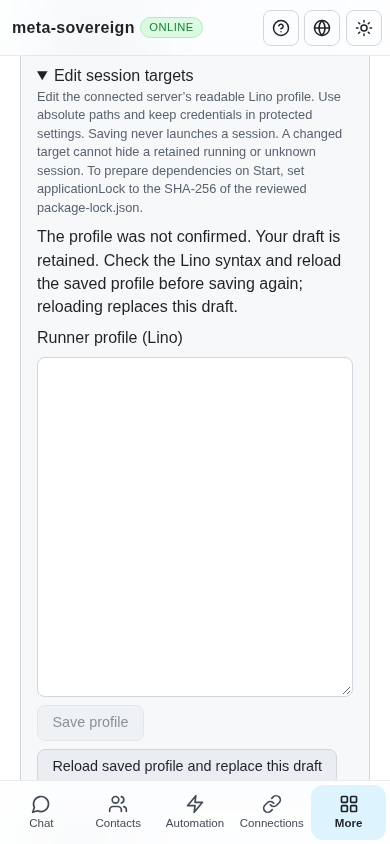
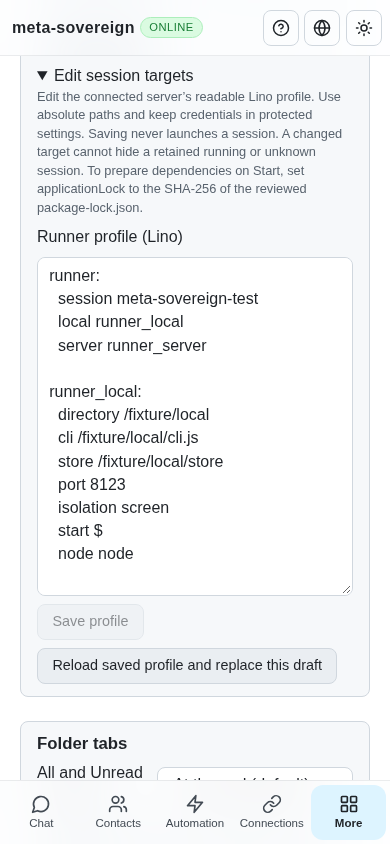

# Open saved runner targets during a session operation

In **Settings → Runner sessions → Show session controls**, open **Edit session targets** while a status check or session change holds the runner control lease. Parent `74c002e9` responds with HTTP 409 and leaves an empty, disabled editor. The profile remained unavailable until the owner requested another read. This occurred while verifying [reviewed production dependencies](runner-application-preparation.md).

The profile read now uses the saved configuration and its revision while the session operation holds the lease. The profile files are replaced atomically. **Save profile** still acquires the control lease and compares the submitted revision to the current configuration before writing. A request blocked by the lease preserves the draft.

- The [API regression](../../../js/tests/runner-profile-api.test.js) holds the actual lease. It expects a 200 and the saved revision in both Lino formats, a 409 for writes during the lease and an acknowledged save after release. The parent fails with `409 !== 200`. Node and Deno each pass 27 focused checks covering authentication, bounded inputs, stale revisions and session ownership.
- The [Chromium reproduction](../../../experiments/issue-56/runner-profile-read-browser.mjs) checks the real Settings editor with the same held lease. Independent Playwright MCP sees HTTP 200 for the saved profile and HTTP 409 for the session status, with an editable 390-pixel viewport and no profile alert. The fixture executes zero runner commands and closes its browser, server and lease.
- The [evidence archive](data/runner-profile-read.tar.gz) includes the parent and fixed source, focused logs and screenshots. The [SHA-256 manifest](data/runner-profile-read.tar.sha256.json) lists each file.

VD01 remains unfinished for reviewed source deployment, operating-system prerequisites and exact-source hosted checks.
