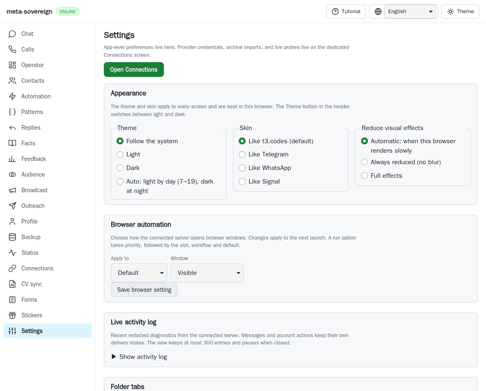
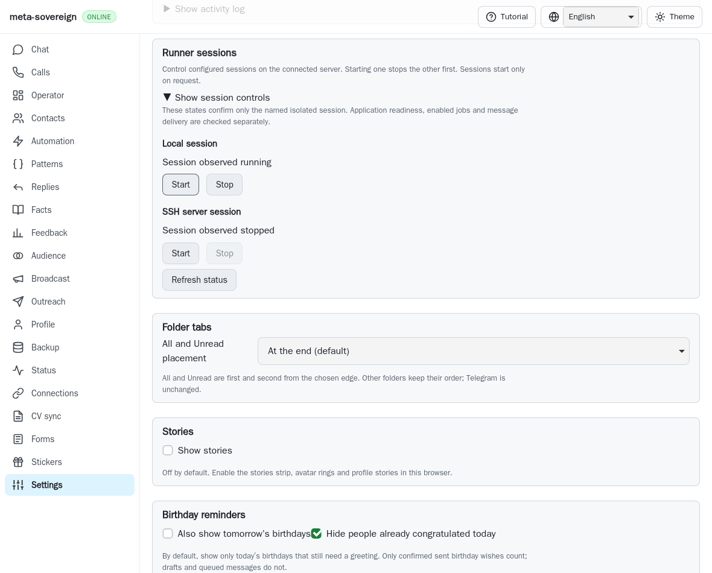
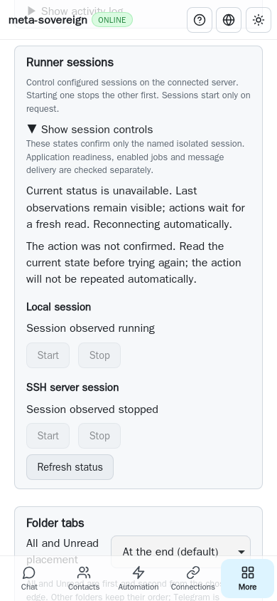

# Observed runner controls in Settings

The [runner API](runner-session-api.md) now has shared controls in the browser
and desktop Settings view. The pinned desktop reference calls for one-window
local/server switching and stopped defaults. T3 Code's grouped settings and
the shared product rules guide the restrained disclosure, spacing and recovery;
no external implementation is copied. Existing theme and language preferences
apply, including English, Russian, Chinese and Hindi.

The closed panel performs no probes. Opening starts one owned status read and
periodic observation, without starting a session or installing dependencies.
Local and SSH controls share the API's retained addresses and global lease.
An explicit start confirms the other mode stopped before observing the new
session. Unknown states, stale reads and changed/unavailable profiles prevent
unsafe starts. A positively observed running retained target remains stoppable.
The panel explicitly distinguishes session existence from application readiness,
enabled jobs and delivery. Local refers to the connected server's machine.

Pending actions retain the last observation without optimistic state changes.
A refused action can supply new unknown states, which replace stale knowledge.
A lost response keeps prior observations visible, disables further actions and
recovers through read-only status requests with bounded backoff. A mutation is
never automatically repeated. Closing the disclosure aborts its owned request
and disposes its timer; the API retains its own transport ownership until actual
completion. Closing UI controls does not imply a detached session was stopped.

```sh
node experiments/issue-56/runner-ui-parent.mjs
node --test --test-concurrency=1 js/tests/runner-view.test.js js/tests/i18n.test.js
deno test --allow-all --no-check js/tests/runner-view.test.js
node js/scripts/build-web.mjs
node experiments/issue-56/runner-ui-check.mjs
```

The real browser regression fails with the exact `aa897f69` parent entry modules
and passes with the new UI. Before screenshots were captured before the UI
edits. Thirty focused Node cases include five state/bridge regressions and the
25 existing locale checks; the five new cases also pass in Deno. Finite tests
hold an action to prove serialization, retain unconfirmed states, require a new
read after ambiguous dispatch and verify closed owners ignore late results.
The same native scenario is registered in the existing mandatory `vk-token`
browser CI entry for full hosted browser coverage.

One owned local WebKit scenario verifies both switch directions, read-only
opening, interrupted-action recovery without replay, unknown SSH refusal,
collapse and phone fit. Independent Playwright MCP verifies all four languages,
actual observed switching and desktop/phone fit, with no page exceptions.
Its raw console records expected 404s for disabled Telegram-only settings and
Chromium cache-write failures on the generated bundle; these are retained and
are not claimed as a clean-console result. The fixture uses no live provider
and closes its resources; strict changed-file lint and formatting pass.

| Before                                                           | After                                                                    |
| ---------------------------------------------------------------- | ------------------------------------------------------------------------ |
|  |  |



Automatic preparation, installed backend/SSH application readiness, shared
profile editing and independent desktop job ownership remain required. This
step does not accept VD01–VD09 or any other incomplete row. All 60 unchecked
criteria remain active in
[PR #57](https://github.com/link-foundation/meta-sovereign/pull/57).

Evidence: [archive](data/runner-session-controls.tar.gz),
[hash manifest](data/runner-session-controls.tar.sha256.json).
