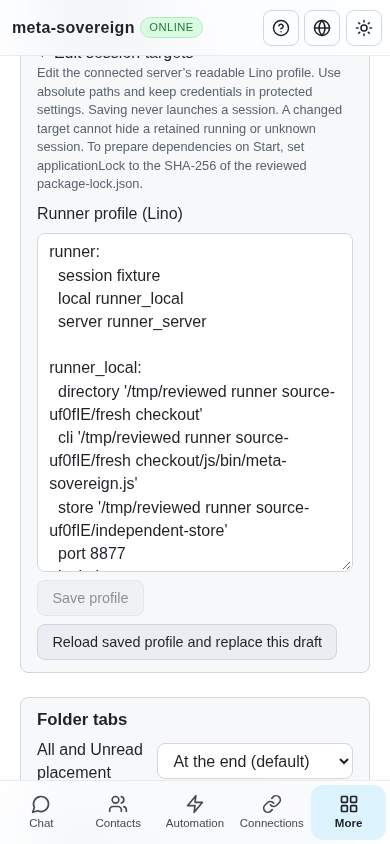
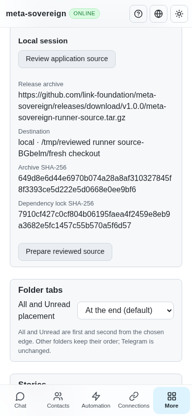
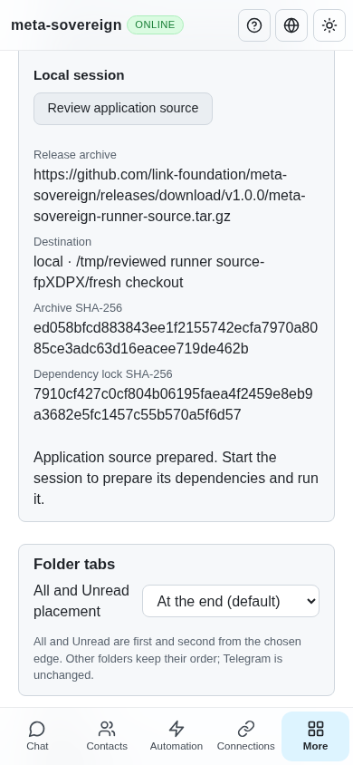

# Prepare a runner checkout from a reviewed release

Set `applicationSource` and `applicationLock` for a fresh local or SSH target,
then open **Settings → Runner sessions → Edit session targets**. The published
`0fda7770` bundle has no review or preparation action. With the updated bundle,
**Review application source** shows the release archive URL, target host and
path, archive SHA-256 and dependency lock SHA-256. **Prepare reviewed source**
uses the reviewed revision. An edit changes the revision and requires another
review. Preparing source leaves the active peer running. A separate Start
prepares dependencies and starts the selected session.

- The [portable API and CLI regression](../../../js/tests/runner-deployment-api.test.js) exercises direct and connected commands, both Lino encodings, stale approval, the controller lease, origin and passcode gates, and bounded request bodies. Preparation makes zero session commands, even with the peer running. Node and Deno each pass 44 focused checks, including the release recipe and lockfile integration.
- The [native experiment](../../../experiments/issue-56/runner-deployment-native.mjs) packages tracked files from a real commit. A modified archive is refused before publishing. The reviewed archive prepares a fresh owner directory, verifies the dependency graph and is reused without another download. An existing owner directory stays intact. Both the temporary production checkout and real loopback SSH pass. The private HTTP fixture supplies the archive bytes in these runs. The tool retains its production URL and digest checks.
- The [browser experiment](../../../experiments/issue-56/runner-deployment-browser.mjs) compares the parent and current Settings bundles at desktop and phone widths. The current bundle issues one review GET with zero downloads and one approved POST followed by a single download. Independent Playwright MCP confirms the same sequence with HTTP 200 at 390 pixels. The independent browser reports fixture favicon and Telegram 404s and one browser cache-write failure. Both browser and API fixtures close with the peer running.
- The [release workflow](../../../.github/workflows/desktop-release.yml) packages the source from the GitHub release tag, adds the archive and Lino recipe to the release checksums and includes them in the existing attestation. Pull requests only build an archive for verification. The hosted SSH/Docker fixture exercises the actual production source and lock when its workflow runs.
- The [evidence archive](data/runner-source-deployment.tar.gz) contains the source snapshots, logs and screenshots. Its [SHA-256 manifest](data/runner-source-deployment.tar.sha256.json) lists each verified file.

VD01 remains open for operating-system prerequisites and exact-source hosted
verification. The draft pull request publishes no release assets.
