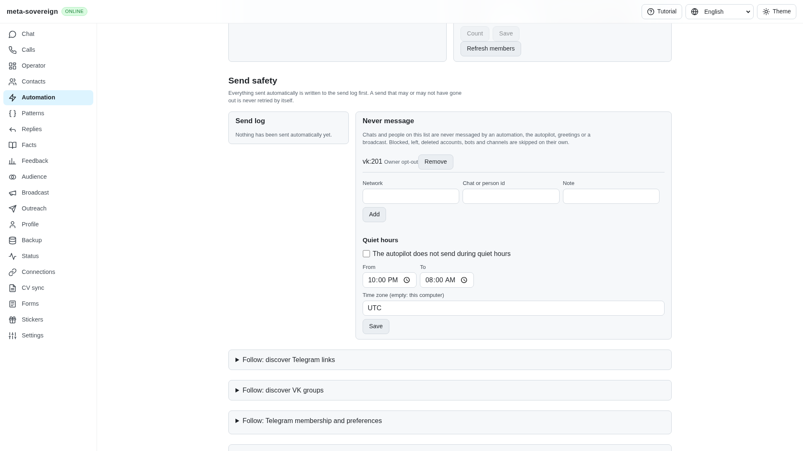
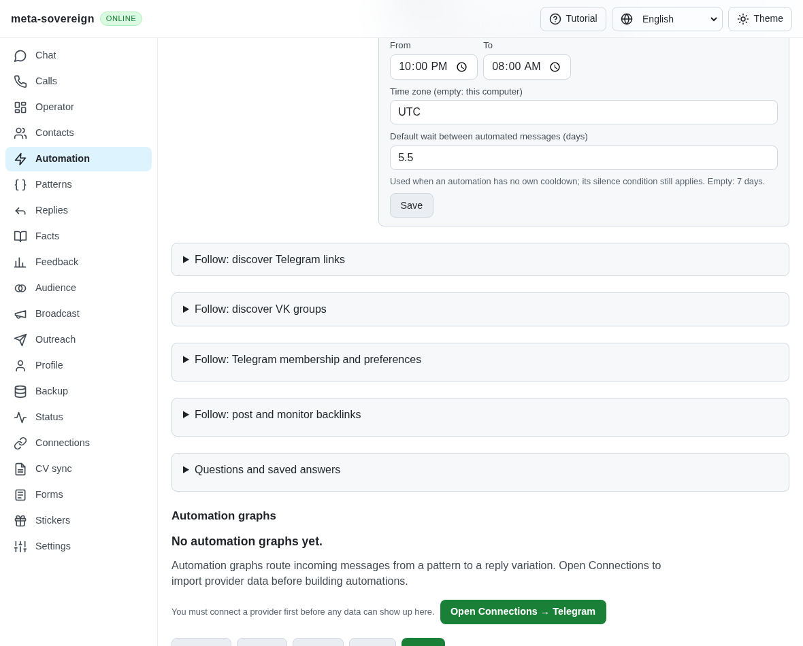
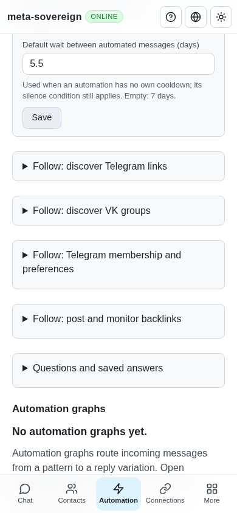
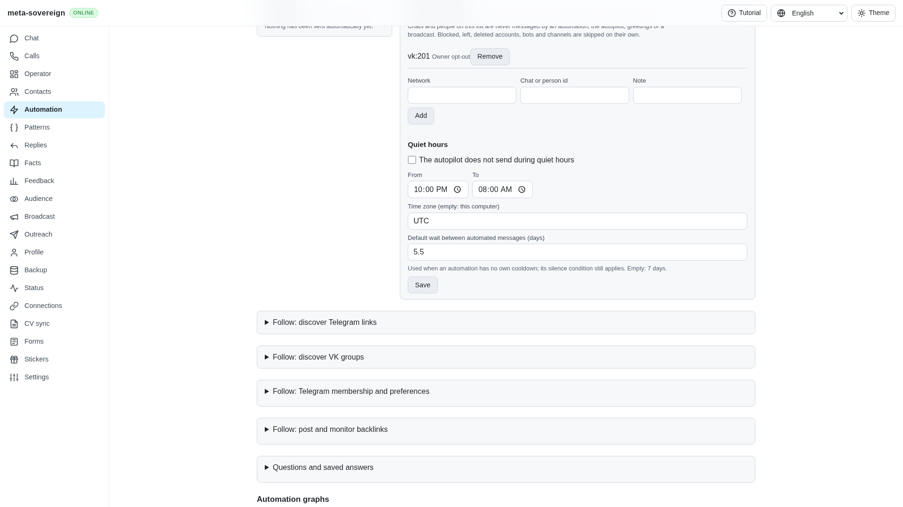

# Shared cooldown control (QA19)

The shared automated-message cooldown could be changed through the API and
[CLI](safety-cli.md), but the safety panel could not show or edit it. The bounded
native regression fails against the previous bundle because the control is
absent; independent MCP inspection records zero matching controls.

The Automations safety panel now shows the acknowledged global value. Owners
can save zero or more days, including fractions, or leave it empty for the
seven-day default. Each automation's explicit cooldown still takes precedence;
its silence condition still applies. This edits the same record as the CLI and
Lino API, keeping opt-outs, quiet hours and timezone intact. Invalid input
disables Save without sending a request. Pending and failed writes retain the
[acknowledgement safeguards](safety-settings-acknowledgement.md).

To reproduce, open Automations with a connected workspace whose global
`cooldownDays` is 7. The previous UI has no cooldown control. In the corrected
UI, save 5.5, reload and inspect the retained value, then clear it to restore the
default. A negative value shows a translated error and sends no write.

All 48 focused portable checks pass and cover fractional boundaries, explicit automation
precedence, longer silence conditions, default reset, all four translations,
shared CLI persistence, acknowledged settings and existing send guards. The
native `verifySafetyCooldown` scenario uses an owned default-Lino server and
verifies two acknowledged writes and two reloads, invalid-input refusal,
unchanged safeguards, no page exceptions and zero provider sends. It is part of
the existing safety-settings entry in both CI browser engines; local validation
uses only installed Chromium. Independent Playwright MCP confirms the retained 5.5-day value after reload, all four translations and a phone viewport without overflow. Both owned MCP fixtures drain with zero sends. Its retained console log includes resource errors from the stopped parent fixture, a missing favicon and a cache-write error; there are no JavaScript page exceptions in the corrected inspection.

```sh
node --test --test-concurrency=1 js/tests/safety-cooldown.test.js js/tests/safety-cli.test.js js/tests/safety-settings-acknowledgement.test.js js/tests/send-safety.test.js
RUN_BROWSER_E2E=1 E2E_EXECUTABLE_PATH=/usr/bin/google-chrome node js/tests/e2e-safety-settings-browser.mjs
```

Before, the shared value is unavailable in the panel:



After, the saved fractional value and default explanation are visible:





The [source/log archive](data/safety-cooldown.tar.gz) and
[per-file manifest](data/safety-cooldown.tar.sha256.json) retain the exact parent
component, missing-control failure and corrected verification. Evidence remains
bounded to synthetic owned fixtures with no live provider access.

This completes one missing UI control, not the full per-system and per-chat
criterion. The acceptance checkpoint remains **82 of 118**, with **36
unfinished**. Full QA19, QA20 and every other unchecked criterion, plus every
exact-head hosted workflow, remain required in
[draft PR #57](https://github.com/link-foundation/meta-sovereign/pull/57).
