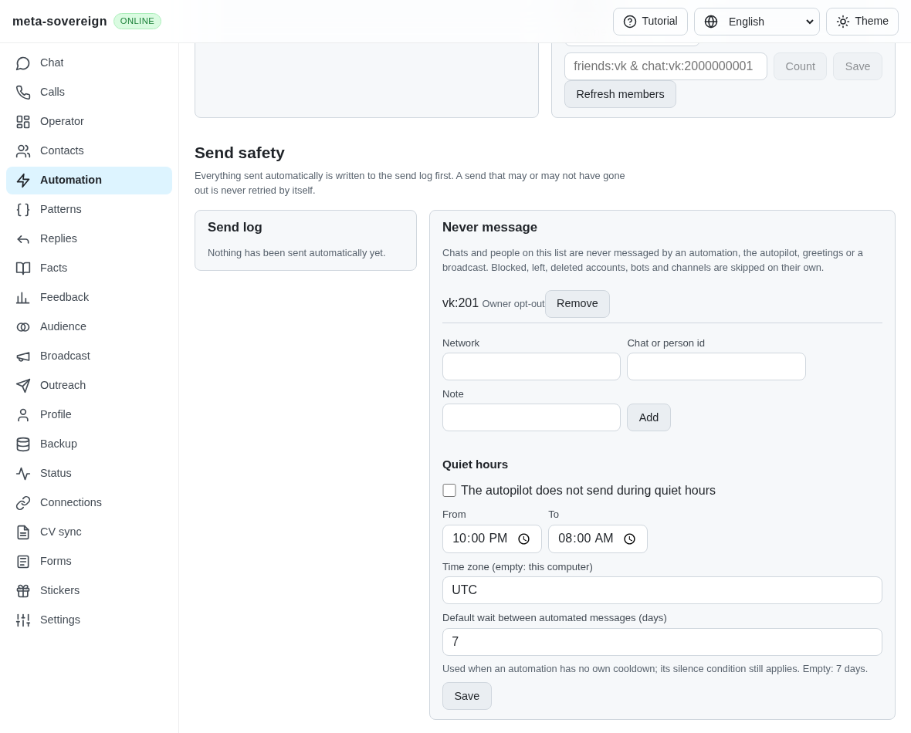
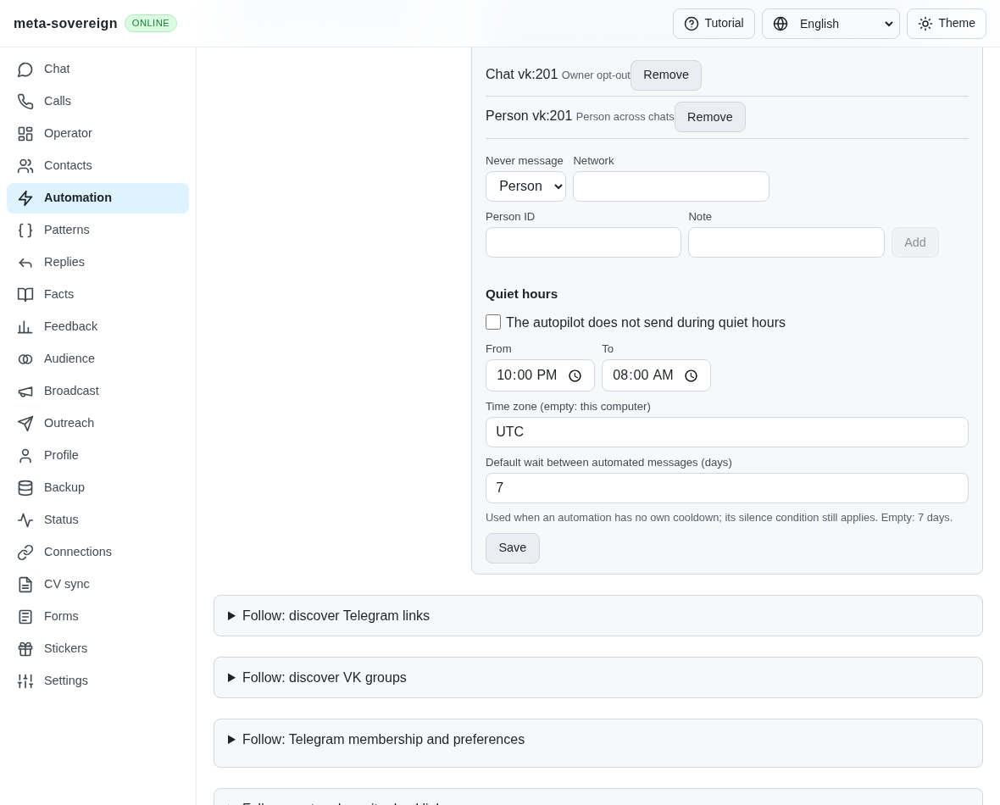
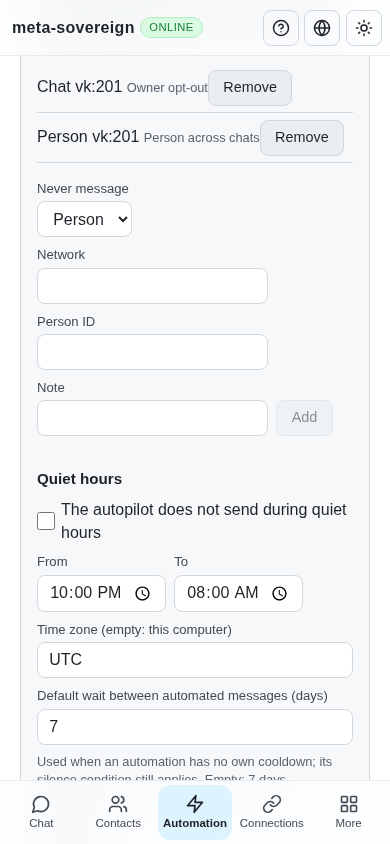
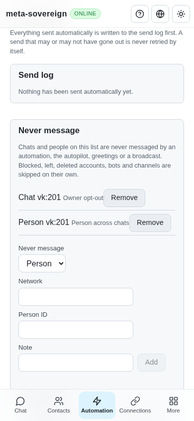

# Distinct chat and person opt-outs (QA19)

The safety panel labelled its identifier field “Chat or person id”, but always
wrote `chat`. A person opt-out available through the shared CLI and Lino API
could not be created in the UI. Its row key also conflated a chat and person
with the same provider and identifier, and its display hid that distinction.

To reproduce, open Automations with a connected workspace, choose a person to
exclude across chats and inspect the resulting settings. The previous panel
offers no person selector and writes a chat entry. The bounded native regression
against the previous bundle fails after ten seconds waiting for the missing
selector; independent Playwright MCP records zero scope and person controls.

The panel now offers explicit Chat and Person scopes with translated identifier
labels in all four interface languages. It submits only the selected scope,
retains separate identifier drafts while switching scopes and clears them only
after acknowledged persistence. A refused save preserves the selected scope,
identifier and note. Existing entries display their actual scope, including
legacy entries containing both fields. Distinct row keys preserve a chat and
person sharing the same identifier; removing either retains the other.

The focused portable checks pass **46 tests**, including actual shared-store
guards for same-ID chat/person exclusions, provider isolation and precise
removal, existing acknowledgement failures, CLI persistence and translations.
All three existing safety browser scenarios pass on installed Chromium. The
new scenario verifies one refused write with retained drafts, two acknowledged
writes, two reloads, the exact saved person record and precise removal while
preserving every other safeguard. It is registered in the existing mandatory
safety-settings entry for both hosted browser engines.

```sh
node --test --test-concurrency=1 js/tests/safety-person.test.js js/tests/i18n.test.js js/tests/safety-settings-acknowledgement.test.js js/tests/safety-cli.test.js
RUN_BROWSER_E2E=1 E2E_EXECUTABLE_PATH=/usr/bin/google-chrome node js/tests/e2e-safety-settings-browser.mjs
```

Independent Playwright MCP confirms both rows survive a reload, person removal
preserves the chat row, all four translated controls render and the phone
viewport has no horizontal overflow. Corrected inspection has no JavaScript
page exceptions; the console records a missing favicon and a cache-write error. Both
owned inspection servers drain with zero sends and no live provider access.
The focused guard test uses synthetic sender calls only.

Before, the ambiguous field cannot create a person exclusion:



After, the same identifier has distinct chat and person entries and controls:





The [checked source/log archive](data/safety-person.tar.gz) and
[per-file manifest](data/safety-person.tar.sha256.json) preserve 53 entries: the exact parent
component, missing-control failure, native receipts and independent inspection.
Archive integrity is separate from complete criterion acceptance. The inventory
remains **83 of 118 accepted, 35 unfinished**; full QA19 and every other unchecked
criterion remain required in [draft PR #57](https://github.com/link-foundation/meta-sovereign/pull/57).
Exact-source hosted verification of this UI change remains pending.
