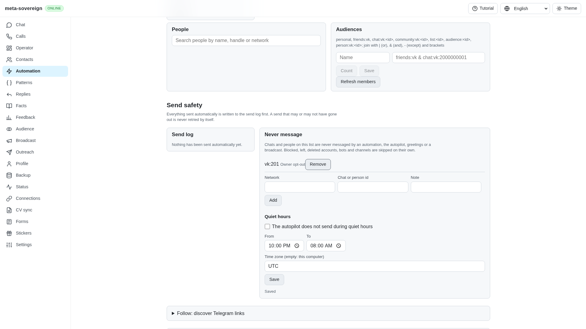
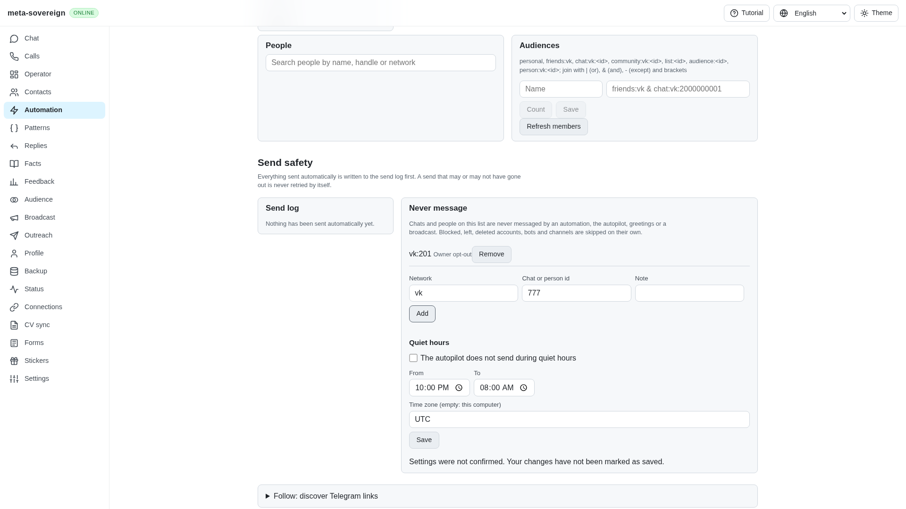
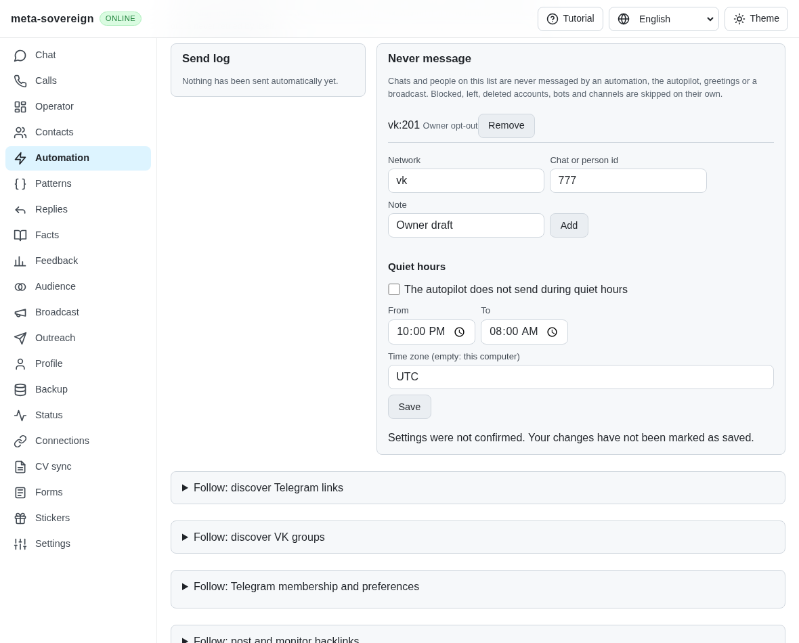
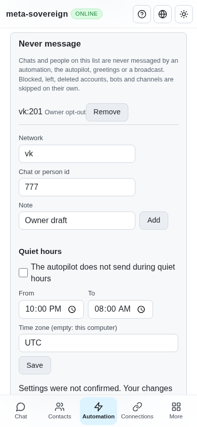

# Acknowledged automation safeguards (QA19/QA20)

This correction supports the unfinished safeguards and recovery requirements in
[issue #56](https://github.com/link-foundation/meta-sovereign/issues/56).
The acceptance checkpoint remains **82 of 118 verified, 36 unfinished**.
[PR #57](https://github.com/link-foundation/meta-sovereign/pull/57) remains draft
and unmerged; this evidence does not accept either complete criterion.

## Reproduction and cause

At parent `62e7c474`, saving automation safeguards admitted a replacement record
without awaiting `flush`. A storage refusal could leave an opt-out removed from
memory. A send guard could read that unacknowledged change. Four focused parent
regressions reproduce rejected admission, rejected flush, a concurrent guarded
send and the absent flush barrier.

The browser also wrote a local copy before the connected request. Its convenience
transport collapsed a refused response into the same value as an absent server.
The panel displayed **Saved** and cleared the owner's draft despite HTTP 400.
Five web API tests fail against the exact parent module. Independent Playwright
MCP inspection reproduces the false Saved message using the real protected
settings route and an intentionally refused storage flush.

## Correction

- Reuse the existing acknowledged-record writer and per-store queue. Reads wait
  for admission and flush, or rollback, before a send guard evaluates safeguards.
- Require a successful, normalized matching receipt from a connected server.
  Refused, missing, malformed and lost replies retain an error; they never become
  an offline save. Explicit offline operation still uses acknowledged storage.
- Disable controls while saving, retain opt-outs and owner drafts after failure,
  and show Saved only after acknowledgement. Reload reads actual server state;
  it never repeats an uncertain write. Error text is available in all four locales.

The shared loading, acknowledgement and recovery behavior follows
[the product vision](../../PRODUCT-VISION.md) and the pinned interaction direction
in [Chat References](../../CHAT-REFERENCES.md). No reference implementation code
was imported.

## Focused verification

The 46 passing checks cover the twelve new regressions, existing automation API
behavior and existing send safeguards. Actual Lino file close/reopen retains
settings. Actual default-Lino HTTP routes refuse failed persistence, preserve the
previous opt-out, reject a foreign origin and return a matching successful receipt.

```sh
node --test --test-concurrency=1 js/tests/safety-settings-acknowledgement.test.js js/tests/automation-api.test.js js/tests/send-safety.test.js
RUN_BROWSER_E2E=1 npm run test:e2e:safety-settings
```

The native Chromium scenario uses the actual UI and Lino routes. It verifies a
pending disabled panel, a rejected flush retaining all draft fields and the old
opt-out, a successful save clearing the draft, then a lost reply after a committed
removal. Reload obtains the committed state. Exactly three PUTs occur: recovery
does not replay the mutation. There are zero page exceptions or provider sends.
The same mandatory entry is registered for Chromium and WebKit in hosted CI.

Independent MCP inspection changes the parent result from `shownSaved: 1` after
HTTP 400 to `shownSaved: 0`, retaining chat draft `777` and opt-out `201`. All
owned browsers and fixture servers were closed. The first fixture invocation
also started an imported helper's command-line server; both were drained, and
the fixture now uses its own unique command-line flag. Expected HTTP refusal,
cache and favicon console diagnostics are retained separately from page errors.

| Parent: refused write reported saved                                         | Corrected: draft retained and refusal shown                                    |
| ---------------------------------------------------------------------------- | ------------------------------------------------------------------------------ |
|  |  |





## Evidence boundary

The [source and log archive](data/safety-settings-acknowledgement.tar.gz) and
[per-file hashes](data/safety-settings-acknowledgement.tar.sha256.json) retain the
parent failures, corrected checks, native/MCP receipts and source snapshots (80 checked entries).
An initial ESLint invocation omitted the repository's explicit config argument;
its tooling error is preserved separately from the corrected configured check.
The focused native run uses the existing system Chrome because the Playwright-managed binary is absent; that environment failure is retained separately. The tests use owned local fixtures and zero live provider actions. Full QA19 and
QA20 mappings, remaining provider behavior and exact-source hosted acceptance
remain required. Passing these checks alone does not complete issue #56.
