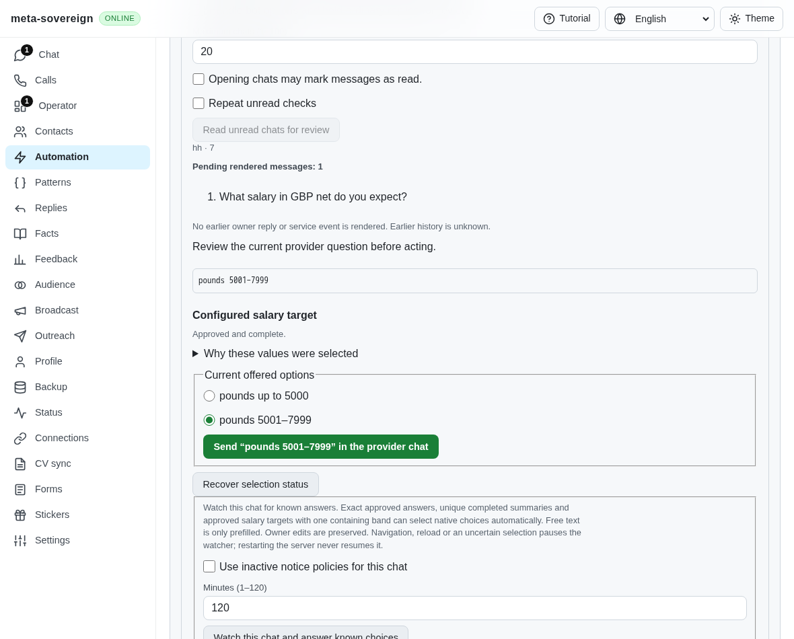

# Configured currencies in saved salary bands

In [PR #57](https://github.com/link-foundation/meta-sovereign/pull/57), set an
approved GBP 6000 net target and save the exact answer `pounds up to 5000`.
Inspect that question with choices `pounds up to 5000` and `pounds 5001–7999`.
Published parent `935fbf8e` keeps the old value for review rather than applying
the current target. Its saved-answer guard contains a fixed currency list.

The guard now uses the existing configured currency vocabulary. Complete aliases
are removed before shorter currency words; otherwise `CREDITS` removes only the
last word of `loyalty credits`. Unknown-currency detection examines the remaining
text, so configured `Canadian dollars` does not become unconfigured USD.
An additional explicit USD choice still holds the entire CAD decision. Personal
explanations and conflicting specific amounts keep their existing review rules.

Four focused tests fail against the exact parent modules. The corrected tests
cover seven configured currencies and their aliases, unchanged source rules,
foreign choices, personal wording, saved amounts and read-only CLI/offline/both
Lino transports. All 33 selected salary checks pass. The unchanged browser
budget contract requires all four salary scenarios once; no deadline or engine
was removed.

Native Chromium shows the old value before the fix and the current containing
band afterward, then confirms one native choice receipt and no text sends.
Independent Playwright MCP reproduces the parent watch holding for review and
verifies message receipt `102` after the fix. Both fixtures close all owned
resources. The MCP console contains only the fixture's missing favicon (404).

| Published parent                                                           | Configured numeric target                                               |
| -------------------------------------------------------------------------- | ----------------------------------------------------------------------- |
|  |  |

[Hashed evidence](data/salary-band-currencies.tar.gz) retains the parent modules,
reproductions, raw native/MCP receipts, changed sources and scoped checks.
Complete QA15 acceptance still requires the full contract mapping and hosted
results. All 40 unchecked original criteria remain required; PR #57 stays draft
and unmerged.
