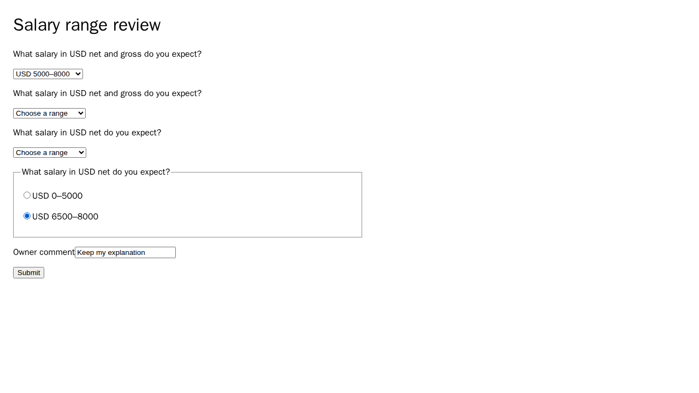
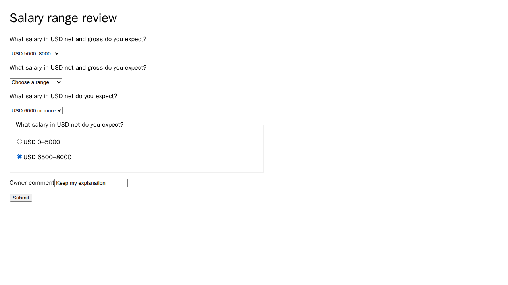

# Preserve numeric salary-band units and boundaries

The complete numeric audit of the pinned [salary-option implementation](https://github.com/konard/hh-job-application-automation/blob/fa0991b8c2d0896fb3b4be6c69947f0590094b15/src/salary-options.mjs)
and its salary/chat tests found five reproducible gaps at parent `246bf5e6`.
Grouped decimal points were read as decimal fractions, English and Cyrillic
scale words were missing, a shared scale multiplied already expanded amounts,
inclusive floors excluded their exact boundary, and negated ranges could be
accepted. Treating `6000 or more` as exclusive also incorrectly selected a
different band at a shared inclusive boundary.

The shared planner now reads comma/dot thousands groups, decimal amounts,
English scale words and Cyrillic abbreviations. It inherits a unique common
scale only for an abbreviated endpoint below 1000. Inclusive and exclusive
comparisons retain distinct bounds, including mathematical labels, and use
Unicode word boundaries. Negated and malformed ranges stay unresolved.
Explicit interval syntax, currency/basis/period guards, unique containment,
reviewed nearest-band behavior and native delivery guards remain in place.

Reproduce all five parent failures with a bounded, single-worker check:

```sh
node --max-old-space-size=384 \
  --import ./experiments/issue-56/salary-band-numbers-before.mjs \
  --test --test-concurrency=1 js/tests/salary-band-numbers.test.js
```

The repaired draft passes 52 focused salary, vocabulary, template, priority and
strict-option tests. The existing mandatory native form scenario fails on the
parent and passes after repair, retaining the existing closed-band select,
reviewed nearest radio and ambiguous alternative assertions. It adds an exact
inclusive floor and verifies three positive readback receipts, preserved owner
text, no extra events on retry, a closed browser and zero submissions.

Independent Playwright MCP checks use the production Forms UI and Lino API
against isolated fixtures. On the parent, the inclusive floor is only a nearest
candidate requiring extra review; it is not classified as containing 6000.
The parent run applies the two existing fields and leaves this floor untouched.
After repair, it is a containing candidate and explicit Apply writes all three
selected fields. The screenshots show these deliberately different reviewed
selections; no native write or submit occurs during planning.

Parent, after reviewing the two existing fields:



After repair, with the inclusive floor also explicitly selected for Apply:



Both independent runs record actual field values, stable retry receipts,
preserved owner text, closed owned reviews and zero submissions. The initial
MCP assertion incorrectly expected no parent proposal: reviewed forms permit
nearest candidates. That failed probe and its clean shutdown remain in the
archive; the corrected probe verifies the actual containing/review distinction.
The parent browser console records `ERR_CACHE_WRITE_FAILURE` for the bundle;
the application completed the flow. The repaired console capture has no errors.
No live account, full local suite or local browser matrix was used.

The checked [evidence archive](data/salary-band-numbers.tar.gz) retains exact
parent/source bytes, Git-blob-verified pinned references, focused/native logs,
MCP receipts and inspected PNGs. Hosted CI on preceding `13806114` exposed a
macOS runtime deadline and a busy DMG detach; their logs are preserved for the
separate CI correction. This finite salary change leaves full QA15 acceptance
and all forty unchecked original criteria required.
[PR57](https://github.com/link-foundation/meta-sovereign/pull/57) remains draft
and unmerged.
