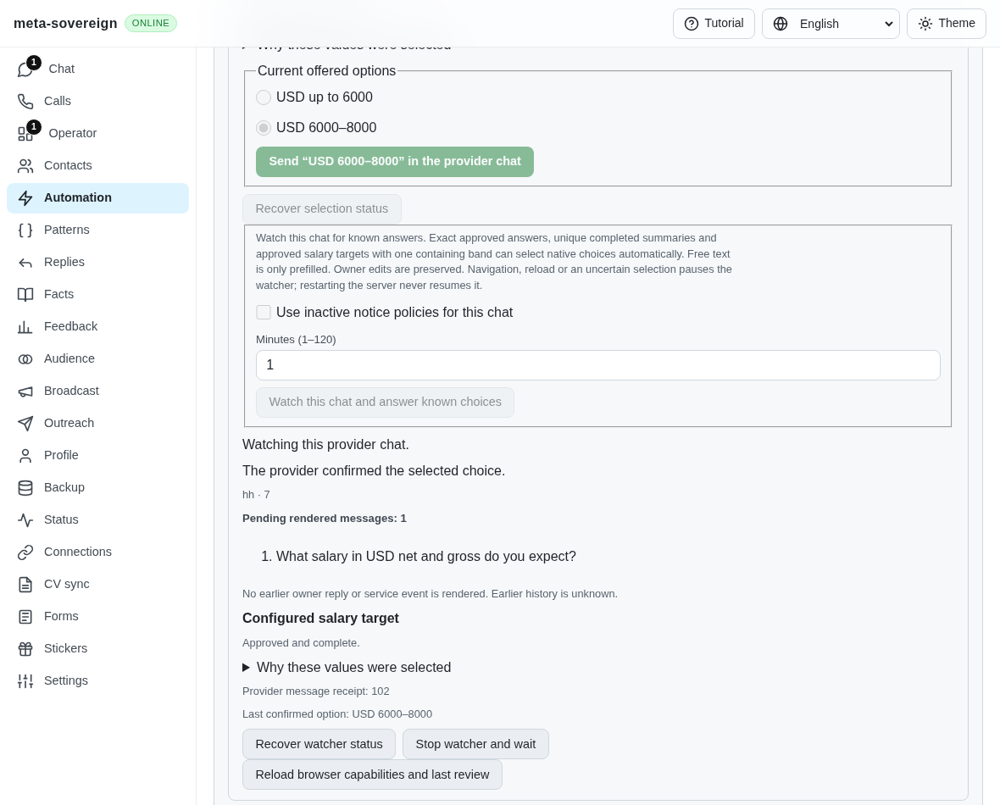
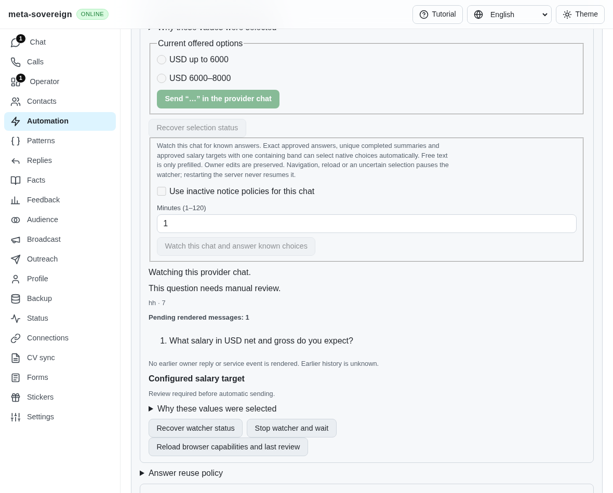

# Overlap for an individual salary target

The pinned salary-option implementation resolves each configured target to one
unique containing band before requiring both targets to select the same band.
In [PR #57](https://github.com/link-foundation/meta-sovereign/pull/57), published
parent `93271fee` instead intersects the matches first. With USD 6000 net and
7100 gross, `USD up to 6000` and `USD 6000–8000` overlap for net. Only the second
contains gross, so the parent incorrectly approves it for automatic selection.

The shared matcher now refuses an overlap for either target before resolving
their common band. This also holds reviewed form proposals. Exclusive endpoints,
equal targets in a unique band, nearest single-target form proposals and the
existing foreign-currency, amount, approval and owner-draft checks remain covered.

Three regression tests fail on the exact published parent; the positive control
passes there. Thirty selected salary checks pass after the correction, including
CLI, offline and both Lino previews with unchanged stored records. Reproduce with
`node --test --test-concurrency=1 js/tests/salary-band-overlap.test.js`; add
`--import ./experiments/issue-56/salary-band-overlap-before.mjs` for the parent.

Native Chromium reproduces one incorrect parent selection with message receipt
`102`, then confirms manual review with zero selections after the fix. Independent
Playwright MCP obtains the same two outcomes. Both final MCP fixtures report
closed resources and zero text sends. Their only console error is a missing
fixture favicon. An initial noninteractive invocation had closed stdin and could
not receive its cleanup input; its owned browser was closed and its remaining
Node process terminated. That interrupted log is retained separately, and only
the repeated interactive run establishes successful cleanup. Two initial native
invocations omitted `RUN_BROWSER_E2E=1`; their explicit skip logs are also retained
and are not verification evidence.

The overlap scenario is awaited inside the existing mandatory salary-watch
scenario. A workflow contract requires this call. The group still has four
registered scenarios and its unchanged three-minute budget on both engines.
Full hosted results and the complete QA15 mapping remain required. All other
unchecked original criteria remain active; PR #57 stays draft and unmerged.

| Published parent                                                               | Corrected review hold                                                                     |
| ------------------------------------------------------------------------------ | ----------------------------------------------------------------------------------------- |
|  |  |

The [checked archive](data/salary-band-overlap.tar.gz) and adjacent SHA-256
manifest retain parent bytes, regressions, native/MCP receipts, scoped checks
and screenshots. The original contract is
[`salary-options.mjs`](https://github.com/konard/hh-job-application-automation/blob/fa0991b8c2d0896fb3b4be6c69947f0590094b15/src/salary-options.mjs).
