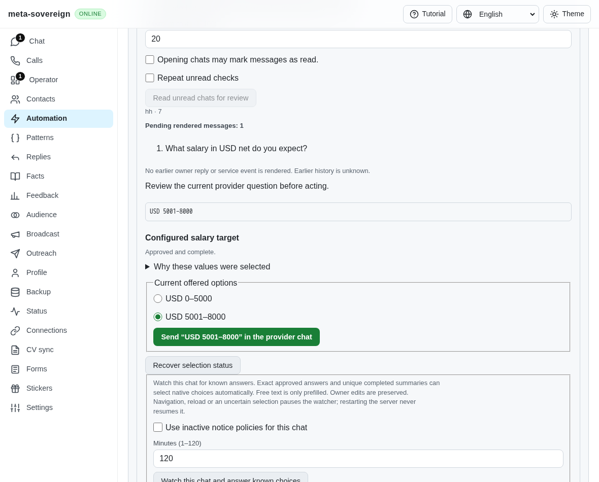
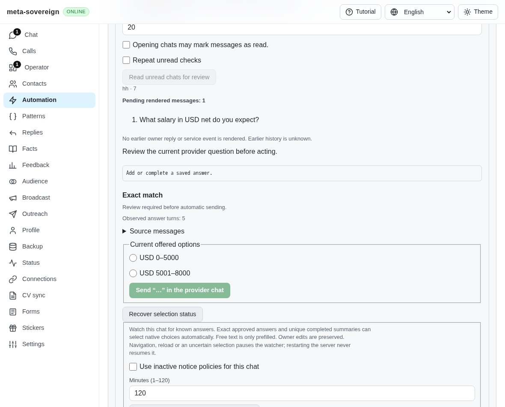

# Saved amounts and mixed-currency salary bands

The pinned chat-option contract requires review when an exact approved saved
amount differs from the configured baseline and is not itself an offered option.
It also leaves numeric bands unresolved when an explicit currency conflicts.
The reference is `konard/hh-job-application-automation` at
`fa0991b8c2d0896fb3b4be6c69947f0590094b15`, particularly
`tests/chat-options.test.mjs`, `tests/salary-options.test.mjs` and their source.
Those files were read in full; their authenticated source hashes are preserved
with the preceding numeric-band evidence.

On `ba17dac9`, an exact saved `From USD 4000 net per month.` was replaced by
the configured USD 6000 target, selecting `USD 5001–8000` as complete and
approved. Separately, filtering the EUR choice out of `USD 5000–8000` and
`EUR 5000–8000` manufactured a unique USD proposal. Both chat and reviewed
form planning inherited the currency problem.

The shared salary planner now holds the conflicting saved amount. Numeric
options with another configured or recognized unconfigured currency hold the
whole choice decision, including lowercase currency codes and units between
numeric endpoints. Exact offered bands, current approved amounts and
current templates retain target selection. Reviewed form planning still uses
current targets over stale saved wording, retaining mandatory review.

`js/tests/salary-band-safety.test.js` reproduces four parent failures and one
passing compatibility case. The final focused group passes 67 tests with one
worker across salary parsing, wording, templates, forms, CLI, offline planning,
both Lino encodings and browser registration. Native Chromium verifies both
blocked proposals, zero blocked clicks and text sends, unchanged saved rules,
a valid explicit selection with a positive provider receipt, and owner draft
protection. The new mandatory `question-salary-options` entry runs the scenario
in both hosted browser engines within the existing deadline and shard policy.
The reused salary-field setup also passes the existing context-priority native
scenario, including its narrow viewport check.

An independent Playwright MCP inspection reproduces the parent proposal and
the repaired review hold. Both owned fixture servers report zero clicks,
zero sends and drained resources. Both MCP pages report a favicon 404;
the inspections themselves succeed. Earlier command/fixture mistakes
remain in the evidence logs and are separate from the genuine parent failures.

To reproduce the native comparison, set `RUN_BROWSER_E2E=1` and an installed
`E2E_EXECUTABLE_PATH`, then run
`js/tests/e2e-question-salary-options-browser.mjs`. For the parent use
`SALARY_BAND_SAFETY_BEFORE=1` and Node's
`--import ./experiments/issue-56/salary-band-safety-before.mjs`.
The isolated provider routes never contact an account.

Before:

After:

The checked evidence archive is `data/salary-band-safety.tar.gz`, with its
adjacent SHA-256 manifest. This completes a further QA15 correction, not full
issue acceptance. All 40 unchecked original criteria and exact-source hosted
verification remain required; [PR 57](https://github.com/link-foundation/meta-sovereign/pull/57)
stays draft and unmerged.
