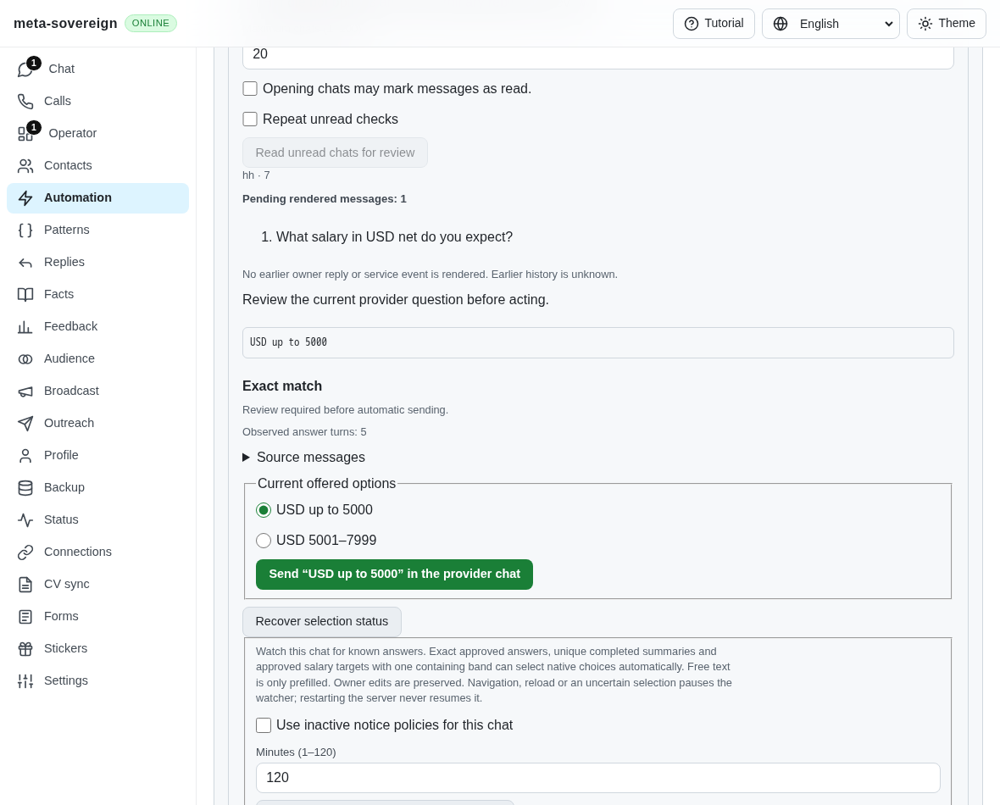

# Saved salary boundaries and conflicting amounts

For [PR #57](https://github.com/link-foundation/meta-sovereign/pull/57), configure
an approved USD 6000 net target, save the exact answer `USD up to 5000`, then
inspect the same question with choices `USD up to 5000` and `USD 5001–7999`.
Parent `549635f2` proposes the old answer for manual review and refuses automatic
selection. It does not apply the current numeric target to the offered bands.

The personal-explanation guard understood simple ranges but lacked the boundary
and scale vocabulary already accepted by the numeric selector. It now permits
that salary syntax through the same selector. Authored explanations still
require review. Separately, the saved-amount conflict guard now checks every
amount: a matching net amount cannot conceal a conflicting gross amount.

Five focused regression tests fail against the published parent. All 33 selected
salary checks pass after the correction, including English/Russian syntax,
unchanged saved rules, overlap/gap/currency refusals, personal explanations and
CLI, offline and both Lino preview transports. The mandatory
`question-salary-options` browser group includes the new native scenario on both
hosted engines. Local verification ran only the relevant Chromium scenario.

The isolated native UI shows the old selected band before the fix and the
current containing band afterward, followed by one explicitly confirmed native
receipt. Independent Playwright MCP checks the confirmed watcher: the parent
stays in review with zero effects; the correction selects `USD 5001–7999`, reads
message receipt `102`, sends no text and closes its owned resources. The only
MCP console message is the fixture's missing favicon (HTTP 404).

| Published parent                                                  | Corrected selection                                                      |
| ----------------------------------------------------------------- | ------------------------------------------------------------------------ |
|  |  |

[Hashed evidence](data/salary-band-saved.tar.gz) preserves exact parent sources,
tests, receipts and checks. Full QA15 acceptance and all 40 unchecked original
criteria remain required until the complete mapping and exact-head hosted checks
are verified. PR #57 remains draft and unmerged.
