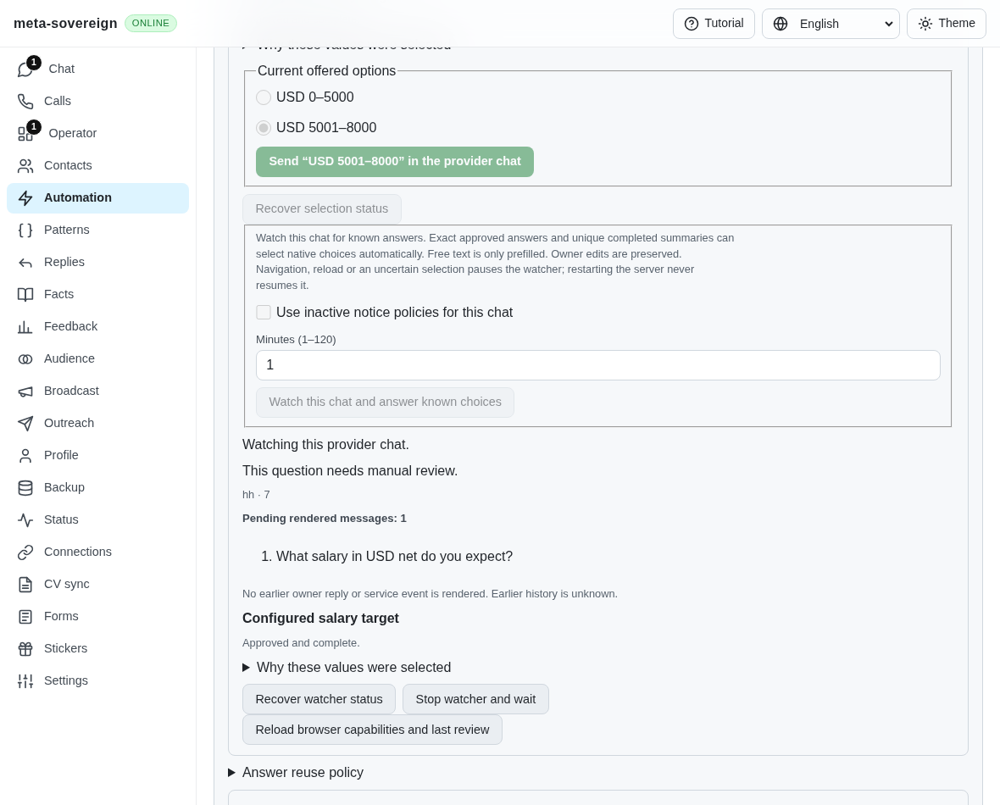
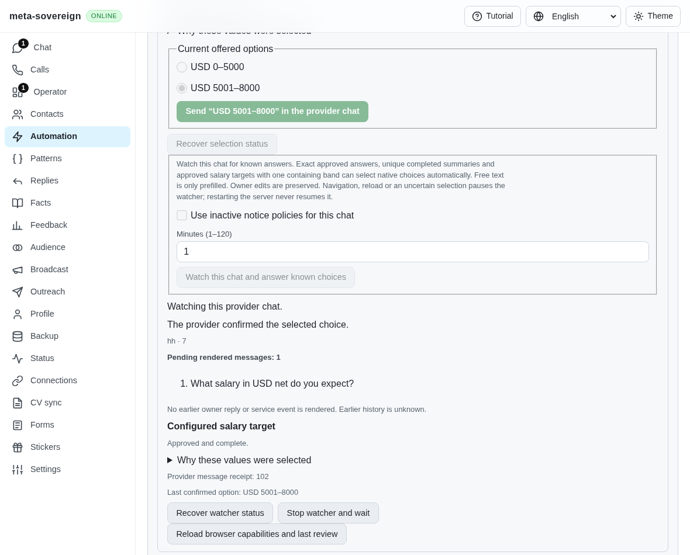

# Approved salary bands during automatic browser answers

QA15 requires a unique containing salary band to be selected automatically.
The pinned `konard/hh-job-application-automation` chat-option tests at
`fa0991b8c2d0896fb3b4be6c69947f0590094b15` explicitly distinguish these
approved decisions from ambiguous bands. Their complete source and tests were
read alongside the preceding numeric and saved-amount corrections.

On `f3412a16`, a configured, approved USD 6000 net target with offered
`USD 0–5000` and `USD 5001–8000` produced a complete approved salary plan.
However, the shared automatic browser gate admitted only exact saved answers
and completed summaries. Both a confirmed current-chat watch and sequential
unread answering held the valid salary option for manual review.

The gate now also admits complete approved salary plans carrying an actual
strict native option whose unique containing choice matches the planned text.
Free salary text, nearest form bands, incomplete targets, ambiguous bands and
conflicting saved amounts remain in review. Existing finite ownership,
dispatch-time knowledge checks, durable choice reservations and positive native
receipts still govern delivery. Unread option admission also refuses an owner
draft before attempting a provider selection.

The eight focused regressions have six failures and two passing safety cases
against the exact parent modules. The repaired focused group passes 57 tests
with one worker, including current-chat watch lifecycle, frozen planning,
sequential unread answers and mandatory browser registration. The new tests
cover missing targets/currency, unapproved configuration, gaps, ties, mixed
currencies, saved amount conflicts, owner drafts, queued saved changes,
positive receipts, duplicate admission and uncertain receipt recovery.

The native Chromium scenario uses the shared visible salary configuration and
an explicit one-minute watch. The parent stays in review with zero effects.
The repair selects once, records provider message `102` and never sends text.
Subsequent mixed-currency and owner-draft watches produce no clicks or text
sends. Both owned native runs close their browser and fixture resources and
report no page errors. Watch and unread help text is updated in all four
locales and the rebuilt web bundle is included. The scenario is mandatory in
the existing `question-salary-options` group for both hosted browser engines.

Independent Playwright MCP runs use the same isolated native provider. The
parent remains in review; the repair has one positive receipt and one click.
Both servers confirm drained resources and zero text sends. Both MCP pages
have only the existing missing-favicon 404. No authenticated account is used.

Reproduce the portable regression with
`node --test --test-concurrency=1 js/tests/salary-band-watch.test.js`.
For the exact parent, add
`--import ./experiments/issue-56/salary-band-watch-before.mjs`.
Run the focused native scenario with `RUN_BROWSER_E2E=1`, an installed
`E2E_EXECUTABLE_PATH`, and
`node experiments/issue-56/salary-band-watch-browser.mjs`.
For its parent comparison also set `SALARY_BAND_WATCH_BEFORE=1` and use
the parent import above. Screenshots are enabled with
`SALARY_BAND_WATCH_SCREENSHOTS=docs/screenshots`.

Before:

After:

The source-bound archive `data/salary-band-watch.tar.gz` and adjacent SHA-256
manifest preserve the original diagnostics, final checks, parent modules and
screenshots. Authenticated provider parity and exact-source hosted verification
remain required. The acceptance inventory still has 40 unchecked criteria;
[PR 57](https://github.com/link-foundation/meta-sovereign/pull/57) stays draft
and unmerged.
