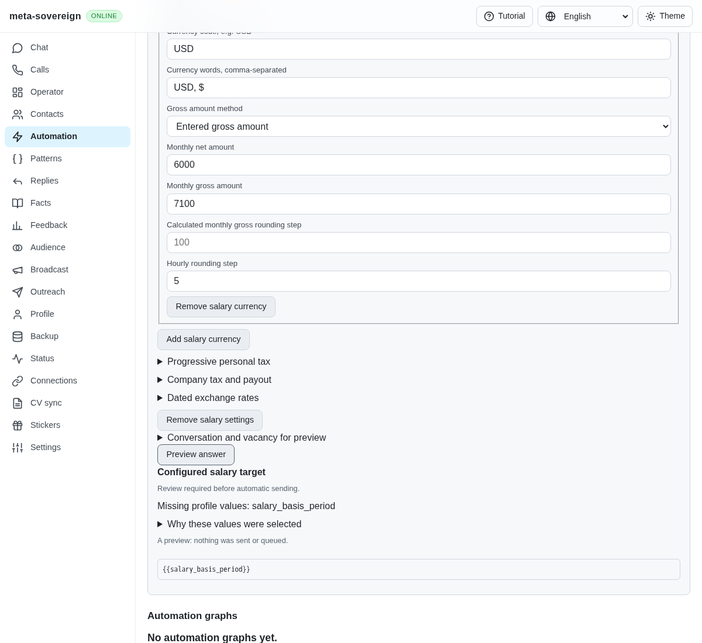
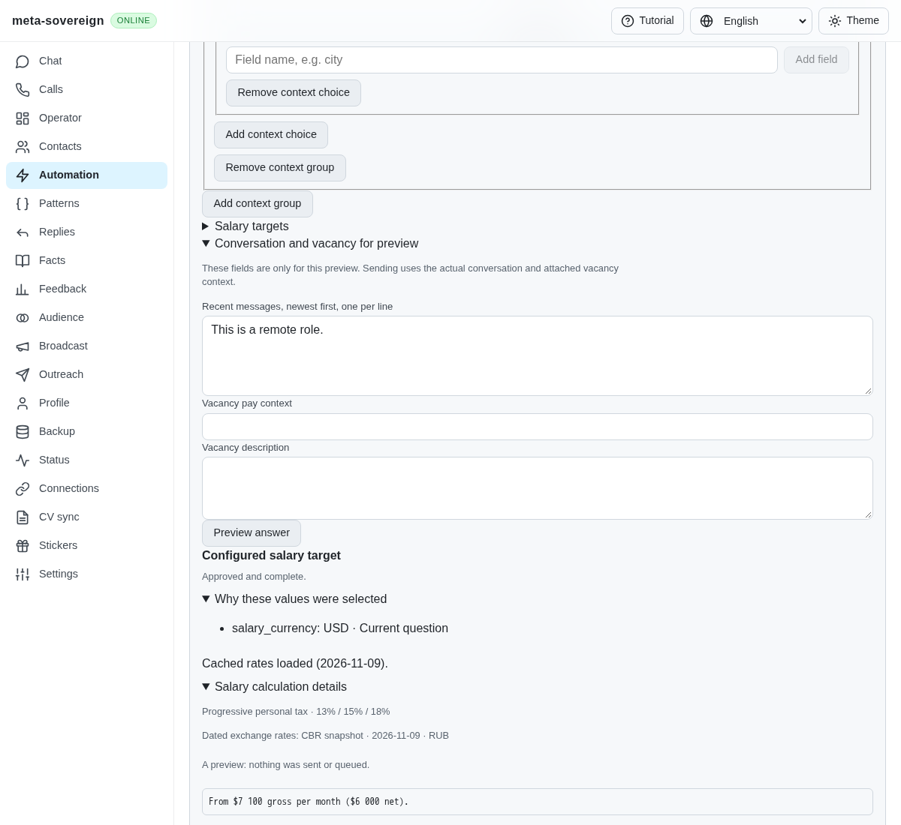
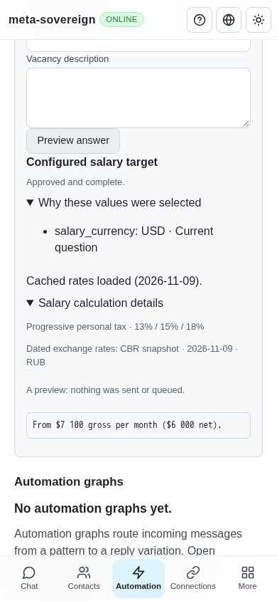
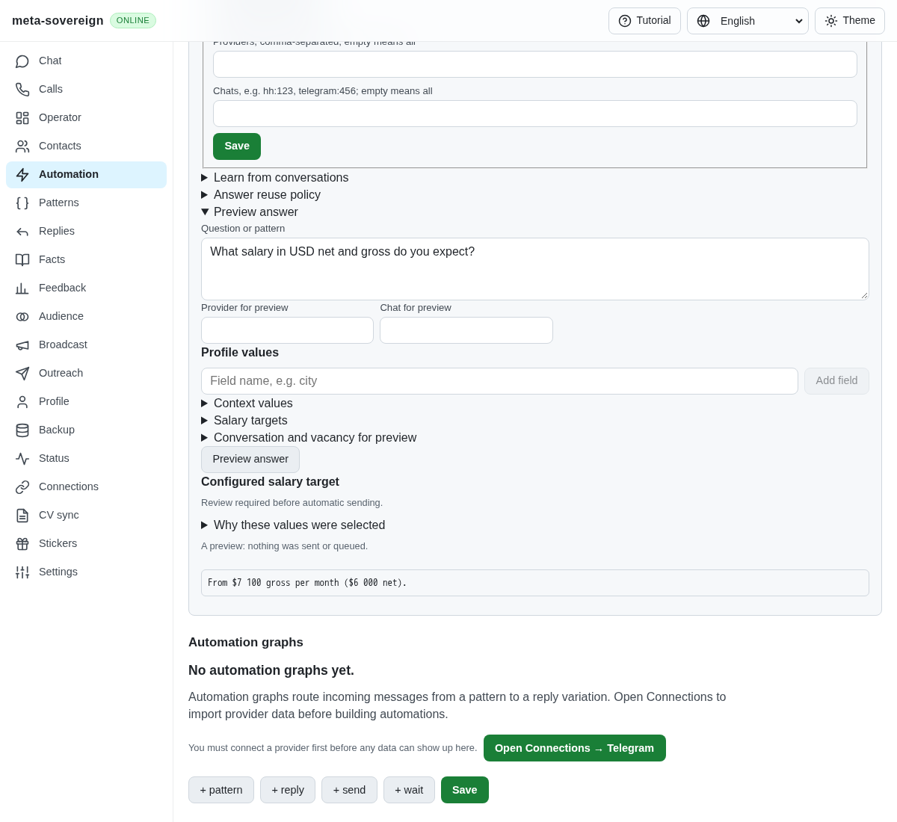

# Salary answers with both tax bases

The pinned HH reference explicitly labels both gross and net amounts when a question mentions both. The shared planner instead classified that wording as an ambiguous basis and returned `{{salary_basis_period}}`, even with both targets configured. Four new planner regressions fail before this correction. The screenshot below captures the actual production bundle against an isolated server before the change.

The question classifier now selects `both`. Each amount resolves independently through the existing explicit, progressive-personal or company/payout method, with the same currency and period. English and Russian output label both amounts. Hourly amounts round separately; a monthly target never becomes an hourly answer without the configured hours. Calculation evidence remains attached to the gross result. Existing single-basis wording stays unchanged.

Both amounts must resolve before the answer is complete. A missing target, stale exchange rate or ambiguous period remains unresolved; separate salary approval still applies. A question asking for both bases cannot silently select a single numeric form band. Rejected wording stays excluded. Final validation rereads both values after typing, so a change to either stops delivery before an outbox claim.

Verification:

- Six new planner/control tests cover both languages, `and`/`or` wording, hourly rounding, company calculation evidence, missing/stale values, approval, rejected wording, form-band ambiguity, CLI, offline UI, both Lino encodings and changes during typing. All 26 cases in the five relevant salary files pass with concurrency one.
- The older salary-control fixture now explicitly includes the normalized `snapshot` policy default introduced by migration 0009. Its exact equality assertions continue checking the complete saved action rather than discarding that field.
- Focused ESLint, production bundle build and the existing production Chromium question flow pass. That browser flow now verifies both amounts with the actual automatic dated cache and progressive-tax evidence at desktop and 390-pixel widths. The helper runs in the existing Chromium/WebKit CI coverage.
- Independent Playwright MCP verifies an actual explicit dual-basis preview with USD 6,000 net and USD 7,100 gross. It remains review-required because the fixture never grants approval. The browser and isolated server are closed. No provider message is sent.
- `node examples/salary-both.mjs` demonstrates the same pure shared planner without network access.

Logs and MCP metadata are retained in `data/salary-both.tar.gz` with a verified hash manifest. Exact-head full CI remains required. Placeholder contraction, cumulative archive learning, advanced multilingual/forms and provider parity remain unfinished.

| Before                                                                                                                                                                                 | After                                                                                                                                                                           |
| -------------------------------------------------------------------------------------------------------------------------------------------------------------------------------------- | ------------------------------------------------------------------------------------------------------------------------------------------------------------------------------- |
|  |  |

