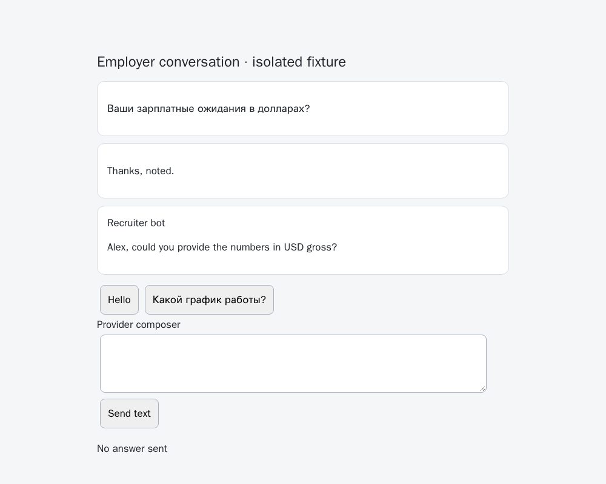
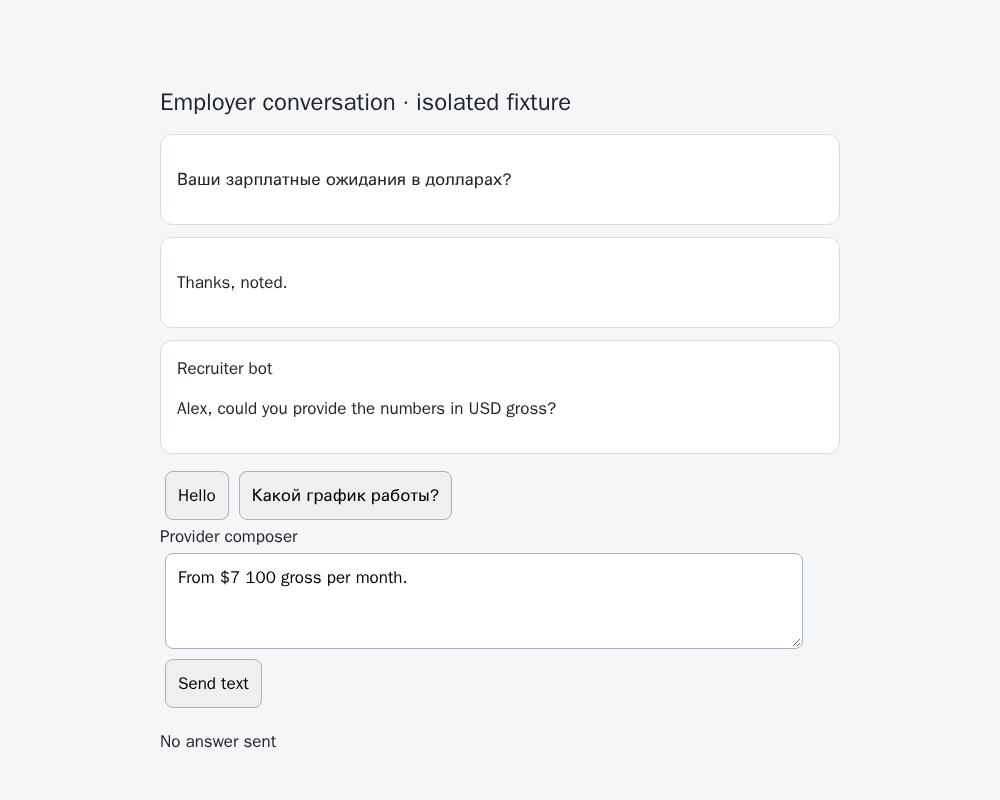

# Salary context from captured browser history

At published parent `19cedfee`, an HH conversation containing a Russian salary
question, a delivered acknowledgement and “Alex, could you provide the numbers
in USD gross?” produces no draft unless a caller supplies `recent` separately.
The browser reader already captures dated message rows, but manual review drops
them while normalizing the question. Watches and unread answering also omit this
window from deterministic planning; unread history was previously consulted
only for explicitly enabled model drafting.

The shared browser planning adapter now derives the existing `recent` input
from the verified native window. It checks the latest question's identity and
body, unique bounded rows, known timestamps, chronological order and the prior
24 hours. It takes at most twenty preceding messages and stops at service,
deleted, pending, failed or uncertain-delivery barriers. An observed empty
window supersedes supplied history; malformed observed history refuses review.
Older adapters that omit message capture retain their explicit-input behavior.
No persisted record shape changes.

Manual review freezes this context, watches derive it again on every observation,
and unread answering uses it without requiring model opt-in. Native prefill and
automatic option selection compare the reviewed context again before acting.
Free text remains subject to the existing automatic-admission policy, owner
drafts remain held and ordinary text is not sent automatically.

Three tests fail at the exact parent while two barrier/identity controls pass:

```sh
node --max-old-space-size=384 \
  --import ./experiments/issue-56/salary-browser-context-before.mjs \
  --test --test-concurrency=1 js/tests/salary-browser-context.test.js
```

All 56 focused tests pass after the correction. The mandatory browser scenario
passes without caller-supplied history and preserves the exact English USD gross
draft, owner text, saved rules and zero sends. A second native check changes the
earlier anchor without changing the latest question: the parent controller
allows the stale prefill, while the corrected controller refuses it. Independent
Playwright MCP inspections reproduce the empty parent draft and acknowledge the
corrected draft; both owned fixtures report closed resources and zero sends.

The first native attempt exposed a fixture setup error: the sender's initial
session navigation discarded inserted history. The fixture now opens that
session before adding synthetic history. A finite probe and intermediate logs
are preserved; the final parent reproduction uses the same corrected fixture.
The watch test also originally expected automatic free-text prefill, which the
existing policy correctly holds for review. Its corrected assertions verify the
review plan and its invalidation without changing that policy.





The [checked archive](data/salary-browser-context.tar.gz) preserves exact parent
modules, source changes, focused/native/MCP receipts and inspected screenshots.
This advances QA12's provider-context integration. Full vacancy acquisition,
source priority mapping, authenticated provider acceptance and all forty
unchecked original criteria remain required in
[PR #57](https://github.com/link-foundation/meta-sovereign/pull/57).
