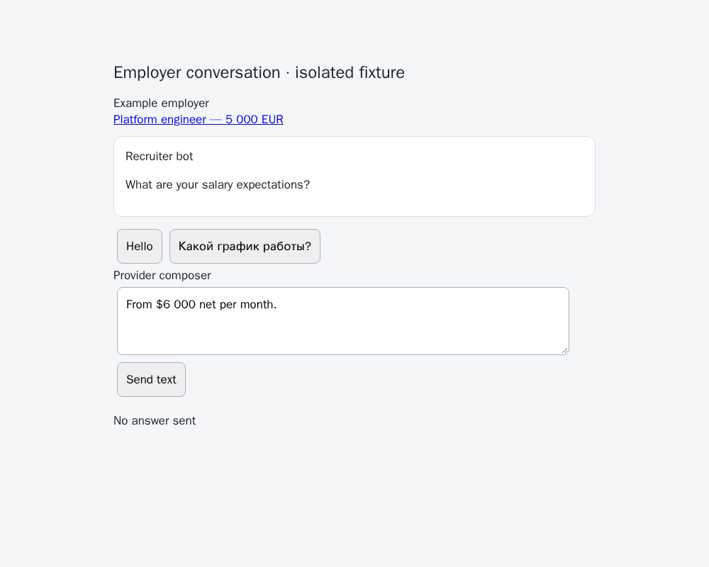
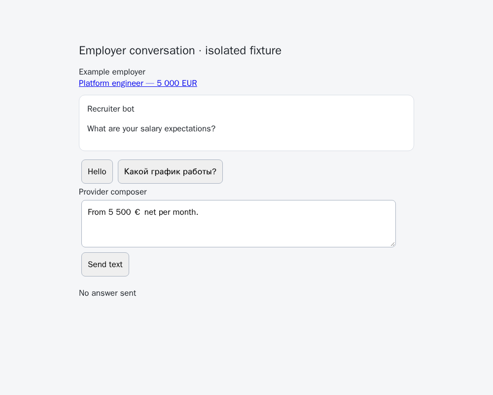

# Observed vacancy card salary context

Published parent `40b4caaabf65db4a70d195742ae1289d042cc28a` ignores currency
shown in an HH chat's observed vacancy card. It reads the linked page instead;
an EUR card with a USD page produces a USD draft. Without a page reader it
falls back to RUB. The pinned reference's `chatContextTexts` places the observed
vacancy name after employer messages and before a separate page read:
[chat-answers.mjs, lines 640–715](https://github.com/konard/hh-job-application-automation/blob/fa0991b8c2d0896fb3b4be6c69947f0590094b15/src/chat-answers.mjs#L640-L715).

The shared browser planning adapter now uses that observed card when a salary
reply still depends on currency. Explicit question, incoming context and
provided vacancy input keep their priority. The card must belong to the same
verified native HH vacancy URL and a replyable incoming turn without an owner
draft. Unknown or ambiguous card currencies stay unresolved instead of being
replaced by another page or the configured default. An acknowledged card needs
no linked-page reader. Derived context is replaced on each observation,
including a card change at the same URL. No persisted record shape changes.

Five of six focused tests fail at the exact parent; the explicit-priority
safety control passes. All eighteen relevant tests pass after the correction.
They cover manual review, watched card changes, unread answering, absent page
readers, ambiguous/foreign currencies and the existing page/history paths.

```sh
node --max-old-space-size=384 \
  --import ./experiments/issue-56/salary-browser-vacancy-card-before.mjs \
  --test --test-concurrency=1 js/tests/salary-browser-vacancy-card.test.js
```

Native Chrome reproduces the parent's `From $6 000 net per month.` with one
routed page read. The correction drafts `From 5 500 € net per month.` with
zero page reads. Both preserve owner text and saved rules and send nothing.
The complete focused salary browser sequence also passes, including its
native history guard and linked-page fallback. The card scenario is awaited
by that mandatory CI sequence in both browser lanes.





Independent Playwright MCP inspection observes the parent's USD proposal and
then verifies the corrected EUR prefill, actual native draft and review status.
The parent fixture closes its one page read; the corrected fixture opens none.
Every owned fixture closes with zero sends and no live provider account.
The raw MCP output retains favicon and browser asset-cache console errors;
the asserted API/native readback completes successfully.

The [checked archive](data/salary-browser-vacancy-card.tar.gz) retains exact
parent modules, focused/native/MCP observations, pinned reference response,
source snapshots and screenshot hashes. Full QA12 source-priority/provider
mapping, current hosted verification and all forty original unchecked criteria
remain required in [PR #57](https://github.com/link-foundation/meta-sovereign/pull/57).
