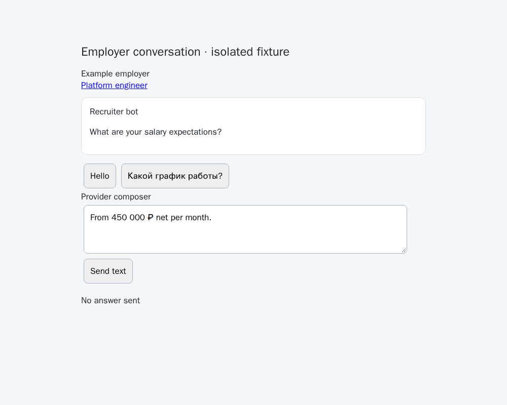
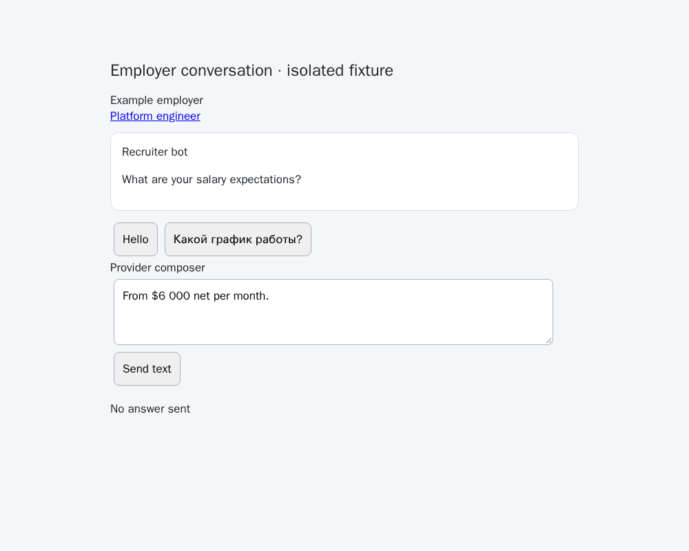

# Native vacancy context for salary replies

At published parent `45bb2376`, an HH conversation asking for salary expectations
defaults to RUB even when its linked vacancy advertises USD. Browser review,
watches and unread answering do not obtain the vacancy context unless a caller
supplies it. The pinned reference resolves chat context first and reads a vacancy
only when another configured currency would change the answer.

The shared browser planning adapter now applies that lazy fallback through the
existing verified vacancy reader and acknowledged vacancy cache. It requires a
canonical observed HH vacancy URL and an incoming, replyable question without an
owner draft. Explicit question, recent chat and supplied vacancy context retain
their priority. Known or currency-invariant replies do not open another page.
Page evidence follows salary, title, then complete description; long descriptions
retain currency clues within the planning bound while the full page stays cached.
Ambiguous or unconfigured currencies retain review. Unreadable or mismatched
pages refuse planning rather than asserting that a default was verified.

The reader uses a separate owned `question-vacancy` slot. Concurrent inspections
share its serialized cache lookup; watches discard derived context when the
observed vacancy changes. Watch/unread cancellation and browser shutdown abort
and drain admitted reads. Existing native question, notice and owner-draft
checks remain in force. No persisted record shape changes or messages sent.

The exact-parent regression command produces five failures and two direct-helper
controls; the controls exercise the new adapter, not historical parent behavior:

```sh
node --max-old-space-size=384 \
  --import ./experiments/issue-56/salary-browser-vacancy-before.mjs \
  --test --test-concurrency=1 js/tests/salary-browser-vacancy.test.js
```

All 60 focused tests pass after the correction, covering manual/watch/unread
planning, cache reuse, URL changes, source order, long and foreign descriptions,
read refusal and shutdown. The native fixture uses the real vacancy reader on a
separate routed page. The parent drafts `From 450 000 ₽ net per month.` without
reading it; the correction reads once and drafts `From $6 000 net per month.`.
The mandatory salary clarification sequence also passes, preserving history
guards, owner text, saved rules and zero sends. Independent Playwright MCP
inspection observes the parent default and acknowledges the corrected prefill.
Every owned page and fixture closes; no real provider account is contacted.





The [checked archive](data/salary-browser-vacancy.tar.gz) contains parent modules,
source snapshots, focused/native/MCP results and screenshot hashes. This is a
partial QA12 integration step. Fresh hosted verification, the full original
context-priority mapping and all forty unchecked criteria remain required in
[PR #57](https://github.com/link-foundation/meta-sovereign/pull/57).
