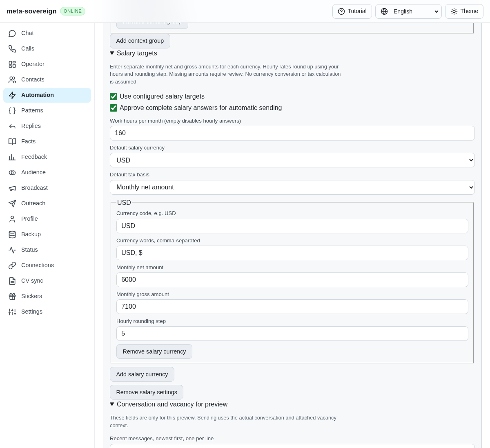
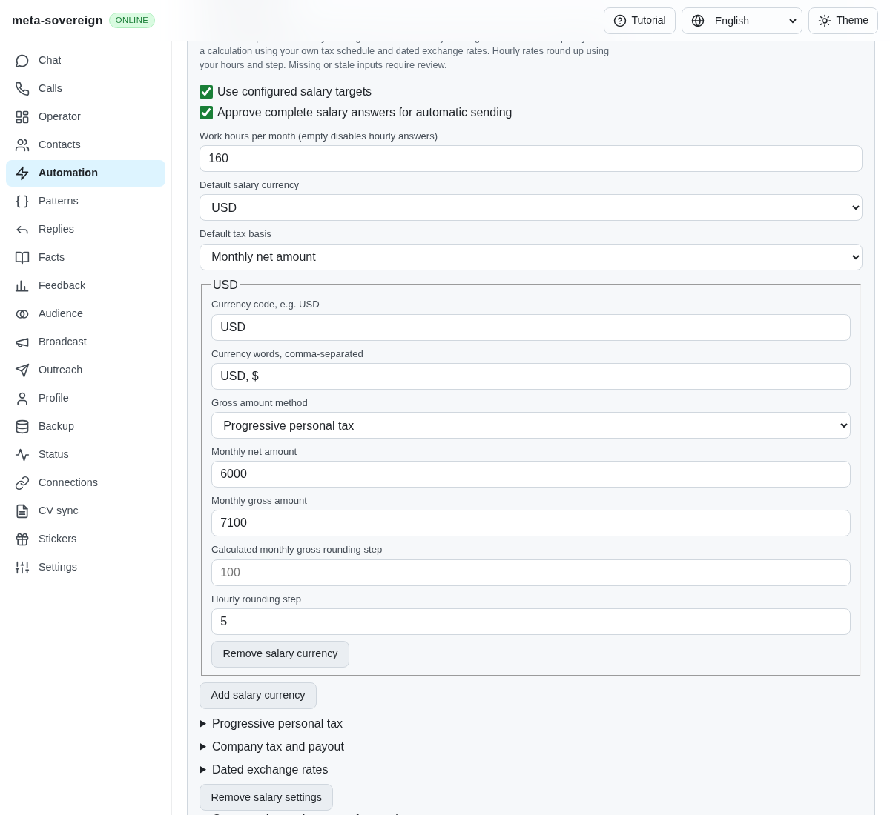
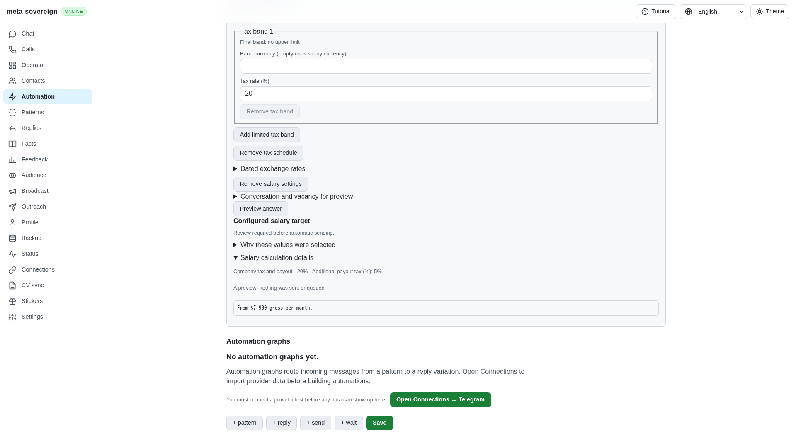
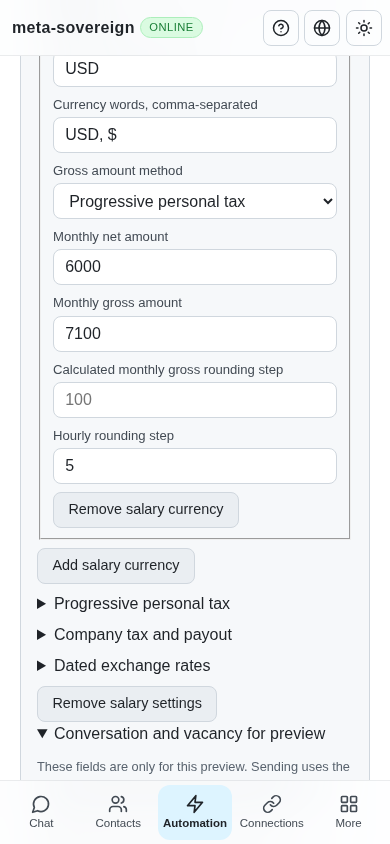

# Configurable salary calculations

Issue 56 requires the HH reference's salary behavior across providers. Independent entered targets did not retain tax schedules or dated exchange rates. A gross question with only a net target stayed unresolved even when the owner supplied the calculation. All six initial regressions fail on the preceding implementation; their complete output is preserved in `data/salary-calculation.tar.gz`.

The shared salary configuration now retains an explicit gross method per currency: `explicit` (the compatible default), `personal` or `company`. Net targets remain independent for every currency. Selecting a calculation uses that currency's net target and ignores its older entered gross value; switching back preserves that value. No jurisdiction, legal rates or foreign net target is chosen automatically.

Personal tax uses owner-supplied annual gross-income bands. The planner inverts each band's net portion progressively, converts only between the contract currency and the tax schedule's currency, then rounds the monthly gross upward. Company tax selects one whole-income annual revenue band and applies `net / ((1 - companyRate) * (1 - payoutRate))`. Band limits can have distinct currencies. Selection uses the final rounded gross so rounding across a company boundary cannot retain the lower rate. A schedule has at most 20 bands and ends with an unlimited `upTo: null` band. Rates are fractions in saved configurations and percentages in the UI.

Calculated monthly rounding defaults to 10,000 RUB and 100 for other configured currencies and is editable through `grossStep`. Existing monthly hours and hourly rounding apply afterward. Explicit gross targets keep their original amount. Missing schedules/rates, invalid cross-currency band order, inconsistent company bands, disabled hourly answers and out-of-bounds results require review. The planner performs no network reads and never falls back to a different tax method.

An optional `exchange` snapshot contains `base`, `rates`, `asOf`, `source` and `maxAgeDays`. Each rate is base-currency units per one unit of its currency; the base itself is one. CLI/API input accepts a keyed rate table or a list of `{ code, rate }` entries and stores the canonical list. Duplicate codes, nonpositive/nonfinite rates, invalid dates and invalid maximum ages are rejected before storage. A snapshot older than its configured 1–365-day limit cannot authorize a calculated answer. Future manually supplied rates are unresolved; CBR snapshots allow a one-day publication lead. Same-currency calculations need no FX snapshot. The source is owner-declared snapshot metadata; this step does not fetch or verify rates remotely.

Preview and saved-action editors share controls for methods, rounding, personal/company bands, payout tax and dated exchange rates. English, Russian, Chinese and Hindi labels are provided. Answer evidence displays the calculation method, applied rates and any exchange source/date/base. The CLI and default text/binary Lino API use the same normalizer and planner, including offline preview. Tax, FX, method, rounding and snapshot-removal edits during typing stop delivery before an outbox claim.

Verification:

- Seven calculation cases cover progressive bands and exact boundaries, independent RUB/USD/EUR targets, monthly/hourly rounding, compound company/payout tax with VND limits, stale/missing FX, explicit-method compatibility, zero tax, overflow, company rounding across a band boundary and malformed configuration.
- Two integration cases verify saved-UI round trips, offline preview, Lino CLI save/plan, both Lino API representations, atomic invalid-edit rejection and six delivery-time configuration changes with zero sends/outbox claims.
- The four relevant salary files pass all 22 tests with concurrency one. Changed-source lint and the production web build pass.
- Production Chromium creates progressive bands and a dated rate through visible controls, verifies missing-rate review before the rate is entered, displays the resulting gross amount and calculation evidence, persists the complete action and checks a 390-pixel viewport.
- Playwright MCP independently enters a 20% company rate and 5% payout tax. A USD 6,000 net target previews USD 7,900 gross, with those rates displayed, explicit review required and nothing sent or queued. The browser and temporary fixture were closed. The console also records a fixture-only disabled RTC broker handshake timeout; general RTC availability gating remains an open capability item, separately from the successful salary assertions.

Before these controls, salary targets accepted only entered amounts:

The updated method/settings controls and independent company preview:

Remaining required work includes rate fetching/cache recovery, both-basis wording, contraction of learned salary literals into placeholders, advanced multilingual/conditional learning, real provider forms/buttons and the other issue-wide workstreams. This bounded step does not complete those criteria or the full CI verification gate.
