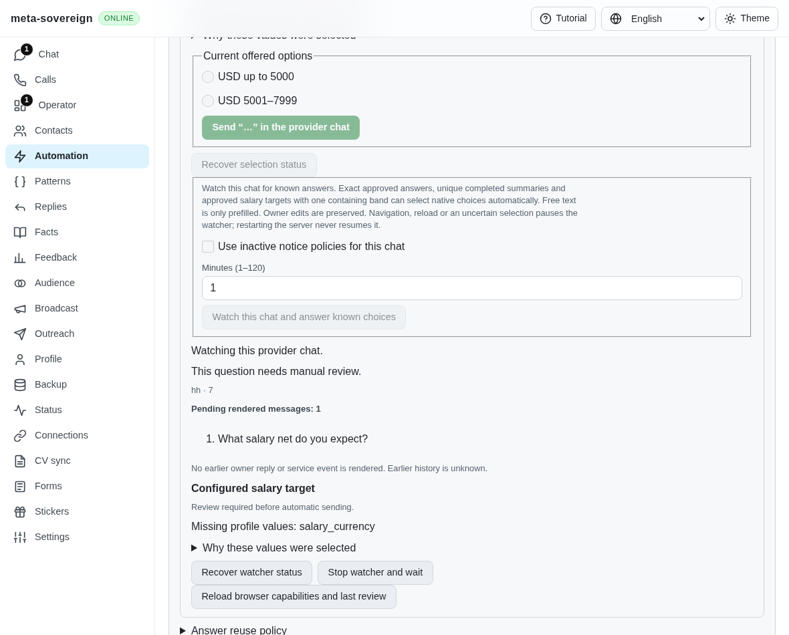
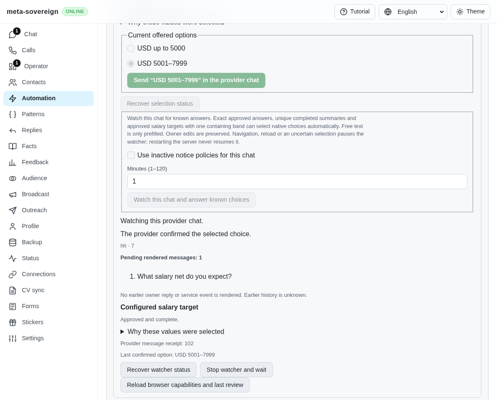

# Currency supplied by salary choices

The pinned [salary selector](https://github.com/konard/hh-job-application-automation/blob/fa0991b8c2d0896fb3b4be6c69947f0590094b15/src/salary-options.mjs)
uses a single currency in the offered ranges when the question omits it.
Published parent `db66d251` ignores that evidence. An approved USD target of
6000, the question “What salary net do you expect?” and choices `USD up to 5000`
and `USD 5001–7999` consequently remain unresolved when no default is configured.

The shared planner now records `source: options` for a unique configured
currency in bounded numeric choices. The explicit question retains precedence;
choice evidence precedes conversation, vacancy and default evidence. This uses
the independent target for that currency without converting another amount.
Mixed or unconfigured currencies remain ambiguous, and missing targets,
currency-free choices, explicit mismatches and owner drafts remain held. The
existing missing-currency watch check now uses genuinely currency-free choices.

Two regressions fail on the exact parent and the safety control passes. All
23 selected salary checks pass, including read-only CLI, offline and both Lino
previews. Reproduce with:

```sh
node --max-old-space-size=384 --test --test-concurrency=1 js/tests/salary-choice-currency.test.js
```

Add `--import ./experiments/issue-56/salary-choice-currency-before.mjs` before
`--test` to compare the parent. Native Chromium and independent Playwright MCP
both observe review with zero parent effects, followed by the correct USD choice
and message receipt `102` after the correction. Final fixtures close, send no
text and use no authenticated provider. Their only console error is the fixture
favicon. Both screenshots were checked as PNG files and visually inspected.

The first duplication check exceeded the unchanged 6.5% limit. The overlap and
currency evidence collectors now share their native receipt/cleanup verifier;
all four existing MCP records pass it and the unchanged duplication gate passes.

| Published parent                                                                        | Corrected containing choice                                                                        |
| --------------------------------------------------------------------------------------- | -------------------------------------------------------------------------------------------------- |
|  |  |

The mandatory salary-watch scenario now awaits this native case; its workflow
contract retains the existing four-scenario registration and three-minute
budget. The complete group passes locally in Chromium. Full hosted matrices
and complete QA12/QA15 mappings remain required in
[PR #57](https://github.com/link-foundation/meta-sovereign/pull/57). This fix
accepts no inventory row by itself. The failed initial `.js` bundle command is
preserved separately; the correct repository `.mjs` command passes.

The [checked evidence archive](data/salary-choice-currency.tar.gz) and adjacent
SHA-256 manifest preserve parent bytes, raw failures, native/MCP receipts,
screenshots, final sources and scoped checks.
