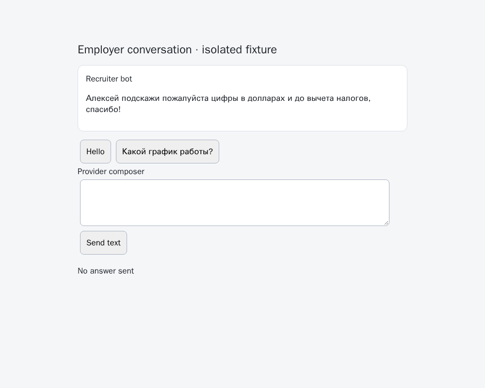
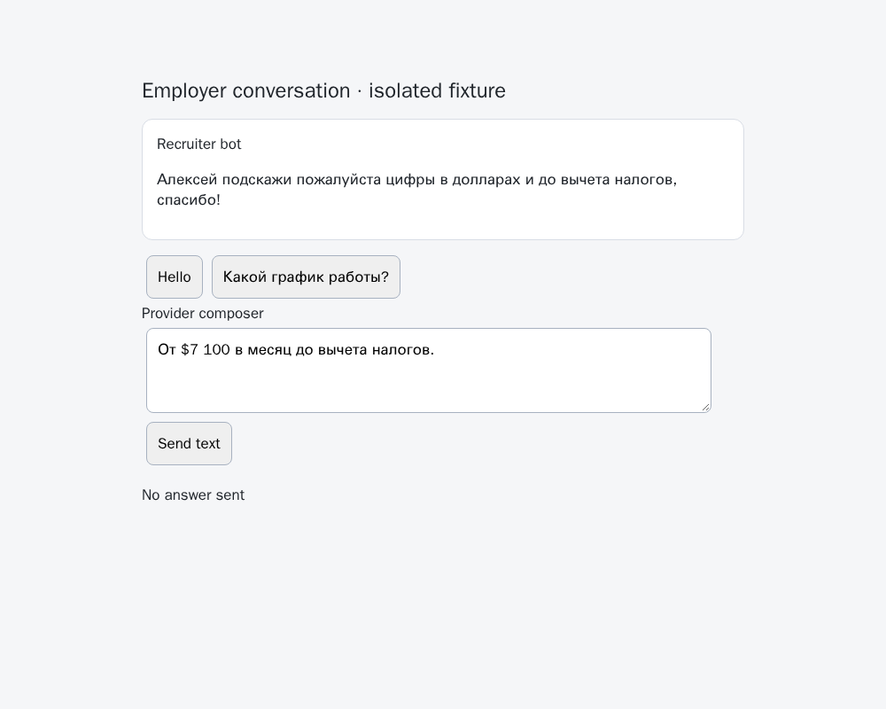

# Salary clarification context

QA12 requires independent question language, requested currency and tax basis,
including polite recruiter clarifications and consecutive follow-ups. The pinned
[chat contract](https://github.com/konard/hh-job-application-automation/blob/fa0991b8c2d0896fb3b4be6c69947f0590094b15/tests/chat-salary-clarification.test.mjs),
[question contract](https://github.com/konard/hh-job-application-automation/blob/fa0991b8c2d0896fb3b4be6c69947f0590094b15/tests/salary-questions.test.mjs)
and [hourly contract](https://github.com/konard/hh-job-application-automation/blob/fa0991b8c2d0896fb3b4be6c69947f0590094b15/tests/hourly-salary.test.mjs)
were studied for behavior without copying their implementation.

On exact parent `deacbb7d`, the bounded clarification vocabulary rejects polite
requests and built-in currency words unless separately configured as keywords.
An intervening clarification question hides the original salary anchor and its
latest requested basis. Currency selection reads an unrelated question's currency
before checking its topic. Common Russian expected-pay field labels and ordinary
hourly wording are also missing. Finally, a name-prefixed request ending in `!`
is routed to notice handling before the salary classifier can run.

Shared planning now recognizes these bounded salary requests, walks consecutive
clarifications back to the original salary period, and inherits the newest basis.
Explicit current currency and basis take precedence over older messages. An
unrelated question stops inheritance before its currency is considered; conflicting
periods, unsupported currency, disabled configuration and unrelated money topics
remain reviewable or unanswered. This uses configured current amounts and never
rewrites messages, saved observations or owner explanations.

Reproduce the five failures against the exact parent and verify the focused set:

```sh
node --max-old-space-size=384 --import ./experiments/issue-56/salary-clarification-before.mjs --test --test-concurrency=1 js/tests/salary-clarification-contract.test.js
node --max-old-space-size=384 --test --test-concurrency=1 js/tests/salary-clarification-contract.test.js js/tests/question-salary.test.js js/tests/question-salary-controls.test.js js/tests/salary-option-contract.test.js js/tests/salary-both.test.js
RUN_BROWSER_E2E=1 E2E_BROWSER=chromium E2E_EXECUTABLE_PATH=/opt/google/chrome/chrome SALARY_CLARIFICATION_ONLY=1 node --max-old-space-size=384 js/tests/e2e-question-controls-browser.mjs
```

All five new tests fail on the parent; all 26 focused tests pass after the fix.
The shared surface test uses an actual Lino CLI configuration, offline preview
and both negotiated HTTP encodings, then checks that storage remains unchanged.
The mandatory browser scenario uses the real browser commander against a
synthetic HH page: explicit prefill reads back the exact Russian USD gross draft,
Send remains untouched, and an owner-written draft is preserved. Independent
Playwright MCP reaches the production browser API and separately confirms draft
acknowledgement; the drained fixture records the exact native text and zero sends.
No authenticated provider account is claimed.

Before:



After explicit prefill:



The checked [evidence archive](data/salary-clarification-contract.tar.gz) and
[manifest](data/salary-clarification-contract.tar.sha256.json) preserve exact
parent modules, pinned reference blobs, source hashes, raw checks and screenshots.
Full QA12 and the other original unchecked criteria remain required; this unit
alone accepts none. Exact-source hosted coverage remains required in
[PR #57](https://github.com/link-foundation/meta-sovereign/pull/57).
