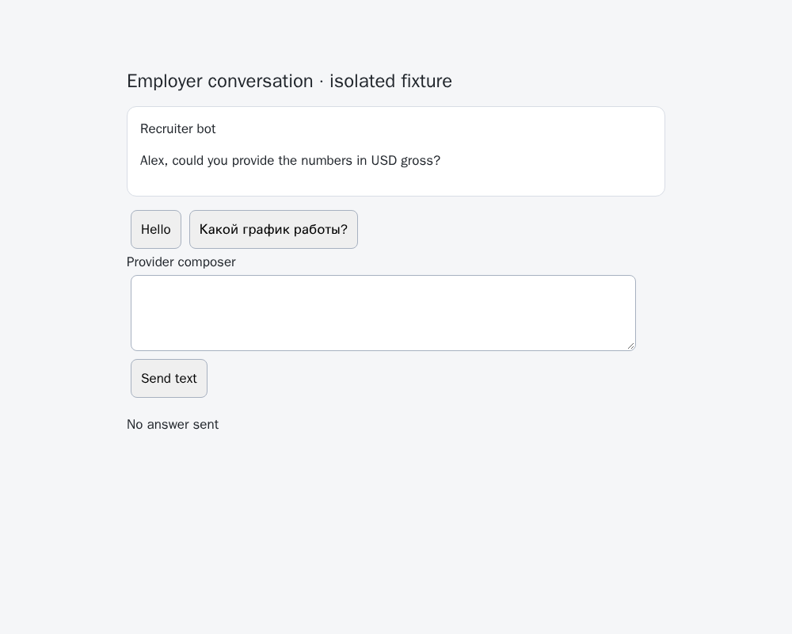
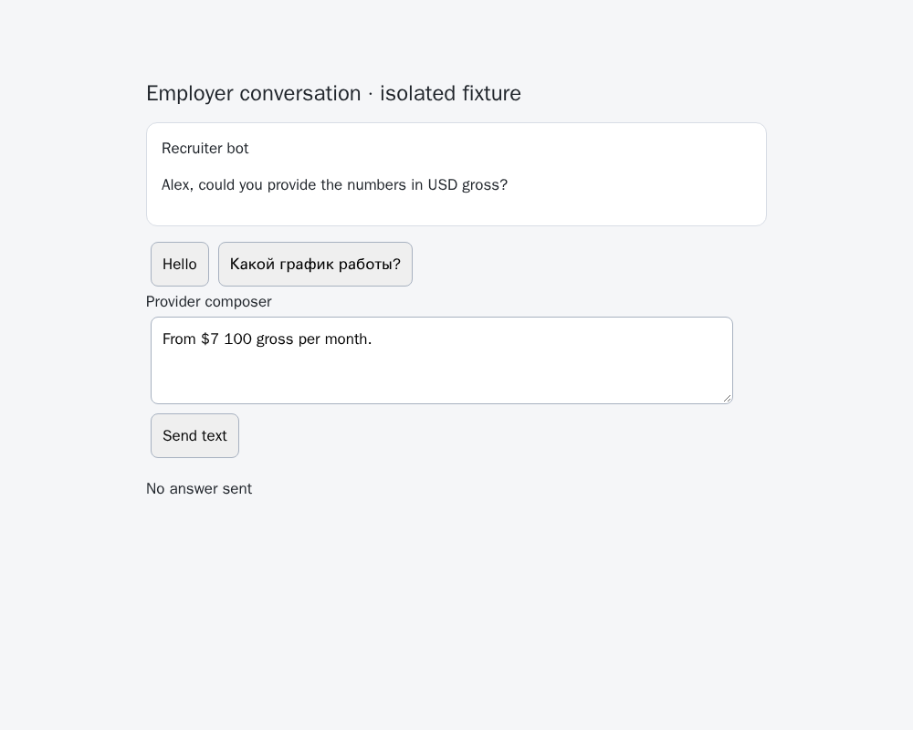

# Named salary clarification requests

At published parent `2ece94b4`, “Alex, could you provide the numbers in USD
gross?” produces no draft after a salary question. “Please provide the figure
in USD gross” and “Алексей, уточни, пожалуйста, сумму в USD до вычета налогов?”
are also missed. The bounded clarification vocabulary omits singular “figure,”
“number(s)” and Russian “сумма”; name prefixes are accepted only before
“подскажи” or “please.” The complete pinned classifier at
`fa0991b8c2d0896fb3b4be6c69947f0590094b15` already recognizes these request forms.

The shared matcher accepts the missing number nouns and name prefixes before
its known request verbs. Currency, tax basis and language remain independent.
Only a related salary anchor permits a clarification; unrelated questions,
budgets, revenue, expenses, unknown currencies and period changes remain held.
Three added tests fail on the exact parent while nine existing controls pass:

```sh
node --max-old-space-size=384 \
  --import ./experiments/issue-56/salary-numbers-before.mjs \
  --test --test-concurrency=1 js/tests/salary-clarification-contract.test.js
```

Twenty-six focused tests pass with the correction, including actual CLI
configuration, offline and both Lino preview encodings. A mandatory native
scenario and independent Playwright MCP inspection reproduce the empty parent
composer, then confirm the exact English USD gross draft. No text is sent,
owner drafts and saved rules are retained, and owned fixtures close. The
initial native invocation lacked the browser opt-in and was skipped; its log
is retained separately from the actual failing and passing browser runs. One
MCP launch had closed stdin; its owned process was drained before repeating
the parent with a terminal and a positive cleanup receipt.





The [checked archive](data/salary-numbers.tar.gz) preserves parent bytes,
regressions, focused checks, native/MCP results and inspected screenshots. This
is a partial QA12 correction. Browser-derived history and vacancy acquisition
still require the complete provider-context mapping; supplied-context fixtures
do not prove that integration. All 40 unchecked original criteria remain
required in [PR #57](https://github.com/link-foundation/meta-sovereign/pull/57).
