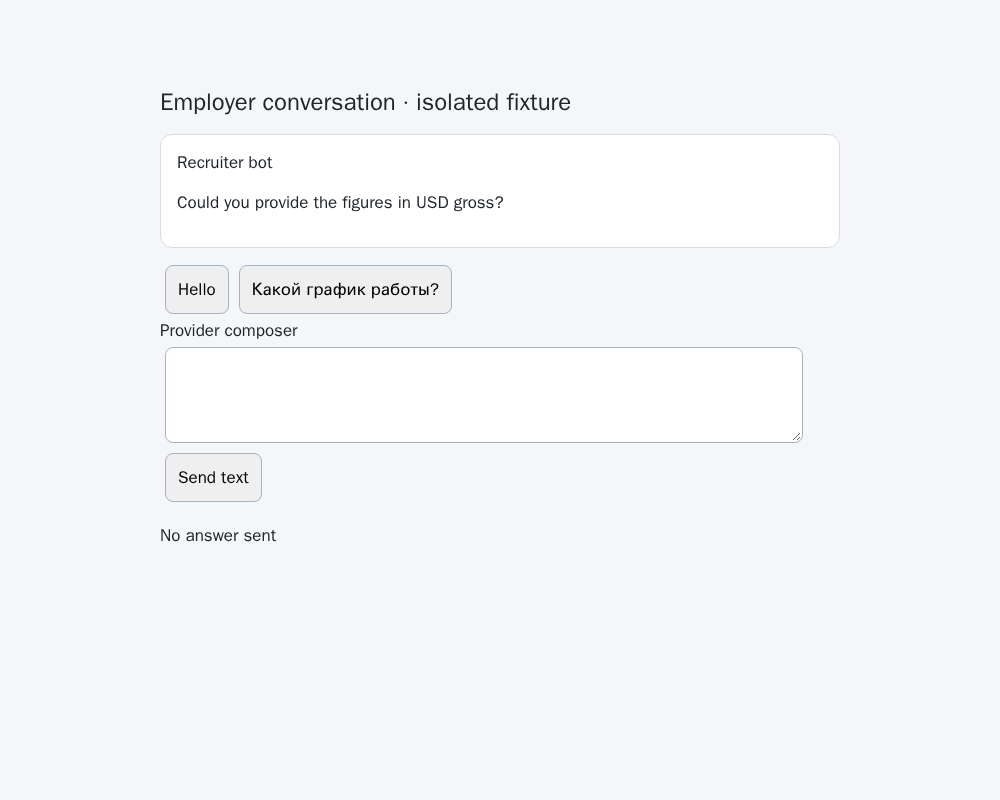
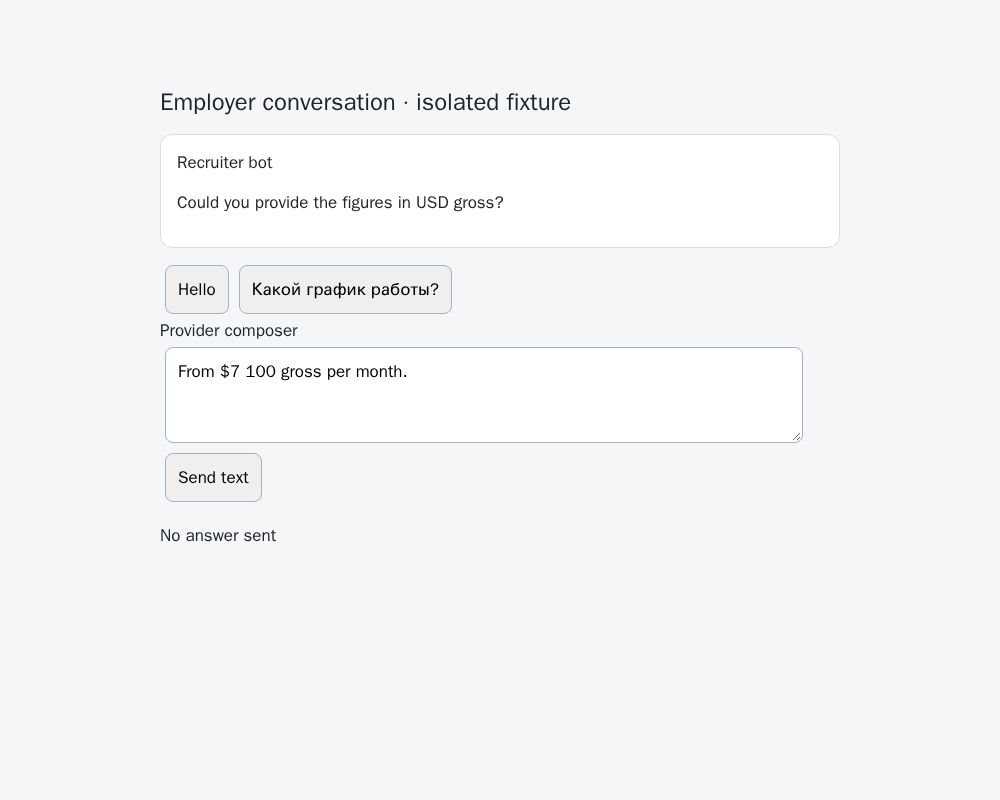

# Salary clarification phrasing and language

The complete pinned [salary question classifier](https://github.com/konard/hh-job-application-automation/blob/fa0991b8c2d0896fb3b4be6c69947f0590094b15/src/salary-questions.mjs)
recognizes polite English requests and ordinary Russian request verbs after a
related salary question. QA12 also separates answer language from the requested
currency and tax basis. The comparison studies behavior without copying code.

Exact parent `6edc5698` rejects “Could you provide the figures in USD gross?”,
“How about USD gross?” and ordinary Russian clarification verbs. Its bounded
word allowlist omits those request words. An already recognized English follow-up
such as “Figures USD gross?” incorrectly inherits Russian from the earlier salary
question because the language shortcut treats it like a bare currency code.

Shared planning now admits those bounded clarification words. A follow-up inherits
the earlier language only when removing configured currency labels and the
language-neutral `gross`/`net` labels leaves no words. Requests containing English
or Russian words choose their own language. The nearest related salary topic,
period limits, explicit currency/basis precedence and independent current targets
remain in force. An unrelated intervening question still stops inheritance.

Reproduce and check with one test worker:

```sh
node --max-old-space-size=384 --import ./experiments/issue-56/salary-phrasing-before.mjs --test --test-concurrency=1 js/tests/salary-clarification-contract.test.js
node --max-old-space-size=384 --test --test-concurrency=1 js/tests/salary-clarification-contract.test.js js/tests/salary-intent-contract.test.js js/tests/salary-context-priority.test.js js/tests/salary-choice-currency.test.js
RUN_BROWSER_E2E=1 E2E_BROWSER=chromium E2E_EXECUTABLE_PATH=/usr/bin/google-chrome node --max-old-space-size=384 experiments/issue-56/salary-phrasing-browser.mjs
```

Four new regressions fail on the exact parent, while its five existing controls
pass. All 23 focused tests pass with the fix. The surface regression uses an
actual CLI Lino configuration, offline preview and both HTTP Lino encodings,
retaining an empty knowledge store. The mandatory question-controls browser
scenario now includes the new polite English follow-up.

The native parent scenario fails before prefill. With the fix it reads back
`From $7 100 gross per month.`, preserves an owner's existing draft and saved
rules, and sends no message. Independent Playwright MCP separately observes the
parent's unanswered plan and the corrected positive native draft receipt. Both
owned MCP fixtures close with zero clicks and zero sends. These are isolated
provider fixtures, not authenticated live-provider execution.

Before:



After explicit prefill:



The verified [archive](data/salary-phrasing.tar.gz) and
[manifest](data/salary-phrasing.tar.sha256.json) retain exact parent bytes,
reference source, raw checks, native receipts and screenshots. This correction
accepts no additional inventory row. Complete QA12 and all 40 unchecked original
criteria still require verification in [PR #57](https://github.com/link-foundation/meta-sovereign/pull/57).
