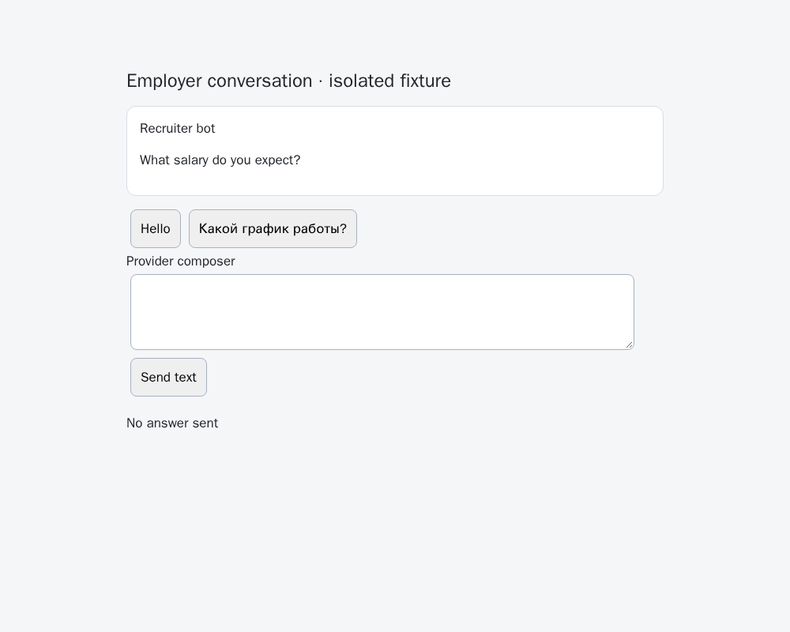
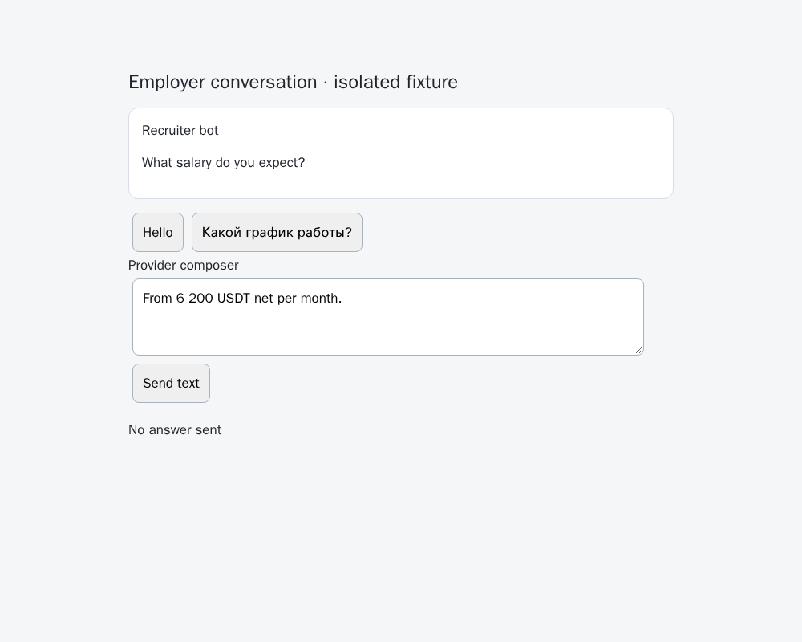
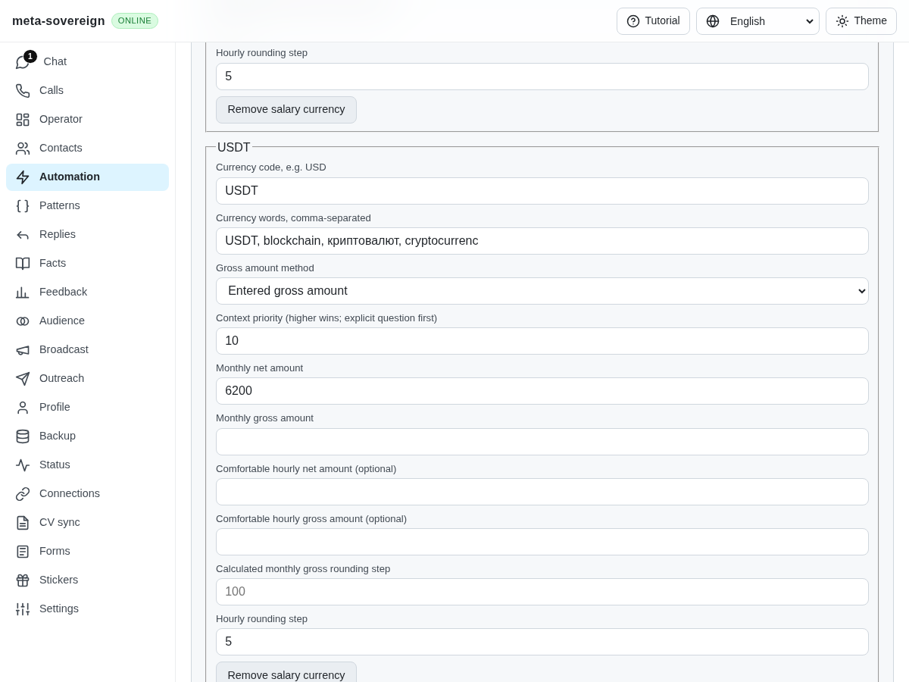
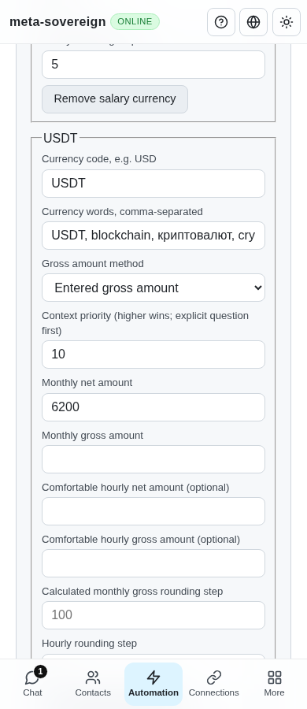

# Configured salary context priorities

This correction in [PR57](https://github.com/link-foundation/meta-sovereign/pull/57)
addresses part of QA12. All 40 unchecked original criteria remain required.

At parent `27511c5e`, a vacancy describing a Blockchain role paid in USD leaves
the answer unresolved even when the owner prefers a configured USDT target for
Blockchain work. Configured stems such as `криптовалют` also miss inflections.
The same matcher misses a currency symbol touching an amount, such as `$5000`.
Three of five finite regression cases fail on that exact parent:

```sh
node --max-old-space-size=384 --import ./experiments/issue-56/salary-priority-before.mjs --test --test-concurrency=1 js/tests/salary-context-priority.test.js
```

Each salary currency now accepts optional `contextPriority`, an integer from
0 through 1000; absent priorities are zero. The shared salary editor exposes it
in all four languages. Higher priorities resolve competing clues within one
context source. Current explicit currency questions still win, and explicit
conflicts, equal priorities and unsupported currencies still require review.
Recent related conversation, vacancy introduction, pay, description and the
configured default retain their existing order. Missing USDT amounts never
borrow USD targets. Configured alphabetic keywords of four or more letters may
match word beginnings; currency codes and short words keep exact boundaries.

Fifty-one focused tests pass, including existing salary and contextual template
cases, four-language parity, actual saved CLI, offline and both Lino previews.
Mandatory native prefill retains owner drafts and saved rules with zero sends.
The real UI verifies a priority change, ambiguity when priorities tie, and
1200/390-pixel layouts. An independent Playwright MCP probe acknowledges the
USDT draft with zero sends and closes its fixture. Its only console error is
the fixture's missing favicon. The two initial UI helper failures used the
wrong button label; their logs are retained with the corrected passing scenario.









The [checked archive](data/salary-context-priority.tar.gz) and
[manifest](data/salary-context-priority.tar.sha256.json) preserve source bytes,
parent failures, focused checks, native/MCP receipts and inspected screenshots.
This synthetic provider evidence makes no authenticated-account claim.
Exact-source hosted verification and complete original salary contracts remain
required before acceptance.
