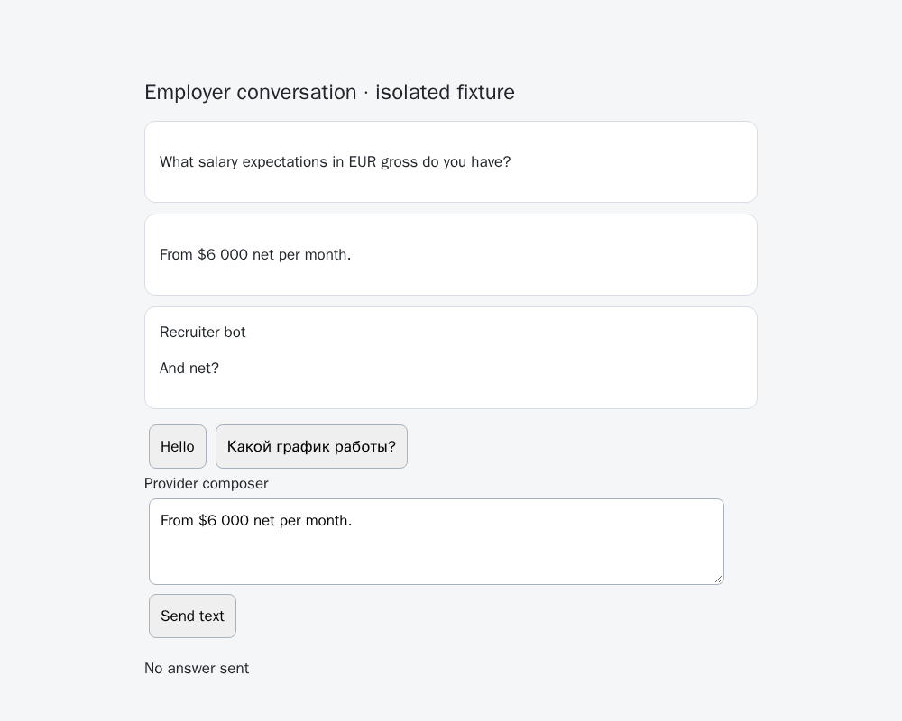
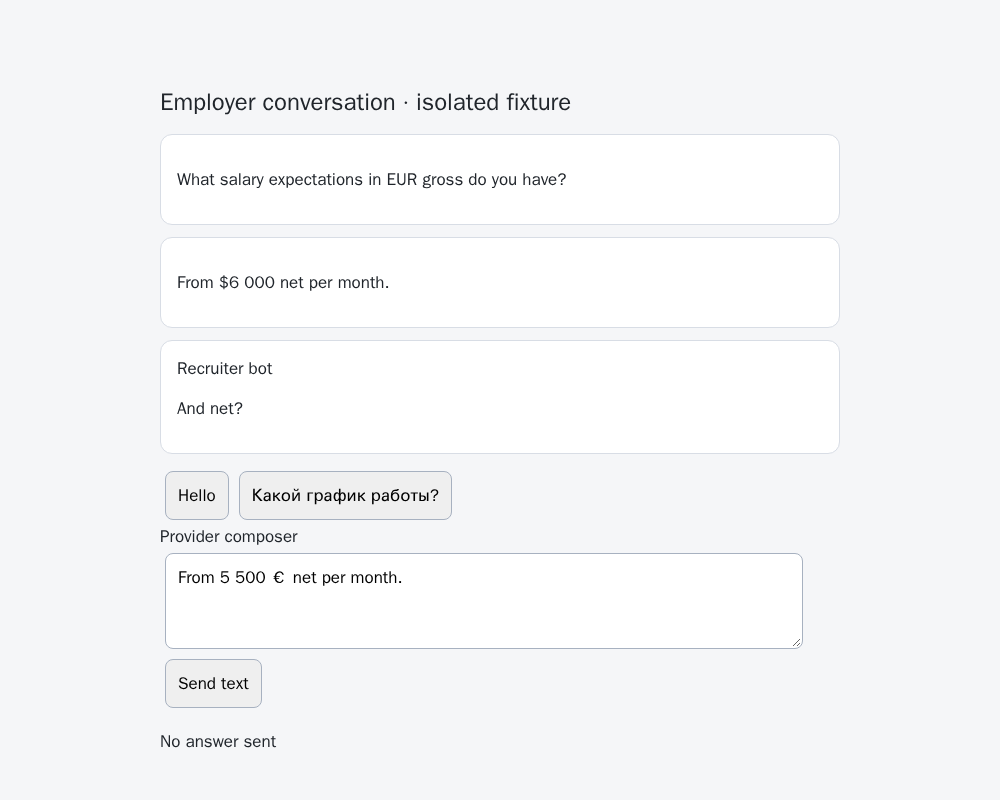

# Incoming employer salary context

Published parent `027b85753c3d889ce9a01bd0416392aaf1b445df` loses message
direction when deriving answer context. An employer asks about EUR gross, the
owner previously answers in USD, and the employer asks “And net?”. The planner
reuses the outgoing USD answer. An outgoing salary question can also create a
false clarification anchor. The pinned reference's `chatContextTexts` excludes
the owner's messages because they may contain answers from another context:
[chat-answers.mjs, lines 705–711](https://github.com/konard/hh-job-application-automation/blob/fa0991b8c2d0896fb3b4be6c69947f0590094b15/src/chat-answers.mjs#L705-L711).

The shared browser and archived-message adapters now retain an optional
`outgoing: true` marker. Normalization validates and preserves that marker;
existing string and incoming context retain their prior shape. Salary planning
excludes outgoing entries before interpreting currency, basis, period, language
or clarification anchors. Generic owner-defined contexts still receive both
directions. Dates, chronology, delivery/service barriers and the twenty-row
window are checked before salary filtering. Unknown delivery cannot be skipped
to revive older incoming context. No exchange rate or conversion is introduced.

Eight of nine focused checks fail at the exact parent; the barrier/generic
context control passes. After correction all 42 relevant checks pass, including
manual prefill, watched changes, unread answering without model opt-in, archived
context, actual CLI configuration, offline and both text/binary Lino previews.

```sh
node --max-old-space-size=384 \
  --import ./experiments/issue-56/salary-employer-context-before.mjs \
  --test --test-concurrency=1 js/tests/salary-employer-context.test.js
```

Native Chrome reproduces the parent's `From $6 000 net per month.` and the
corrected `From 5 500 € net per month.` in the actual routed HH composer. Owner
drafts and saved rules remain unchanged; no answer is sent. The scenario is
awaited by the mandatory salary sequence in both browser engines.





Independent Playwright MCP inspection observes the parent's USD proposal and
then verifies corrected EUR/net review, acknowledged prefill and an actual
native draft. Both owned fixtures close with zero clicks and zero text sends.
The raw browser output retains an unrelated favicon error. No live provider
account is used.

The [checked archive](data/salary-employer-context.tar.gz) retains exact parent
modules, pinned source, focused/native/MCP observations, source snapshots and
screenshot hashes. Full QA12 contract mapping, current hosted verification and
all forty original unchecked criteria remain required in
[PR #57](https://github.com/link-foundation/meta-sovereign/pull/57).
