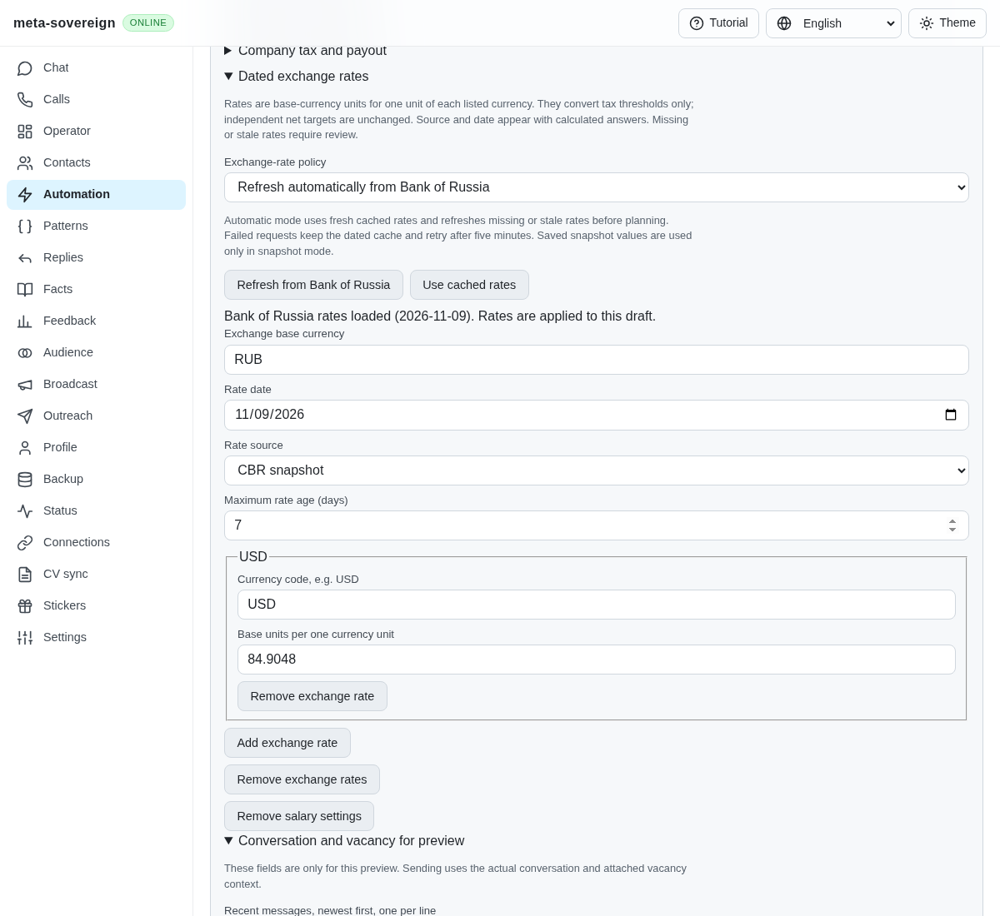
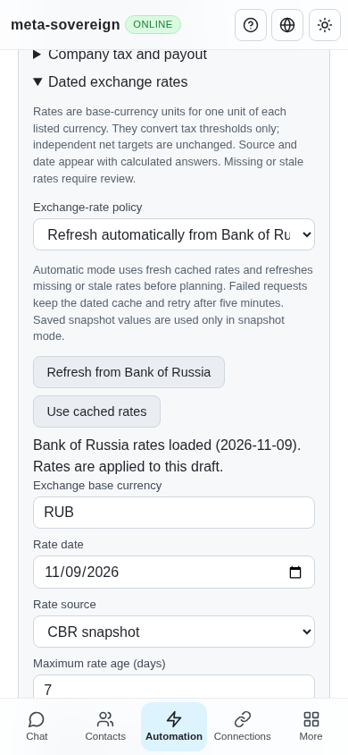
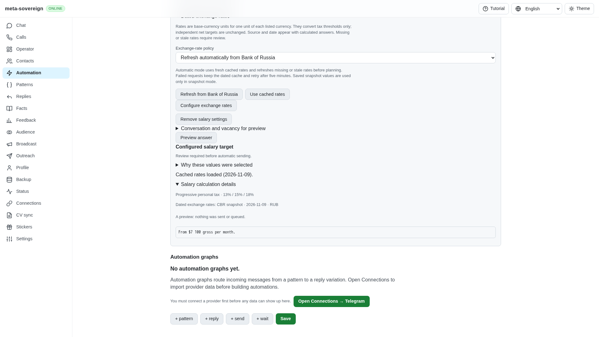

# Automatic exchange-rate policy

The HH reference refreshes rates during salary preparation and recovers its last successful cache. The first shared salary implementation exposed only an explicit refresh. A saved automatic workflow could therefore exhaust its dated snapshot without a configured refresh path. Four focused regressions fail before this change, including the actual preview returning `{{salary_exchange_USD_RUB}}` despite a valid shared cache. Evidence is retained in `data/salary-exchange-policy.tar.gz`.

Saved salary settings now select `exchangeMode: snapshot | cbr` through the same CLI/Lino API/UI action model. `snapshot` remains the default and migration 0009 explicitly preserves that behavior for existing automations, rates and approvals. Restored automatic policies survive migration. No migration fetches rates.

In `cbr` mode the asynchronous preview and runner reuse a fresh shared cache. Missing or stale cache triggers the bounded primary-source refresh described in [exchange recovery](salary-exchange.md). Concurrent automatic plans for one store share their in-flight request. Failed requests retain the actual cache date and wait five minutes before another automatic attempt; an explicit refresh remains available. Freshness uses the configured maximum age, seven days by default. The retry state belongs to the current process and resets on restart. There is no polling timer or background request when no automation is planned.

Automatic mode never substitutes an unselected manual snapshot when its cache is missing. Rates are resolved into the current plan without rewriting the saved action, manual rates, independent net targets or approval. Previews, Chat and Operator show the actual `updated`, `cached`, `stale` or `unavailable` state and fallback warning. Stale or missing rates still require review for calculations that need currency conversion. Independent net and same-currency calculations retain their existing behavior.

The pure planner performs no network requests. Its current planning clock now reaches salary calculation, and final delivery rereads the saved policy and current cache after typing. A changed calculated amount stops before an outbox claim. A public feed failure does not become a claimed successful fetch or delivery.

Verification:

- All 31 focused policy, salary calculation, control, migration and registry tests pass at concurrency one. Five policy/control cases cover opt-in validation, coalescing, fresh-cache reuse, failed-cache preservation, backoff/retry, absence of manual fallback, preview/runner/final-send behavior and CLI/offline UI/both Lino encodings. Two migration cases cover old snapshots, idempotency, dry run and imported policies.
- Focused lint and production build pass. Production Chromium uses the real plan endpoint and injected offline feed: automatic mode ignores the deliberately different saved manual rate, shows stale recovery, backs off repeated previews, switches back to manual mode accurately, and saves the selected policy. Desktop and 390-pixel layouts pass. The first draft capture asserted width before the responsive class arrived; waiting for the same existing compact-layout condition as other browser fixtures resolves that harness timing failure.
- Independent Playwright MCP selects automatic mode against the isolated actual server with a seeded dated cache and no manual snapshot. USD 6,000 net with configured progressive bands produces USD 7,100 gross and visible cache/date evidence; approval remains required. No feed or provider request is mocked in that MCP check. The cache is explicitly fixture data, not a live market observation. Browser and fixture are closed.

Before this step, [rate controls](../../screenshots/issue-56-salary-exchange-cached.png) exposed explicit refresh only.

Salary placeholder contraction, both-basis wording, advanced forms/provider parity and all remaining issue-wide work remain required. This completes the inventoried rate-fetch/cache mechanism, not full HH or cross-provider parity. Exact-head full CI remains a separate gate.
