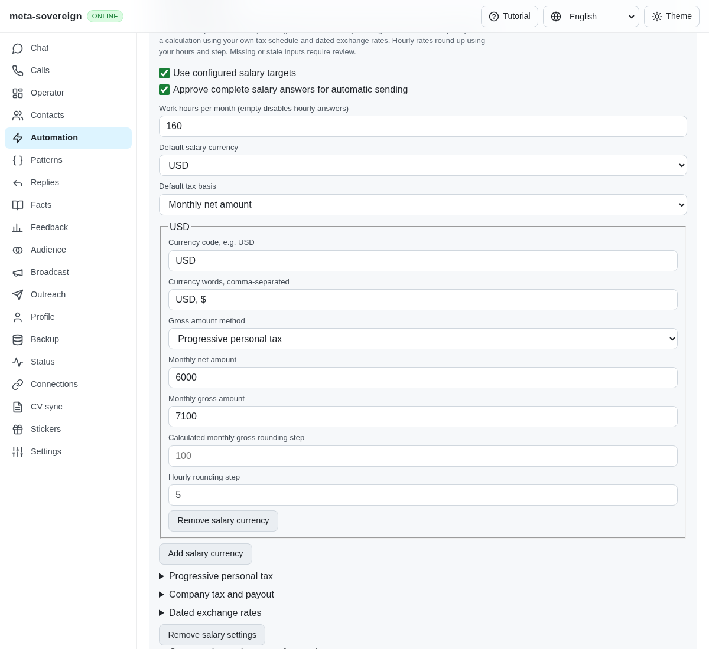
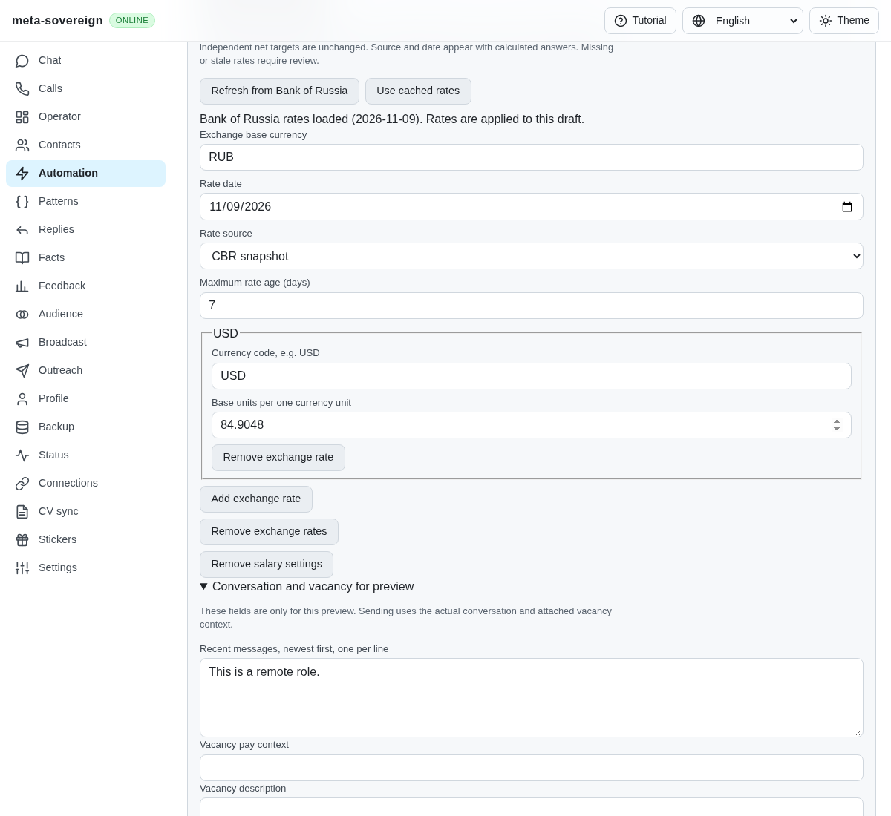
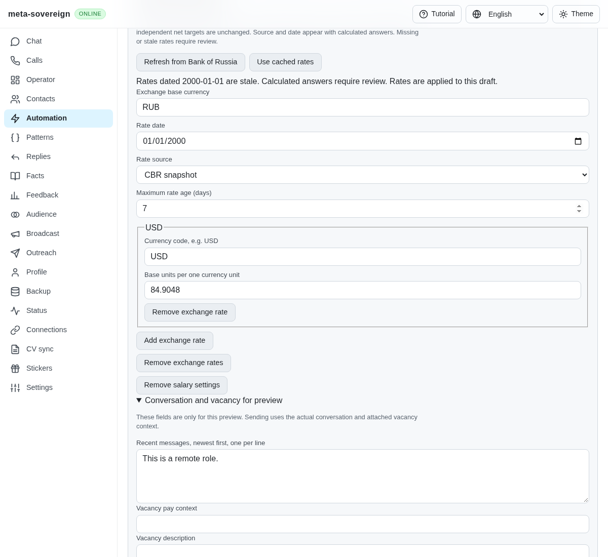
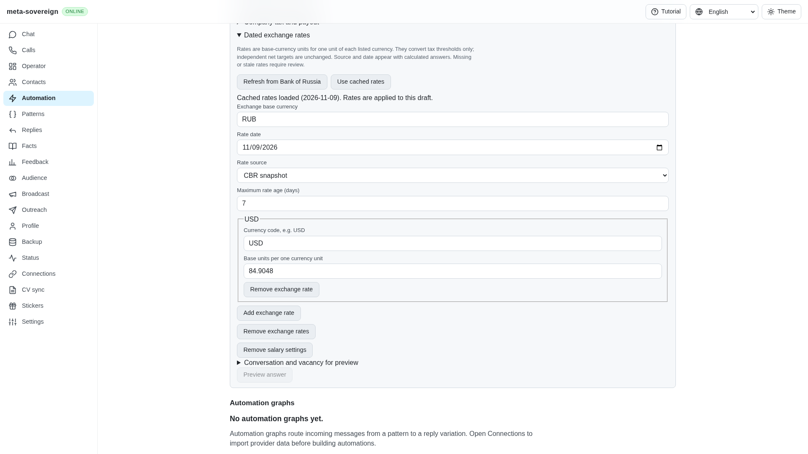
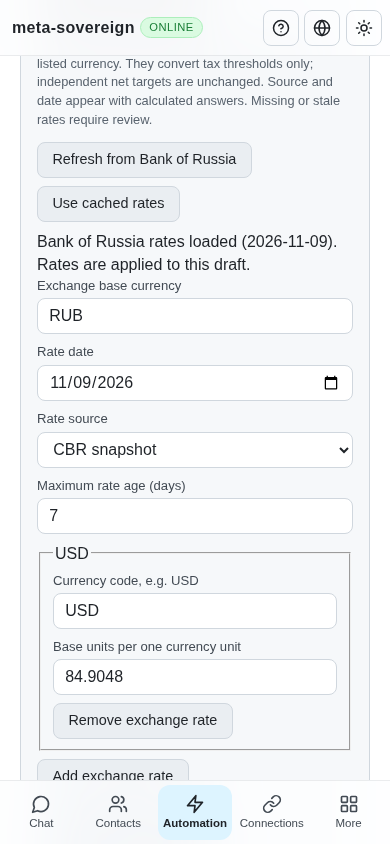

# Dated primary-source exchange rates and recovery

Issue 56 includes the HH reference's exchange-rate fetching and cached fallback. The first calculation step accepted only an owner-entered snapshot. Five fetch/parser/cache regressions fail before this implementation because those modules do not exist. A separate delivery regression demonstrates that advancing the injected runner clock during typing did not advance the final salary freshness check. The logs are preserved in `data/salary-exchange.tar.gz`.

The reference at `fa0991` reads a third-party JSON mirror and caches its latest successful response. Its `Value / Nominal` conversion matters: some currencies are quoted in lots of 10,000 units. The implementation here uses the Bank of Russia's [documented XML service](https://www.cbr.ru/development/SXML/) and fixed [daily feed](https://www.cbr.ru/scripts/XML_daily.asp), researched on 2026-11-09. The retained public response is dated 10 November, a legitimate next-day publication. USD is 82.7536 RUB per unit; VND is 32.3130 RUB per 10,000 units, or approximately 0.0032313 RUB per unit. Publication date and fetch time remain separate.

The parser accepts at most 1 MiB, 100 currencies and 2,000 XML tags. It rejects DTD/entity declarations, malformed XML, invalid real dates, invalid codes, duplicate currencies, nonpositive rates and invalid nominal lots. A direct, pinned `@xmldom/xmldom` runtime dependency provides the same XML parser on the server and offline web app; Windows-1251 is decoded before parsing. Refresh has a ten-second abort deadline, rejects redirects and accepts no caller-supplied URL. Focused checks use finite, injected responses and never contact the public source.

An explicit refresh writes `salary-exchange:cbr` only after a valid response. Missing, malformed, rejected HTTP, oversized, stalled, implausibly future and older-than-cached responses retain the previous snapshot. The result distinguishes `updated`, `cached`, `stale` and `unavailable`, exposes origin, date and fetch time, and identifies fallback. A failed cache write throws rather than claiming persistence. Freshness is evaluated against the requested 1–365-day maximum; no successful request rewrites the publication date to make old rates look current. Migration 0008 introduces an empty unavailable cache without network access or changes to existing answers, and preserves restored snapshots.

The same service is available through:

- `meta-sovereign automations answers exchange` for cached reads; add `--refresh` and optionally `--max-age-days=7` for an explicit refresh.
- `GET` and `POST /api/automations/answers/exchange` with default readable or binary Links Notation. POST accepts `refresh` and `maxAgeDays`.
- Shared preview and saved-action controls, localized in English, Russian, Chinese and Hindi. Refresh and cached-read buttons show loading, freshness and fallback, and apply a returned snapshot to the editable draft. Existing saved actions are unchanged until saved. A missing cache keeps entered rates. A late response preserves edits made while loading; subsequent manual edits hide the previous applied-state message.

Answer planning consumes its configured snapshot without network requests. The runner now passes its current clock into the final post-typing validation, so a snapshot that expires during typing requires review before any outbox claim. Owner-configured taxes, independent net targets and explicit approval retain their existing semantics. `examples/salary-exchange.mjs` demonstrates a primary refresh and an injected offline fallback.

Verification is deliberately focused:

- Twenty-five tests cover parser/normalization, nominal lots, primary URL and redirect policy, explicit refresh, cache reads, stale recovery, invalid/newer/older dates, byte and timeout bounds, persistence failure, CLI/offline browser control and both Lino API encodings, plus salary calculations, delivery expiry and schema registration/migration. All pass at concurrency one, with focused lint and the production web build.
- Production Chromium exercises missing-cache preservation, disabled duplicate actions, edits during a delayed request, successful refresh, visible cached fallback, stale-rate review, updated calculation, persisted action data and a 390-pixel viewport. The initial draft browser run exposed a missing `dom.js` API registration; the complete rerun passes after registration.
- Independent Playwright MCP loads a seeded, dated cache through the actual isolated server, confirming source, date, per-unit rate and visible cached state. The only console error is an unrelated missing favicon. The browser and fixture are closed. These UI data are fixtures, not claimed live market observations.

Before, exchange snapshots required manual entry:

Updated refresh, stale recovery and mobile controls:

Unattended refresh policy, salary placeholder contraction, both-basis wording, full provider/form workflows and the other issue-wide workstreams remain required. Exact-head full CI remains a separate gate; this step does not complete issue 56.
