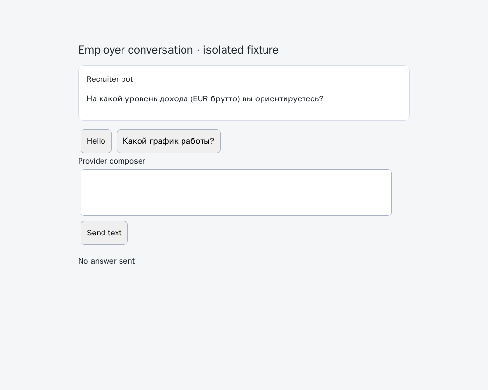
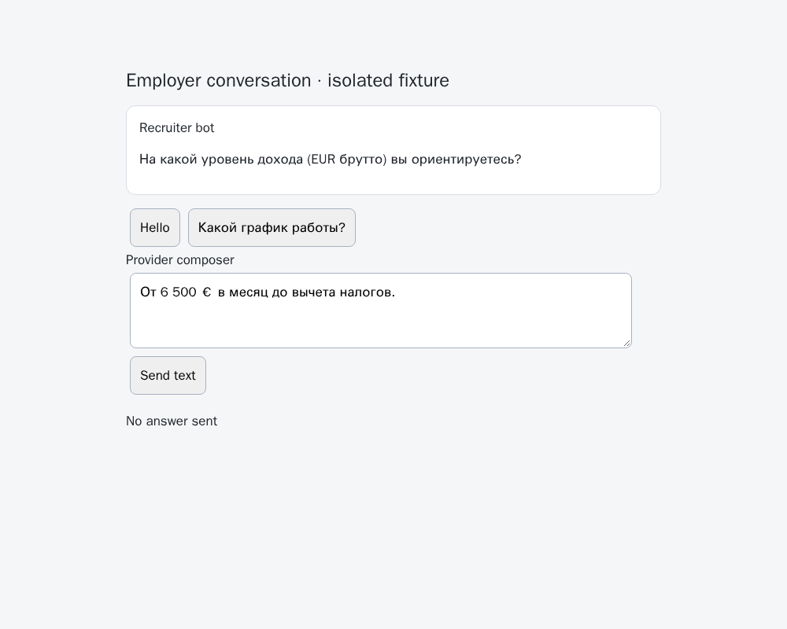

# Expected-pay vocabulary, tax aliases and explicit pay periods

This partial QA12/QA13 correction in [PR57](https://github.com/link-foundation/meta-sovereign/pull/57)
accepts no additional inventory row. All 40 unchecked original criteria remain
required, including the complete salary contracts and provider workflows.

At parent `6a2b60cb`, ordinary questions about a desired income level or salary
range produce no salary draft. The same planner treats `брутто` as its default
net basis and `за час` as a monthly period. It also answers some questions about
current earnings and accepting a proposed range as if they requested a target.
Six bounded regressions fail on those exact parent bytes:

```sh
node --max-old-space-size=384 --import ./experiments/issue-56/salary-intent-before.mjs --test --test-concurrency=1 js/tests/salary-intent-contract.test.js
```

The shared recognizer now covers the expected-income and range phrases,
informal requests, gross/net aliases and hourly abbreviations from the pinned
HH reference contract. Explicit annual/daily periods cannot become monthly
targets. Current-job, historical-pay, proposed-offer acceptance and payroll
requests remain outside automatic salary inference. Short alias follow-ups
inherit only a related topic and its original period. The existing multi-question
assembly keeps unknown questions and requires review.

Thirty-four focused checks pass with one worker and a 384 MiB Node heap. They
include actual CLI, offline and both Lino previews, unchanged stored settings,
approved wording, learned vocabulary, existing period/currency choices and
delivery revalidation. The shared persisted-preview fixture retains all three
contracts' output and unchanged-data assertions while removing duplicated setup.
Strict scoped lint, formatting, secrets, web bundling and the unchanged 6.5%
duplication limit pass. Full runtime/browser coverage remains a hosted check.

The native browser regression first captures an empty composer on the parent.
After the fix, explicit prefill reads back `От 6 500 € в месяц до вычета налогов.`
for `На какой уровень дохода (EUR брутто) вы ориентируетесь?`. It preserves an
owner-written draft and sends nothing. An independent Playwright MCP probe
uses the real production API and independently acknowledges the same prefill.
Both owned fixtures close; these are synthetic provider pages and make no
authenticated-account claim.





The checked [evidence archive](data/salary-intent-contract.tar.gz) and
[manifest](data/salary-intent-contract.tar.sha256.json) retain exact parent and
corrected source, focused failures/successes, native/MCP receipts and screenshots.
The original pinned vocabulary and period assertions are preserved in the
preceding salary wording/vocabulary evidence; no reference source is built or run.
